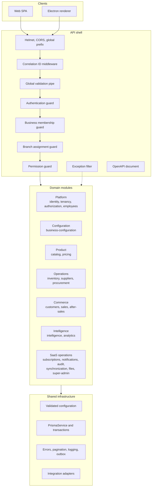
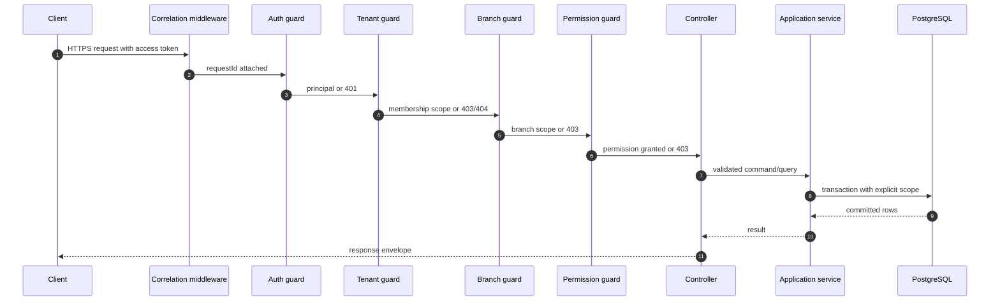

# Backend architecture

**Status:** Step 2 target design. The API shell, configuration validation, Prisma wiring, probes and
their tests are implemented. No business module, endpoint, guard or workflow exists yet.

This document defines the NestJS modular-monolith shape. Tenant/authorization rules are detailed in
[`MULTI_TENANT_SECURITY_ARCHITECTURE.md`](MULTI_TENANT_SECURITY_ARCHITECTURE.md); module dependencies
and owners in [`MODULE_DEPENDENCY_MAP.md`](MODULE_DEPENDENCY_MAP.md); the REST contract in
[`../api/API_ARCHITECTURE.md`](../api/API_ARCHITECTURE.md).

## 1. Shape

One NestJS application (`apps/api`), one PostgreSQL database, one schema, in-process modules.



The global prefix is `api` today. All business controllers must mount under a `v1` segment so the
public contract is `/api/v1/...`; probes remain `/health` and `/ready` outside the prefix
(implemented). No business controller exists yet.

## 2. Standard module layout

```
apps/api/src/modules/<module>/
  <module>.module.ts          Nest module; imports public modules and providers
  <module>.public.ts          only the public contracts (tokens, interfaces, DTO-free types)
  api/
    controllers/              HTTP adapters, route metadata, no business decisions
    dto/                      class-validator request DTOs and response shapes
    presenters/               mapping from application results to API responses
  application/
    commands/                 one use case per file for state changes
    queries/                  read use cases
    ports/                    dependencies on other modules or external systems
    services/                 orchestration of a use case
  domain/                     only where stock, money, permissions or history justify it
    entities/
    value-objects/
    policies/
    errors/
  infrastructure/
    repositories/             Prisma access; the only place that knows table shapes
    mappers/
    adapters/                 implementations of ports owned by this module
  tests/                      unit and integration fixtures for this module
```

Rules:

1. Controllers validate and delegate. They never compute price, stock, entitlement or permission
   outcomes.
2. Application services own the transaction boundary and call domain policies.
3. Domain code has no Nest or Prisma imports. It receives plain values and returns decisions or
   errors.
4. Repositories are private to their module. Exporting a repository is an architecture violation.
5. DTOs never leak into domain code; map at the boundary.
6. Small CRUD modules may omit `domain/`; workflows involving stock, money, permissions or history
   must not.

## 3. Module catalogue

Ownership is summarized here and detailed in
[`MODULE_DEPENDENCY_MAP.md`](MODULE_DEPENDENCY_MAP.md); the approved allocation (D-034) gives every
module exactly one owner who covers its backend, data, frontend, API, permissions, tests and
documentation. "Exposes" means the module's public application interface; internal repositories,
Prisma models and private DTOs are never exposed.

### 3.1 Platform and identity

#### `identity`

- **Purpose:** authenticate people; manage user accounts and sessions.
- **Owns:** users, credentials, sessions/refresh tokens, email verification, password recovery.
- **Internal components:** auth service, session service, credential hashing adapter, verification
  token service, user repository.
- **Exposes:** `AuthService`, `SessionService`, `UserDirectory` (minimal user profile lookup),
  `CurrentPrincipal` contract.
- **Depends on:** shared configuration/database, notifications port (send verification/reset mail).
- **Must not control:** business membership, roles, branch access, employee records.
- **Events:** `identity.user-registered`, `identity.session-revoked`, `identity.password-changed`.
- **Authorization:** public login/refresh/reset endpoints (rate-limited); all other endpoints
  require an authenticated principal; self-service or Super Admin only.
- **Testing:** credential/token unit tests; integration for refresh rotation and reuse detection;
  e2e for invalid/expired sessions and rate limiting.

#### `tenancy`

- **Purpose:** represent businesses, the people who belong to them and their branches.
- **Owns:** businesses, business profile fields, memberships, invitations, branch records, business
  switching data, branch assignments at the membership level.
- **Internal components:** business service, membership service, invitation service, branch
  service, business scope resolver.
- **Exposes:** `BusinessDirectory`, `MembershipService`, `BranchDirectory`, `BusinessScopeResolver`,
  `TenantContextFactory`.
- **Depends on:** `identity` (user existence), `authorization` (role assignment reference),
  `notifications` port. It never reads subscription state; entitlement gating happens in the
  request pipeline, not in membership logic.
- **Must not control:** catalog, stock, sales, prices, payments. It owns organization structure,
  not operations.
- **Events:** `tenancy.business-created`, `tenancy.membership-changed`, `tenancy.branch-created`,
  `tenancy.branch-archived`.
- **Authorization:** membership changes require `tenant:membership:*`; Owner-only for ownership
  transfer and branch archival with open operational records.
- **Testing:** isolation tests for cross-business membership and branch access; invitation expiry;
  ownership transfer rules.

#### `authorization`

- **Purpose:** decide what a principal may do.
- **Owns:** permission catalogue, roles, role assignments, access policies, policy evaluation
  cache/version.
- **Internal components:** permission registry, role service, assignment service, policy engine,
  permission guard metadata reader.
- **Exposes:** `PermissionEvaluator`, `RoleCatalog`, `AssignmentService`, `PermissionsForPrincipal`.
- **Depends on:** shared contracts only. Principals, memberships and branches arrive as opaque IDs
  in the evaluation input; the request-pipeline guard composes the tenancy lookup and the
  authorization decision. `authorization` never imports another module's services.
- **Must not control:** business workflows. It answers allow/deny; domain services still enforce
  state-transition rules.
- **Events:** `authorization.role-assigned`, `authorization.role-revoked`,
  `authorization.permissions-changed`.
- **Authorization:** role/permission administration requires Owner or Business Admin with
  `tenant:role:*`; no one can grant a permission they do not hold; Super Admin cannot grant
  business permissions.
- **Testing:** permission-matrix unit tests; e2e for every role on restricted operations; stale
  assignment revocation.

#### `employees`

- **Purpose:** employee records, branch assignment and employment status, separate from login
  accounts.
- **Owns:** employee profiles, employment status, branch assignment history.
- **Internal components:** employee service, assignment service, status policy.
- **Exposes:** `EmployeeDirectory`, `EmployeeAssignmentService`.
- **Depends on:** `tenancy`, `identity` (optional link to a user), `authorization` (assignment
  reference).
- **Must not control:** credentials or sessions; deactivating an employee never deletes their audit
  or sales history.
- **Events:** `employees.employee-deactivated`, `employees.assignment-changed`.
- **Authorization:** `tenant:employee:*` for Business Admin/Owner; Managers may view employees in
  their branches but cannot change roles or employment status.
- **Testing:** branch-assignment boundary; deactivation effects on sessions/permissions; history
  preservation.

### 3.2 Business configuration

#### `business-configuration`

- **Purpose:** hold the business-type configuration that makes one platform behave correctly for
  grocery, fashion, pharmacy and cosmetics.
- **Owns:** business type selection, industry profiles, configurable attributes, settings,
  capability flags, labels/terminology, setup state.
- **Internal components:** profile registry, settings service, capability resolver, validation of
  industry-specific field definitions.
- **Exposes:** `BusinessConfigurationReader`, `CapabilityService`, `SettingsService`.
- **Depends on:** `tenancy`.
- **Must not control:** products or stock rules themselves; it supplies definitions that catalog
  and inventory validate against.
- **Events:** `configuration.business-type-changed`, `configuration.settings-updated`.
- **Authorization:** `tenant:settings:*` for Business Admin/Owner; business-type change requires
  Owner and is blocked once operational records exist without a migration plan.
- **Testing:** one contract test per business type proving the same core service accepts its
  profile; immutable business-type switch rules.

### 3.3 Product management

#### `catalog`

- **Purpose:** the product master for all business types.
- **Owns:** categories, brands, products, variants, attribute definitions/values, units and
  conversions, barcodes, media links, import jobs, archive state.
- **Internal components:** product service, variant policy, category tree service, unit conversion,
  import pipeline (validate → dry-run → apply), archive policy, media service (via `files`).
- **Exposes:** `ProductReader`, `ProductService`, `VariantReader`, `UnitConversionService`,
  `CatalogImportService`.
- **Depends on:** `tenancy`, `business-configuration`, `files`, `authorization` metadata.
- **Must not control:** stock, prices, sales. Archiving a product never deletes historical sale or
  movement rows.
- **Events:** `catalog.product-created`, `catalog.product-archived`,
  `catalog.import-completed`.
- **Authorization:** `catalog:product:*` for Business Admin/Owner; Managers may read and propose
  edits; Cashiers read for POS only.
- **Testing:** variant uniqueness per business; unit conversion; import idempotency and failure
  reporting; archive with history.

#### `pricing`

- **Purpose:** effective selling prices, branch overrides, price history and discount rules.
- **Owns:** price lists, product prices, branch price overrides, price change history, discount
  definitions.
- **Internal components:** price resolver, price change service, discount evaluator, history
  writer.
- **Exposes:** `PriceResolver` (effective price for product/variant/branch at a time),
  `PriceAdminService`, `DiscountEvaluator`.
- **Depends on:** `catalog`, `tenancy`.
- **Must not control:** sales or inventory. It supplies a price; the sale owns the recorded
  snapshot.
- **Events:** `pricing.price-changed`, `pricing.discount-published`.
- **Authorization:** `pricing:price:*` and `pricing:discount:*` for Business Admin/Owner; Managers
  may approve branch overrides within their branches.
- **Testing:** deterministic precedence (branch override → price list → base); time-effective
  history; discount stacking rules; offline price snapshot semantics.

### 3.4 Inventory and purchasing

#### `inventory`

- **Purpose:** the single authority for quantities and stock history.
- **Owns:** stock balances per business/branch/location, append-only stock movements, adjustments,
  batches, expiry, quarantine, stocktaking, valuation inputs, alerts, transfers (submodule).
- **Internal components:** movement service, balance projector, batch/expiry policy, adjustment
  workflow, stocktake workflow, transfer workflow, valuation service, alert evaluator.
- **Exposes:** `InventoryCommandService` (receive, issue, adjust, transfer, quarantine, count),
  `StockReader`, `BatchReader`, `AvailabilityService`, `ValuationReader`.
- **Depends on:** `catalog`, `tenancy`, `authorization` metadata, `audit` port.
- **Must not control:** procurement approvals, sale pricing/payments. It applies stock effects
  requested by those workflows and owns the resulting ledger.
- **Events:** `inventory.stock-movement-recorded`, `inventory.batch-expiring`,
  `inventory.stocktake-finalized`, `inventory.transfer-dispatched`,
  `inventory.transfer-received`.
- **Authorization:** physical/operational permissions (`inventory:*`) are never granted to Business
  Admin; Manager/Owner only; Cashier has no adjustment permission. A stock-shortfall reconciliation
  exception is raised by `synchronization` (D-025); the inventory adjustment or stocktake that
  follows is a normal, separately audited inventory workflow performed by an authorized Owner or
  Manager after physical verification.
- **Testing:** real-PostgreSQL tests for every movement type, a no-negative guard on every accepted
  movement — including sync-ingested sales — idempotent receiving, transfer two-step atomicity,
  append-only corrections; isolation tests per branch.

#### `suppliers`

- **Purpose:** supplier master data and relationship records.
- **Owns:** supplier profiles, contacts, supplier-product links, price history, documents, ratings,
  performance scores, disputes, statements.
- **Internal components:** supplier service, contact service, product-supplier link service,
  performance evaluator, statement service.
- **Exposes:** `SupplierDirectory`, `SupplierProductReader`, `SupplierPerformanceReader`,
  `SupplierStatementService`.
- **Depends on:** `tenancy`, `catalog`, `files`.
- **Must not control:** purchase orders, receiving, payments. Statements summarize procurement
  facts owned elsewhere.
- **Events:** `suppliers.supplier-archived`, `suppliers.performance-updated`.
- **Authorization:** `suppliers:*` for Business Admin (master data) and Manager (operational
  relations); payments remain outside this module.
- **Testing:** archive preserves historical references; supplier isolation; statement arithmetic
  from procurement facts.

#### `procurement`

- **Purpose:** the purchasing lifecycle from request to received goods and supplier payable.
- **Owns:** purchase requests, RFQs and revisions, quotations, comparison, negotiations, pricing
  agreements, purchase orders and revisions, receiving records, supplier invoices, supplier
  payments.
- **Internal components:** RFQ service, quotation comparison, negotiation record service, purchase
  order service, receiving workflow, three-way match policy, supplier invoice/payment services.
- **Exposes:** `PurchaseOrderService`, `ReceivingService`, `SupplierInvoiceService`,
  `SupplierPaymentService`, `ProcurementQuery`.
- **Depends on:** `suppliers`, `catalog`, `inventory`, `tenancy`, `files`, `notifications` port,
  `subscriptions` entitlement read.
- **Must not control:** stock quantities (inventory applies movements) or supplier master data.
  A purchase order creates a commitment, never stock.
- **Events:** `procurement.purchase-order-approved`, `procurement.receiving-accepted`,
  `procurement.invoice-recorded`, `procurement.supplier-payment-recorded`.
- **Authorization:** Business Admin may prepare digital documents but cannot accept receiving,
  perform physical inspection/negotiation or approve physical operations; Manager/Owner execute
  receiving and approvals; supplier payments require Owner/Manager with payment permission.
- **Testing:** PO approval does not change stock; only accepted receiving increases stock; partial
  receiving; three-way match; transaction rollback on failure; idempotent receiving.

### 3.5 Sales operations

#### `customers`

- **Purpose:** customer identity and purchase history for the business.
- **Owns:** customer profiles, contact points, consent flags, purchase history projections,
  insights.
- **Internal components:** customer service, deduplication policy, history projector, insight
  queries.
- **Exposes:** `CustomerDirectory`, `CustomerHistoryReader`, `CustomerInsightsReader`.
- **Depends on:** `tenancy` only at compile time. Purchase-history projections are fed by
  `sales.sale-completed` and `after-sales.*` events, so `customers` never imports `sales` or
  `after-sales`.
- **Must not control:** sales or returns; it reads projections.
- **Events:** `customers.customer-created`, `customers.customer-merged`.
- **Authorization:** Cashier may create/lookup a customer for a sale; Manager/Business Admin may
  edit/merge; deletion is archive-only.
- **Testing:** deduplication rules; consent handling; history remains after archival.

#### `sales`

- **Purpose:** sell goods and record money and receipts truthfully, including POS shift control.
- **Owns:** sales, sale items, customer payments, receipts, cashier shifts, cash reconciliation,
  POS terminal sessions, sale price snapshots, discount applications.
- **Internal components:** POS sale service, shift service, payment recording, receipt renderer
  port, sale return handoff, cash reconciliation policy.
- **Exposes:** `SaleCommandService`, `ShiftService`, `SaleReader`, `ReceiptService`,
  `RefundExecutionPort`, `OfflineSaleIngestService` (used by synchronization).
- **Depends on:** `catalog`, `pricing`, `inventory`, `customers`, `tenancy`, `authorization`
  metadata, `files`/PDF port, `notifications` port.
- **Must not control:** stock ledger (inventory applies issue movements), refund approval
  (after-sales), subscription billing.
- **Events:** `sales.sale-completed`, `sales.sale-voided`, `sales.shift-opened`,
  `sales.shift-closed`, `sales.payment-recorded`.
- **Authorization:** `sales:*` scoped to branch; Cashier can sell, open/close own shift and reprint
  own receipts; void/refund approval requires Manager/Owner.
- **Testing:** transaction covers sale + stock issue + payment; duplicate `Idempotency-Key` returns
  the same sale; no negative stock on any accepted sale; `OfflineSaleIngestService` commits nothing
  and returns the shortfall outcome when stock is insufficient; shift totals.

#### `after-sales`

- **Purpose:** returns, refunds, exchanges and collection follow-up after a sale.
- **Owns:** return requests, inspection results, refund records, exchanges and exchange
  reservations, collection follow-ups.
- **Internal components:** return policy, inspection workflow, refund service, exchange
  reservation, collection follow-up scheduler.
- **Exposes:** `ReturnService`, `RefundService`, `ExchangeService`, `AfterSalesQuery`.
- **Depends on:** `sales`, `inventory`, `catalog`, `customers`, `tenancy`, payment ports.
- **Must not control:** original sale mutation; a return creates new compensating records.
- **Events:** `after-sales.return-approved`, `after-sales.refund-completed`,
  `after-sales.exchange-reserved`.
- **Authorization:** Cashier may initiate a request; approval/refund requires Manager/Owner with
  `after-sales:refund:approve`; Business Admin has no refund execution permission.
- **Testing:** refund cannot exceed paid amount; stock restock only after inspection; exchange
  reservation and expiry; transaction rollback; original sale immutable.

### 3.6 Intelligence

#### `intelligence`

- **Purpose:** produce advisory forecasts, recommendations and explanations from historical data.
- **Owns:** forecast runs, forecast points, recommendation proposals, model registry metadata,
  feature snapshots, explanations, confidence/uncertainty.
- **Internal components:** data-preparation query layer, forecasting model adapter, recommendation
  rules, explanation builder, scheduler, model registry.
- **Exposes:** `ForecastQuery`, `RecommendationQuery`, `ForecastRunService`,
  `RecommendationReviewService`.
- **Depends on:** read contracts from `sales`, `inventory`, `catalog`, `pricing`, `tenancy`;
  analytics feature tables; no operational write access.
- **Must not control:** purchasing, transfers, prices or stock. Recommendations are records that a
  human reviews; approval creates a normal workflow command in the owning module.
- **Events:** `intelligence.forecast-completed`, `intelligence.recommendation-created`,
  `intelligence.recommendation-reviewed`.
- **Authorization:** Manager/Owner read and review; Business Admin may view; Cashier none. Model
  configuration is restricted to platform/Super Admin plus business opt-in.
- **Testing:** feature input contracts; deterministic fixtures; recommendations never mutate stock;
  review requires permission and records the actor; confidence surfaced.

#### `analytics`

- **Purpose:** dashboards, reports, comparisons and exports over business data.
- **Owns:** report definitions, read-model projections, export jobs and generated report metadata.
- **Internal components:** query services, read-model refresh jobs, export pipeline, chart-friendly
  aggregations, branch comparison.
- **Exposes:** `DashboardQuery`, `ReportQuery`, `ExportService`.
- **Depends on:** read contracts from domain modules, `files`, `tenancy`, `subscriptions`
  entitlement (report entitlements).
- **Must not control:** operational data. It never writes domain tables.
- **Events:** `analytics.export-completed`.
- **Authorization:** role and branch scoped; Cashier sees own-shift summaries only; Business Admin
  may see administrative reports; Manager sees branch analytics; Owner all branches.
- **Testing:** aggregation correctness against seeded fixtures; tenant/branch filters; export
  authorization; large-range pagination.

### 3.7 Platform operations

#### `subscriptions`

- **Purpose:** control SaaS access by plan, trial, entitlement and usage.
- **Owns:** plans, trials, subscriptions, invoices, payment attempts, entitlements, usage counters,
  renewals, grace periods.
- **Internal components:** plan catalogue, subscription lifecycle, entitlement resolver, usage
  limit evaluator, renewal scheduler, payment reconciliation.
- **Exposes:** `EntitlementService`, `SubscriptionService`, `BillingQuery`, `PaymentWebhookService`.
- **Depends on:** `identity`, `tenancy`, payment gateway port, `notifications` port, `audit`.
- **Must not control:** business operations; it gates them. A business with an expired subscription
  is read-only or restricted according to the entitlement policy, never deleted.
- **Events:** `subscriptions.trial-started`, `subscriptions.activated`, `subscriptions.payment-
failed`, `subscriptions.expired`.
- **Authorization:** Owner manages plan/payment; Business Admin may view invoices; Super Admin may
  apply documented support overrides; webhooks are signature-verified, not user-authenticated.
- **Testing:** entitlement matrix per plan; webhook idempotency; grace-period transitions; payment
  amount/currency/plan matching; no client-trusted activation.

#### `notifications`

- **Purpose:** deliver in-app, email and SMS messages and record preferences and delivery.
- **Owns:** notification preferences, templates reference, delivery attempts, delivery history,
  escalation rules.
- **Internal components:** notification dispatcher, channel adapters, template registry, preference
  service, retry policy.
- **Exposes:** `NotificationPort` (send), `NotificationInboxQuery`, `PreferenceService`.
- **Depends on:** shared infrastructure and integration adapters (email/SMS) only. Callers pass
  resolved recipient descriptors (`userId`, verified email/phone) in the command; `notifications`
  never queries `identity` or `tenancy` directly.
- **Must not control:** business state. Delivery failure never rolls back a business transaction;
  the outbox handles retries.
- **Events:** consumes business events; publishes `notifications.delivery-failed`.
- **Authorization:** users read their own inbox/preferences; administrators manage templates only
  through platform settings.
- **Testing:** preference enforcement; retry/backoff; no secrets or full PII in logs; template
  rendering failures do not lose the business transaction.

#### `audit`

- **Purpose:** an append-only record of who did what, where and when.
- **Owns:** audit events, access logs, privileged-access records, audit query indexes.
- **Internal components:** audit writer, event schema, query service, retention policy.
- **Exposes:** `AuditPort` (write), `AuditQuery`.
- **Depends on:** shared infrastructure only; consumes events from all modules.
- **Must not control:** domain data; it never mutates other tables.
- **Events:** consumes audit-worthy events; emits none that change business state.
- **Authorization:** Managers view branch-relevant audit; Owner/Business Admin view business audit;
  Super Admin views platform audit; no update/delete permission for any role.
- **Testing:** append-only; actor/business/branch attribution; failed-write handling policy;
  retention/export authorization.

#### `synchronization`

- **Purpose:** accept offline operations safely and resolve conflicts without data loss.
- **Owns:** device registrations, sync sessions, operation envelopes, idempotency records, conflict
  records, stock-shortfall reconciliation exceptions, sync history, server cursors.
- **Internal components:** device service, operation ingest, deduplication store, conflict detector,
  reconciliation exception workflow, delta feed generator.
- **Exposes:** `SyncIngestService`, `SyncFeedService`, `DeviceRegistry`, `ConflictQuery`,
  `ReconciliationService` (query, investigate, release, close).
- **Depends on:** `sales` (offline sale ingest), `inventory` availability, `catalog`/`pricing` delta
  feeds, `identity`/`tenancy` device auth, `audit`.
- **Must not control:** domain rules; it validates identity/idempotency and delegates each
  operation to the owning module's public command.
- **Events:** `sync.operation-accepted`, `sync.operation-conflicted`,
  `sync.operation-rejected`, `sync.reconciliation-exception-created`,
  `sync.reconciliation-exception-resolved`, `sync.device-revoked`.
- **Authorization:** device token bound to a user session, business and branch; revoked devices are
  rejected; sync never crosses businesses. Resolution requires the reconciliation permission and
  branch scope; Business Admin can view but never resolve a physical stock outcome.
- **Testing:** duplicate delivery, out-of-order operations, revoked device, conflict retention,
  cross-tenant operation rejection, stock shortfall creates one exception with no sale or movement,
  replayed shortfall reuses the exception, and authorized release commits at most once; full details
  in [`OFFLINE_SYNCHRONIZATION_ARCHITECTURE.md`](OFFLINE_SYNCHRONIZATION_ARCHITECTURE.md).

#### `files`

- **Purpose:** manage uploaded documents, product media and generated files.
- **Owns:** file metadata, ownership links, checksums, storage keys, upload sessions, retention.
- **Internal components:** upload service, storage adapter, metadata repository, signed URL
  service, validation policy.
- **Exposes:** `FileService`, `FileUploadService`, `FileDownloadService`.
- **Depends on:** storage adapter (integration), `tenancy`, `authorization` metadata.
- **Must not control:** business records; deleting a file is restricted by business retention rules.
- **Events:** `files.file-uploaded`, `files.file-quarantined`.
- **Authorization:** upload/download requires business membership and the owning resource's
  permission; signed URLs are short-lived; MIME/size validation happens server-side.
- **Testing:** path traversal, MIME spoofing, oversized upload, cross-tenant file access, orphan
  cleanup.

#### `super-admin`

- **Purpose:** operate the platform itself, not a tenant.
- **Owns:** platform settings, support cases, business support access grants, privileged-access
  sessions, platform monitoring views.
- **Internal components:** support access service, platform settings service, monitoring query,
  privileged-access audit.
- **Exposes:** `SupportAccessService`, `PlatformSettingsService`, `PlatformMonitoringQuery`.
- **Depends on:** `identity`, `tenancy`, `subscriptions`, `audit`.
- **Must not control:** business data without a time-boxed, reason-recorded support grant; never
  holds business-role permissions by default.
- **Events:** `super-admin.support-access-granted`, `super-admin.support-access-used`,
  `super-admin.support-access-revoked`.
- **Authorization:** Super Admin only; every access is audited; no silent impersonation.
- **Testing:** grant expiry, audit completeness, denied access without grant, separation from
  business roles.

## 4. Communication rules

### 4.1 Synchronous calls

Use a direct public service call when the caller needs the result inside the same transaction or
must not proceed without it:

- Sale creation asks `PriceResolver` for the effective price and `InventoryCommandService` to apply
  the issue movement.
- Receiving asks `InventoryCommandService` to apply accepted quantities.
- A refund asks `RefundExecutionPort` exposed by sales/payment handling.
- Guards ask `PermissionEvaluator`.

The caller depends on an exported interface or provider token, never on a concrete repository.

### 4.2 Asynchronous events

Use an event when the outcome is a side effect that may be retried independently and the business
transaction must not fail because of it:

- Notification delivery, analytics refresh, audit projection, AI feature extraction, export
  generation.
- Search/index updates if introduced.

Events are not used for stock or money invariants. Those are written in the same transaction as the
business fact. The in-process event bus dispatches after commit; a transactional outbox row backs
retriable external work (decision D-026). No broker is introduced.

### 4.3 Event catalogue conventions

- Names: `<module>.<past-tense-fact>` (for example `sales.sale-completed`).
- Payloads contain identifiers, businessId, branchId, occurredAt and the minimum facts needed; no
  credentials and no unnecessary PII.
- Consumers must be idempotent because the outbox can deliver more than once.
- Events are internal contracts; changing their fields requires reviewing every consumer.

## 5. Shared backend infrastructure

| Concern                | Current state | Target design                                                                                   |
| ---------------------- | ------------- | ----------------------------------------------------------------------------------------------- |
| Configuration          | Implemented   | Zod validation at boot; add integration/secret keys as each module lands                        |
| Environment validation | Implemented   | Fail-fast startup; no silent defaults for secrets                                               |
| Global validation      | Implemented   | `ValidationPipe` with whitelist, forbid unknown fields, transform                               |
| Exception handling     | Partial       | Add a filter mapping domain errors to RFC 9457 problem details with stable codes and `traceId`  |
| Logging                | Partial       | Nest logger now; structured JSON, redaction and per-module context planned                      |
| Correlation ID         | Planned       | Middleware accepts/creates `X-Request-Id`, stores it in async context, echoes it, adds to audit |
| API versioning         | Partial       | Global prefix `api`; business controllers mount `v1`; additive changes only within a version    |
| Authentication guard   | Planned       | Validates access token/session; creates `CurrentPrincipal`                                      |
| Permission guard       | Planned       | Reads route metadata; deny-by-default; evaluates against membership and branch scope            |
| Tenant context         | Planned       | Business guard validates path `businessId` against membership; builds `TenantScope`             |
| Branch context         | Planned       | Branch guard validates assignment and active branch; builds `BranchScope`                       |
| Transactions           | Partial       | `PrismaService` exists; add transaction helper and retry policy                                 |
| File uploads           | Planned       | `files` module with storage adapter, limits and signed URLs                                     |
| Background jobs        | Planned       | DB-backed outbox + scheduler; advisory locks for multi-instance safety; no broker               |
| Health/readiness       | Implemented   | `/health` liveness, `/ready` database check, no error leakage                                   |
| OpenAPI                | Planned       | `@nestjs/swagger` generated document at `/api/docs` in non-production environments              |

### 5.1 Request pipeline



Order matters: never evaluate permissions before the business/branch scope is known. Cross-tenant
objects return `404` consistently (see the security document).

### 5.2 Transactions and concurrency

Patterns required for stock, money and permissions:

- Bind every command to `TenantScope`; reject missing `businessId`/`branchId` at compile time and at
  runtime.
- Use a Prisma interactive transaction for a complete business fact (sale + items + payment + stock
  movement + audit + outbox).
- Use `Serializable` isolation with bounded retries for stock mutations; use conditional updates
  (`quantityOnHand >= requested`) where possible.
- Add a `version` column to mutable aggregates that can be edited concurrently; reject stale writes
  with `409`.
- Use unique constraints as the final duplicate guard (operation ID, idempotency key, receipt
  number per branch/sequence).
- Never read a balance outside the transaction that mutates it when making a stock decision.
- A failed transaction rolls back every row, including audit/outbox, unless the failure itself must
  be recorded separately.

Those patterns are architecture requirements; no stock or money code exists yet.

### 5.3 Illustrative scope contract

The following is a design contract, not implemented code:

```ts
export interface TenantScope {
  businessId: string;
  actor: { userId: string; membershipId: string };
  branchId?: string;
  permissions: ReadonlySet<string>;
}
```

Repositories and application services accept `TenantScope` and derive filters from it. A bare
`businessId` parameter is not an acceptable substitute because it does not prove authorization.

## 6. Backend authorization requirements

- Every business route declares the required permission through metadata; missing metadata is a
  development error and fails closed.
- Every state transition re-checks authorization inside the application service, not only in the
  controller.
- Business Admin permissions exclude receiving acceptance, stock adjustments/counts, transfer
  execution, quarantine/disposal, physical negotiations and cashier operations.
- Super Admin operations are separate routes under `/api/v1/platform` and audited.
- Permission evaluation results may be cached per membership version but never across businesses.

The complete matrix is in
[`MULTI_TENANT_SECURITY_ARCHITECTURE.md`](MULTI_TENANT_SECURITY_ARCHITECTURE.md).

## 7. Enforcement and review

- **Now:** module folders do not exist; there is no cross-module import surface.
- **First two modules:** add an automated boundary rule (dependency-cruiser or
  `eslint-plugin-boundaries`) so deep imports and cycles fail CI.
- **Every PR:** reviewer checks controller thickness, repository visibility, tenant scope and
  transaction boundaries.
- **Every slice:** adds unit tests for policies, integration tests against real PostgreSQL for
  stock/money, and e2e tests for authorization/isolation failures.

## 8. Explicit non-goals

- Microservices, network calls between modules, a shared "god" service or package.
- Event sourcing the whole system; only the stock ledger is append-only by design.
- Business logic in controllers, guards or Prisma middleware.
- A generic repository abstraction that hides tenant scoping.
- Implementing the Step 3 schema in this step.
