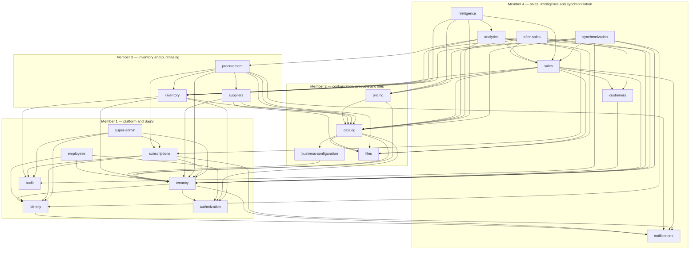

# Module dependency map

**Status:** Step 2 design baseline. No domain module exists in code yet; this map constrains how the
twenty-one modules described in [`BACKEND_ARCHITECTURE.md`](BACKEND_ARCHITECTURE.md) may be built.
It is the reference for imports, code review and the planned dependency lint.

## 1. Reading the map

| Rule                       | Meaning                                                                                                                  |
| -------------------------- | ------------------------------------------------------------------------------------------------------------------------ |
| Arrows point to dependency | `A --> B` means A imports B's **public interface**. A may not import B's repositories, entities or DTOs.                 |
| Solid arrows only          | The dependency graph shows compile-time imports. Event subscriptions and projections are not compile edges.              |
| No cycles                  | Any proposed edge that closes a cycle is rejected; break it with an event or by moving the rule.                         |
| Leaf modules               | `authorization`, `notifications` and `audit` have no domain dependencies. They are policies and delivery, not workflows. |
| Shared kernel              | Config, database, errors, logging, event bus and outbox live in `src/shared`, not in a domain module.                    |
| One owner                  | Every module has exactly one human owner (Section 3). A second team may consume its contracts, never edit it.            |

Event-only relationships (dashed concept, listed in Section 5):

- `audit` subscribes to audit-worthy events from every module. It is never imported by them except
  through `AuditPort`, which is a shared-kernel interface with an audit-module implementation.
- `notifications` consumes identity/tenancy/procurement/sales/subscription events; nothing imports
  it except through `NotificationPort`.
- `customers` maintains its purchase-history projection from `sales` and `after-sales` events
  rather than importing those modules.
- `intelligence` and `analytics` read projections and read contracts; they never receive commands.

## 2. Dependency graph

This graph is acyclic by construction. It is the target; today no edges exist because no domain
module is implemented.

## 3. Ownership

The allocation below is the approved four-member baseline (D-034). One owner per module. Ownership
means the member designs the tables, writes the module, owns its frontend/API/tests/documentation and
reviews every contract change; it does not mean they exclusively write every line. Attempts to
equalize headcount alone are explicitly rejected: workload is balanced by estimated effort, with
supporting tasks distributed as described in
[`../team/TEAM_DEVELOPMENT_GUIDELINES.md`](../team/TEAM_DEVELOPMENT_GUIDELINES.md) §1. Cross-team
work happens through the contract registry (Section 4).

| Module                   | Owner | Owns (summary)                                                             | Key public contracts                                                              | Phase |
| ------------------------ | ----- | -------------------------------------------------------------------------- | --------------------------------------------------------------------------------- | ----- |
| `identity`               | M1    | Users, credentials, sessions, recovery                                     | `AuthService`, `SessionService`, `UserDirectory`                                  | 1     |
| `tenancy`                | M1    | Businesses, memberships, invitations, branches                             | `BusinessDirectory`, `MembershipService`, `BranchDirectory`                       | 1     |
| `authorization`          | M1    | Permission catalogue, roles, assignments, policy                           | `PermissionEvaluator`, `RoleCatalog`, `AssignmentService`                         | 1     |
| `employees`              | M1    | Employee records, employment status, assignment                            | `EmployeeDirectory`, `EmployeeAssignmentService`                                  | 2     |
| `subscriptions`          | M1    | Plans, trials, entitlements, billing, Chapa webhook                        | `EntitlementService`, `SubscriptionService`, `PaymentWebhookService`              | 4     |
| `notifications`          | M4    | Preferences, templates, delivery attempts                                  | `NotificationPort`, `NotificationInboxQuery`, `PreferenceService`                 | 1     |
| `audit`                  | M1    | Append-only audit events and queries                                       | `AuditPort`, `AuditQuery`                                                         | 1     |
| `synchronization`        | M4    | Devices, envelopes, idempotency, conflicts, stock-shortfall reconciliation | `SyncIngestService`, `SyncFeedService`, `DeviceRegistry`, `ReconciliationService` | 5     |
| `files`                  | M2    | File metadata, storage keys, upload sessions                               | `FileService`, `FileUploadService`, `FileDownloadService`                         | 2     |
| `super-admin`            | M1    | Support grants, platform settings, monitoring                              | `SupportAccessService`, `PlatformSettingsService`                                 | 5     |
| `business-configuration` | M2    | Business type, industry profiles, settings                                 | `BusinessConfigurationReader`, `CapabilityService`                                | 1     |
| `catalog`                | M2    | Products, variants, categories, units, media links                         | `ProductReader`, `ProductService`, `UnitConversionService`                        | 2     |
| `pricing`                | M2    | Price lists, overrides, discounts, price history                           | `PriceResolver`, `PriceAdminService`, `DiscountEvaluator`                         | 2     |
| `inventory`              | M3    | Stock ledger, balances, batches, transfers, counts                         | `InventoryCommandService`, `StockReader`, `AvailabilityService`                   | 3     |
| `suppliers`              | M3    | Supplier master, contacts, product links, statements                       | `SupplierDirectory`, `SupplierStatementService`                                   | 3     |
| `procurement`            | M3    | Requests, RFQs, POs, receiving, invoices, payments                         | `PurchaseOrderService`, `ReceivingService`, `SupplierPaymentService`              | 4     |
| `customers`              | M4    | Customer profiles, history projections, insights                           | `CustomerDirectory`, `CustomerHistoryReader`                                      | 3     |
| `sales`                  | M4    | Sales, payments, receipts, shifts, offline ingest                          | `SaleCommandService`, `ShiftService`, `OfflineSaleIngestService`                  | 4     |
| `after-sales`            | M4    | Returns, refunds, exchanges, follow-ups                                    | `ReturnService`, `RefundService`, `ExchangeService`                               | 5     |
| `analytics`              | M4    | Dashboards, reports, exports, read models                                  | `DashboardQuery`, `ReportQuery`, `ExportService`                                  | 5     |
| `intelligence`           | M4    | Forecasts, recommendations, explanations                                   | `ForecastQuery`, `RecommendationQuery`, `ForecastRunService`                      | 5     |

Members: M1 Platform and SaaS, M2 business configuration, products and files, M3 inventory and
procurement, M4 sales, intelligence, synchronization and notifications. Phases are defined in
Section 8. The phase in this table is the phase in which the module's first slice ships, not the only
phase in which it is touched.

## 4. Allowed and forbidden dependencies

"Depends on" repeats the graph; "must never depend on" is the review checklist. Violations are
rejected even if the code compiles.

| Module                   | May depend on                                                                                         | Must never depend on                                                             |
| ------------------------ | ----------------------------------------------------------------------------------------------------- | -------------------------------------------------------------------------------- |
| `identity`               | shared kernel, `notifications` port                                                                   | `tenancy`, `authorization`, any business module                                  |
| `authorization`          | shared kernel only                                                                                    | `identity`, `tenancy`, any workflow module                                       |
| `notifications`          | shared kernel, integration adapters                                                                   | `identity`, `tenancy`, any domain module                                         |
| `audit`                  | shared kernel, event bus                                                                              | any domain module (events only)                                                  |
| `tenancy`                | `identity`, `authorization`, `notifications` port                                                     | `subscriptions`, `catalog`, `inventory`, `sales`                                 |
| `employees`              | `tenancy`, `identity`, `authorization`, shared kernel                                                 | `sales` totals, `inventory`, payroll scope that does not exist                   |
| `business-configuration` | `tenancy`, shared kernel                                                                              | `catalog`, `pricing`, `inventory`, `sales`                                       |
| `catalog`                | `tenancy`, `business-configuration`, `files`, `authorization` metadata                                | `inventory`, `pricing`, `sales`, `procurement`                                   |
| `pricing`                | `catalog`, `tenancy`, shared kernel                                                                   | `sales`, `inventory`, `procurement`                                              |
| `inventory`              | `catalog`, `tenancy`, `authorization` metadata, `audit` port                                          | `sales`, `procurement`, `suppliers`, `pricing`                                   |
| `suppliers`              | `tenancy`, `catalog`, `files`                                                                         | `procurement` internals, `sales`, `inventory` ledger                             |
| `procurement`            | `suppliers`, `catalog`, `inventory`, `tenancy`, `files`, `notifications`, `subscriptions`             | `sales`, `after-sales`                                                           |
| `customers`              | `tenancy`, shared kernel; event-fed projections                                                       | `sales` compile-time imports, `after-sales` compile-time imports                 |
| `sales`                  | `catalog`, `pricing`, `inventory`, `customers`, `tenancy`, `files`, `notifications`                   | `procurement`, `after-sales` internals, `synchronization` internals, `analytics` |
| `after-sales`            | `sales`, `inventory`, `catalog`, `customers`, `tenancy`, payment port                                 | `procurement`, `synchronization` internals, `analytics`                          |
| `analytics`              | read contracts of `sales`, `inventory`, `catalog`, `procurement`, `files`, `tenancy`, `subscriptions` | any module's write service; domain tables directly                               |
| `intelligence`           | read contracts of `sales`, `inventory`, `catalog`, `pricing`, `analytics`                             | any write service; `procurement` commands; stock mutations                       |
| `subscriptions`          | `identity`, `tenancy`, `notifications`, `audit`, payment adapter                                      | `catalog`, `inventory`, `sales`, `procurement`                                   |
| `synchronization`        | `sales`, `inventory`, `catalog`, `pricing`, `identity`, `tenancy`, `audit`                            | direct domain tables; bypassing owning module commands                           |
| `files`                  | `tenancy`, `authorization` metadata, storage adapter                                                  | domain modules; it stores metadata, not business records                         |
| `super-admin`            | `identity`, `tenancy`, `subscriptions`, `audit`                                                       | business workflow commands; business tables without a support grant              |

Two rules apply to every row:

1. A module may import another module only through `<module>.public.ts` and only the symbols listed
   in Section 5.
2. No module imports `PrismaService` to query another module's models. The shared `PrismaService`
   is for the owning module's own tables and for transactions that the owning module coordinates.

## 5. Cross-module contract registry

Synchronous contracts are called inside the caller's transaction when a business invariant spans
both modules. The provider validates the scope; the caller never re-implements a provider rule.
Asynchronous contracts are eventual and must not be used where the caller needs an answer before
committing.

| Provider                 | Contract                          | Consumers                                            | Mode        | Guarantee / invariant                                                                                                                            |
| ------------------------ | --------------------------------- | ---------------------------------------------------- | ----------- | ------------------------------------------------------------------------------------------------------------------------------------------------ |
| `identity`               | `UserDirectory.getProfile`        | tenancy, employees, subscriptions, sync              | sync        | Opaque user profile; no credentials returned                                                                                                     |
| `tenancy`                | `MembershipService.assertMember`  | guards, all business modules                         | sync        | Throws not-found semantics for non-members; never leaks existence                                                                                |
| `tenancy`                | `BranchDirectory.assertBranch`    | guards, inventory, sales, procurement                | sync        | Branch belongs to the business and actor assignment                                                                                              |
| `tenancy`                | `TenantContextFactory`            | request pipeline, background jobs                    | sync        | Builds immutable scope; jobs must carry `businessId`                                                                                             |
| `authorization`          | `PermissionEvaluator.can`         | guards, domain policy checks                         | sync        | Deny by default; deterministic for a permission version                                                                                          |
| `authorization`          | `AssignmentService.assignRole`    | tenancy membership flows                             | sync        | Role must be grantable by the acting principal                                                                                                   |
| `business-configuration` | `CapabilityService.isEnabled`     | API guards, catalog, inventory, web feature registry | sync        | Capability read is cached per request; changes invalidate version                                                                                |
| `catalog`                | `ProductReader.getSellable`       | sales, pricing, inventory, sync                      | sync        | Archived product is not sellable; unit conversions are authoritative                                                                             |
| `pricing`                | `PriceResolver.resolve`           | sales, sync                                          | sync        | Returns effective price plus the snapshot fields the sale must persist                                                                           |
| `inventory`              | `InventoryCommandService.apply`   | sales, procurement receiving, after-sales, sync      | sync        | Append-only movement; idempotent by operation key; any movement that would make available stock negative aborts the whole transaction            |
| `inventory`              | `AvailabilityService.check`       | sales, sync feed                                     | sync        | Advisory read only; the mutation re-checks inside the transaction                                                                                |
| `customers`              | `CustomerDirectory.findOrCreate`  | sales, after-sales                                   | sync        | Deduplicated within business; never merges without permission                                                                                    |
| `sales`                  | `SaleCommandService.complete`     | desktop online path (via API), sync                  | sync        | Whole sale, payment and stock issue commit or roll back together                                                                                 |
| `sales`                  | `OfflineSaleIngestService.ingest` | synchronization                                      | sync        | Idempotent by `operationId`; on stock shortfall commits no sale or movement and returns the shortfall outcome; replay returns the stored outcome |
| `sales`                  | `RefundExecutionPort`             | after-sales                                          | sync        | Refund cannot exceed paid amount; writes a compensating record                                                                                   |
| `suppliers`              | `SupplierDirectory.get`           | procurement                                          | sync        | Archived supplier still readable for historical documents                                                                                        |
| `procurement`            | `ReceivingService.accept`         | inventory via command, sync workers                  | sync        | Only this call may trigger a positive stock movement for a purchase                                                                              |
| `subscriptions`          | `EntitlementService.check`        | request pipeline, procurement, analytics             | sync        | Backend gate; never trusted from the client                                                                                                      |
| `subscriptions`          | `PaymentWebhookService.handle`    | Chapa webhook edge                                   | sync        | Signature verified, idempotent by provider reference                                                                                             |
| `audit`                  | `AuditPort.write`                 | all modules                                          | sync        | Append-only; called inside the transaction it records                                                                                            |
| `notifications`          | `NotificationPort.send`           | identity, tenancy, procurement, sales, subscriptions | async queue | Delivery failure never rolls back the business transaction                                                                                       |
| `files`                  | `FileUploadService.createSession` | catalog, suppliers, procurement, analytics           | sync        | Checksum and MIME validated server-side; ownership scoped to business                                                                            |
| `synchronization`        | `SyncIngestService.submit`        | desktop client                                       | sync        | Device token bound to user, business and branch; duplicate-safe                                                                                  |

## 6. Event registry

Events are named `<module>.<past-tense-fact>` and published after the transaction commits through
the transactional outbox. A consumer must tolerate duplicate delivery and out-of-order arrival; it
must key idempotency on the event ID. Events are internal to the monolith and are not a public API.

| Event                                                                     | Publisher              | Subscribers                                                     |
| ------------------------------------------------------------------------- | ---------------------- | --------------------------------------------------------------- |
| `identity.user-registered`                                                | identity               | notifications, audit                                            |
| `identity.session-revoked`                                                | identity               | audit                                                           |
| `tenancy.business-created`                                                | tenancy                | subscriptions, audit, notifications                             |
| `tenancy.membership-changed`                                              | tenancy                | authorization, audit, notifications                             |
| `tenancy.branch-created` / `branch-archived`                              | tenancy                | audit, analytics                                                |
| `authorization.role-assigned` / `role-revoked`                            | authorization          | audit, notifications                                            |
| `employees.assignment-changed`                                            | employees              | authorization, audit                                            |
| `configuration.business-type-changed`                                     | business-configuration | catalog, inventory, analytics, audit                            |
| `catalog.product-created` / `product-archived`                            | catalog                | pricing, inventory, analytics, audit                            |
| `catalog.import-completed`                                                | catalog                | notifications, audit                                            |
| `pricing.price-changed`                                                   | pricing                | sync feed, analytics, audit                                     |
| `inventory.stock-movement-recorded`                                       | inventory              | analytics, intelligence, audit, sync feed                       |
| `inventory.batch-expiring`                                                | inventory              | notifications, intelligence                                     |
| `inventory.transfer-dispatched` / `transfer-received`                     | inventory              | analytics, audit                                                |
| `procurement.purchase-order-approved`                                     | procurement            | notifications, analytics, audit, sync feed                      |
| `procurement.receiving-accepted`                                          | procurement            | inventory (already applied in-transaction), analytics, audit    |
| `procurement.invoice-recorded`                                            | procurement            | suppliers statement projection, analytics, audit                |
| `sales.sale-completed`                                                    | sales                  | customers history, analytics, intelligence, audit, sync feed    |
| `sales.payment-recorded`                                                  | sales                  | analytics, audit                                                |
| `sales.shift-closed`                                                      | sales                  | analytics, audit, notifications                                 |
| `after-sales.refund-completed`                                            | after-sales            | sales reporting projection, customers history, analytics, audit |
| `subscriptions.activated` / `payment-failed` / `expired`                  | subscriptions          | notifications, audit, super-admin monitoring                    |
| `sync.operation-accepted` / `operation-conflicted` / `operation-rejected` | synchronization        | audit, notifications (conflict alert)                           |
| `sync.reconciliation-exception-created` / `-resolved`                     | synchronization        | notifications, audit, analytics                                 |
| `files.file-quarantined`                                                  | files                  | audit, notifications                                            |

`inventory.receiving-accepted` is deliberately not a second stock write: receiving calls
`InventoryCommandService.apply` synchronously inside the same transaction, then publishes the fact.
The event exists for analysts and notifications, not to move stock later.

## 7. Enforcement

| Control                  | Status   | Detail                                                                                                                              |
| ------------------------ | -------- | ----------------------------------------------------------------------------------------------------------------------------------- |
| Public entry file        | Planned  | Each module exposes only `<module>.public.ts`; the barrel is the module's API.                                                      |
| Dependency lint          | Planned  | `dependency-cruiser` rules when the second module lands: no cycles, no private imports, no deep relative paths across modules.      |
| Prisma boundary          | Planned  | Repository classes are module-private; code review rejects cross-module model access.                                               |
| Contract tests           | Planned  | Each public contract has a test that runs against the provider, including scope rejection.                                          |
| ADR for new edges        | Required | Adding an edge not in Section 2 requires updating this document and, if it changes a boundary, an ADR.                              |
| Event-only integration   | Required | Where a cycle is tempting, publish an event or move the rule; do not merge modules.                                                 |
| Shared-kernel discipline | Required | `src/shared` holds mechanism only (config, Prisma, errors, logging, events, outbox). A business rule in `shared` is a boundary bug. |

## 8. Implementation order

The order follows the dependency graph: a module may start only when every provider it calls has a
stable contract. Phases overlap; the columns are tracks, not a waterfall.

| Phase | Member 1                                   | Member 2                                   | Member 3                                      | Member 4                                                                | Exit criteria                                                                                                 |
| ----- | ------------------------------------------ | ------------------------------------------ | --------------------------------------------- | ----------------------------------------------------------------------- | ------------------------------------------------------------------------------------------------------------- |
| 1     | identity, tenancy, authorization, audit    | business-configuration (after tenancy)     | contract review, inventory test harness       | contract review, notifications, sales test harness                      | A user can register, create a business, be assigned a role and be authorized; tenant isolation tests pass     |
| 2     | employees                                  | catalog, pricing, files                    | inventory core ledger and movements           | customers                                                               | Catalog CRUD with units, prices and media; stock ledger accepts movements and refuses negatives               |
| 3     | subscriptions (plans, entitlements)        | catalog import, business-type profiles     | suppliers, inventory counts/transfers/batches | sales online POS, shifts                                                | A sale commits stock + payment atomically; entitlement gating works                                           |
| 4     | Chapa webhook, subscription reconciliation | price history and branch overrides         | procurement RFQ → PO → receiving → invoice    | after-sales (returns, refunds, exchanges)                               | PO never increases stock; only accepted receiving does; refunds compensate                                    |
| 5     | super-admin                                | configuration-driven UI registry contracts | inventory valuation, transfer reporting       | synchronization, reconciliation, analytics, intelligence, notifications | Offline sale replays exactly once; stock shortfall is refused and reconciled; forecasts create proposals only |

Implementation gates inside every phase:

1. The provider contract exists and has a contract test before a consumer starts.
2. The consumer adds no edge outside Section 2.
3. Migrations are announced before merge per [`../team/TEAM_DEVELOPMENT_GUIDELINES.md`](../team/TEAM_DEVELOPMENT_GUIDELINES.md).
4. Authorization and tenant-isolation tests ship with the first endpoint of each module.
5. A module is not "done" until its events are in the registry and its subscribers handle duplicates.

Dependency rationale for the order:

- `catalog` before `inventory` because movements reference sellable units and conversions.
- `inventory` before `sales` because a sale cannot be correct without the ledger.
- `pricing` before `sales` because a sale must persist a price snapshot.
- `customers` before `sales` for the optional customer attach, but sales must work without a
  customer, so this edge is soft and can ship in the same phase.
- `subscriptions` before procurement/analytics entitlement checks, but after tenancy exists.
- `synchronization` last because it replays the commands of `sales` and `inventory`; those commands
  must be stable and idempotent first.
- `intelligence` last because it consumes read models produced by `analytics` and history from
  `sales` and `inventory`.
