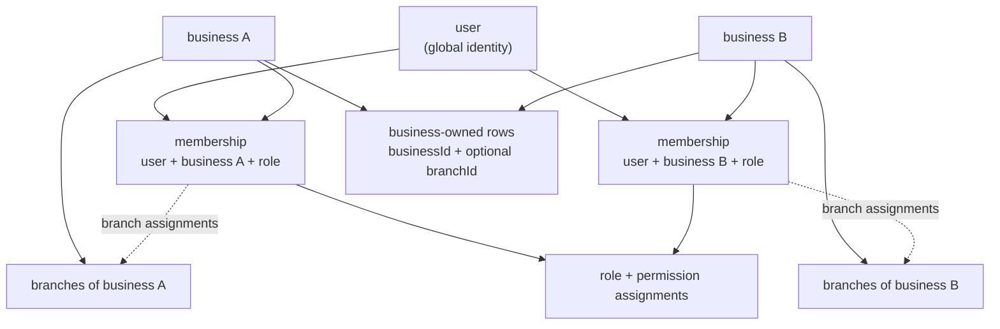
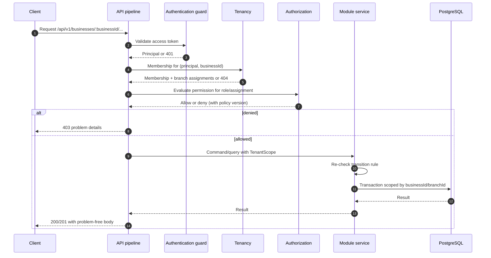

# Multi-tenant security architecture

**Status:** Step 2 design baseline. None of the guards, permission tables or session mechanisms below
exist in code yet. `partial` and `implemented` markers refer to the Phase 0 shell only.

This document unifies tenant isolation, branch isolation, roles, authorization and the security
blueprint. It supersedes the former `tenant-and-branch-isolation.md`, which is deleted in Step 2.
Decisions referenced here are recorded in
[`ARCHITECTURE_DECISION_RECORDS.md`](ARCHITECTURE_DECISION_RECORDS.md) (D-019, D-023, D-025, D-027,
D-028, D-031).

## 1. Actors and scopes

| Actor             | Scope                                                       | Notes                                                                   |
| ----------------- | ----------------------------------------------------------- | ----------------------------------------------------------------------- |
| Owner             | One business, all branches                                  | Billing, ownership transfer, role assignment, physical operations       |
| Business Admin    | One business, no branch required                            | Digital/software administration only; never physical operations         |
| Manager           | Assigned branches within one business                       | Physical and operational execution                                      |
| Cashier           | Own POS terminal/shift within an assigned branch            | Sales, own shift, own receipts; no approvals                            |
| Super Admin       | Platform, no business by default                            | Time-boxed, reason-bound support access only (D-028)                    |
| Background worker | The business/branch carried by the job, plus a system actor | Rebuilds scope from persisted IDs; never inherits a user's live session |

A person may belong to several businesses. A person may hold different roles in different businesses.
Everything below assumes this: **identity is global, authority is per membership**.

## 2. Tenant data model



Rules:

- `users` are global; credentials and sessions belong to the user, not to a business.
- `memberships` link a user to a business and carry a role reference.
- `branches` belong to exactly one business.
- Branch assignment is a separate relation from membership: a Manager or Cashier is assigned to
  specific branches; an Owner implicitly covers all branches; a Business Admin needs none.
- Every business-owned table carries `businessId`. Branch-scoped tables also carry `branchId`.
- Tables that reference another business-owned row use a **composite** foreign key on
  `(businessId, id)` so a cross-business reference cannot be inserted even by a buggy service.

## 3. Tenant context lifecycle

Tenant scope is established per request, validated before any business code runs, passed explicitly,
and enforced again at the data layer.

1. **Authentication.** The access token yields a principal (`userId`, session ID, token expiry). The
   token carries **no** business or role claim: those can be revoked or changed, and stale claims
   would outlive the change.
2. **Business resolution.** The business comes from the URL:
   `/api/v1/businesses/:businessId/...`. There is no implicit "current business" in the session.
3. **Membership validation.** The business guard loads the membership for `(principal, businessId)`.
   Missing or inactive membership returns **404** for business-scoped resources, so a non-member
   cannot distinguish "exists but forbidden" from "does not exist".
4. **Branch validation.** For branch-scoped routes the branch guard verifies the branch belongs to
   the business and that the actor is assigned to it. Owners pass; unassigned actors receive 403
   because membership is already known.
5. **Permission evaluation.** The permission guard evaluates the declared permission against the
   actor's role assignments for that business and branch.
6. **Scope construction.** The pipeline builds an immutable scope object and passes it as an
   explicit first argument to application services.
7. **Propagation.** Services pass the scope to module-owned repositories. Repositories include
   `businessId` (and `branchId` where applicable) in every predicate. No module queries another
   module's tables.
8. **Re-check.** State transitions re-evaluate the specific permission in the service, inside the
   transaction, because route permissions alone cannot express rules like "a Manager may refund only
   within their branch" or "a Cashier may void only an uncompleted sale".

Illustrative scope (design only, no such type exists yet):

```ts
export interface TenantScope {
  businessId: string;
  actor:
    | { kind: 'user'; userId: string; membershipId: string; sessionId: string }
    | { kind: 'system'; jobId: string };
  branchId?: string;
  permissions: ReadonlySet<string>;
}
```

The scope is frozen. A service cannot widen it. A job's system actor carries only the permissions the
job type declares, never a user's full set.

## 4. Authorization flow



A 401 means no valid session. A 403 means the session is valid and membership exists but the
permission or branch is wrong. A 404 is used when revealing existence would itself leak tenant
information.

Illustrative enforcement only — no guard or evaluator exists in code yet:

```ts
// Route-level: deny by default when no permission is declared.
export const RequirePermission = (permission: string) => SetMetadata(PERMISSION_KEY, permission);

@Injectable()
export class PermissionGuard implements CanActivate {
  constructor(
    private readonly reflector: Reflector,
    private readonly evaluator: PermissionEvaluator,
  ) {}

  canActivate(context: ExecutionContext): boolean {
    const required = this.reflector.getAllAndOverride<string | undefined>(PERMISSION_KEY, [
      context.getHandler(),
      context.getClass(),
    ]);
    if (!required) return false;

    const scope = context.switchToHttp().getRequest().tenantScope as TenantScope | undefined;
    return scope !== undefined && this.evaluator.can(scope, required);
  }
}

// Service-level: re-check the transition and the branch inside the transaction.
async approveRefund(scope: TenantScope, returnId: string): Promise<RefundResult> {
  const ret = await this.returns.findScoped(scope, returnId); // always business-scoped
  if (!scope.permissions.has('after-sales:refund:approve')) {
    throw new ForbiddenProblem('REFUND_NOT_PERMITTED');
  }
  if (ret.branchId !== scope.branchId) {
    throw new ForbiddenProblem('BRANCH_SCOPE_VIOLATION');
  }
  return this.refunds.execute(scope, ret);
}
```

The guard is UX-adjacent enforcement at the boundary; the service check is the one that protects the
state transition. Both are required.

## 5. Permission model

Permissions are named `resource:subject:action` (for example `inventory:stock:adjust`). Roles are
named bundles of permissions; the role a membership holds determines the bundle. The catalogue is
deny-by-default: an endpoint without a declared permission is treated as forbidden, not open.

| Permission group                | Owner        | Business Admin     | Manager           | Cashier        | Scope    |
| ------------------------------- | ------------ | ------------------ | ----------------- | -------------- | -------- |
| Business settings and type      | Yes          | Yes                | No                | No             | Business |
| Members and invitations         | Yes          | Yes                | No                | No             | Business |
| Role assignment                 | Yes          | Digital roles only | No                | No             | Business |
| Catalog and product master      | Yes          | Yes                | Read, propose     | Read for POS   | Business |
| Pricing and discounts           | Yes          | Yes                | Branch override   | No             | Branch   |
| Supplier master                 | Yes          | Yes                | Read, operational | No             | Business |
| Procurement documents (RFQ/PO)  | Yes          | Prepare            | Yes               | No             | Branch   |
| Receiving acceptance            | Yes          | No                 | Yes               | No             | Branch   |
| Supplier payments               | Yes          | No                 | With permission   | No             | Branch   |
| Inventory count/adjust/transfer | Yes          | No                 | Yes               | No             | Branch   |
| Stock reconciliation resolution | Yes          | View only          | Yes               | No             | Branch   |
| Sales and POS                   | Yes          | No                 | Yes               | Yes            | Branch   |
| Sale void                       | Yes          | No                 | Yes               | No             | Branch   |
| Return initiation               | Yes          | No                 | Yes               | Yes            | Branch   |
| Refund approval                 | Yes          | No                 | Yes               | No             | Branch   |
| Reports                         | All branches | Business reports   | Assigned branches | Own shift only | Branch   |
| Audit log                       | Yes          | Yes (read)         | Branch (read)     | No             | Branch   |
| Subscription and billing        | Yes          | Invoice view       | No                | No             | Business |
| Devices and sync                | Yes          | Yes                | Branch device     | No             | Branch   |

Rules that the matrix does not capture:

- **Business Admin never holds physical-operation permissions.** No configuration can grant receiving,
  stock count, adjustment, transfer execution, cash handling, POS or refund execution to that role.
  Role administration by an Admin can grant only permissions the Admin holds; physical permissions
  therefore remain with Owner (and Manager where the matrix says so).
- **No one grants a permission they do not hold.** An Admin cannot create a "super manager" role.
- **Branch scope is part of the grant**, not a UI filter. A Manager's permission for branch A does not
  apply in branch B.
- **Super Admin is not in this matrix** and receives no business permissions. Business actions taken
  during support access are attributed to the support grant (D-028).
- **Cashier sales are self-scoped** for reads (own sales, own shift, own receipts) while creation is
  branch-scoped.

The final permission catalogue is code in the `authorization` module; this table is the design intent
and must match it. Divergence is a bug.

## 6. Branch isolation

- Branch IDs are validated against the business before use; `branchId` from another business is a
  not-found, never a cross-business read.
- Branch-scoped rows store `branchId`; queries must include it. Business-level rows (products, price
  lists, suppliers) are not branch-filtered unless a branch override exists.
- Stock is held per branch/location. A transfer is the only operation that moves quantity between
  branches, and it is a two-step, audited workflow.
- Aggregations (dashboards, reports) either run with a business scope and group by branch, or with a
  branch scope; they never mix an unscoped union.
- A branch archive is blocked while open operational records exist or is restricted to Owner with an
  explicit resolution step. History remains readable.

## 7. Multi-business users and business switching

- The session is business-agnostic. Switching a business changes the `businessId` in the URL and the
  client's remembered selection; it does not require a new login.
- The client discovers available businesses at `GET /api/v1/me/businesses` (planned contract) and
  shows only memberships that are active.
- Switching re-runs membership and permission evaluation on the next request. A revoked membership
  fails immediately, even if the client still shows the business.
- The last-used business may be remembered locally per user on the device, but it is a convenience,
  never an authorization input.
- A user with no membership in a business cannot enumerate its branches, members or resources.

## 8. Cross-tenant prevention

| Control                | Rule                                                                                                           |
| ---------------------- | -------------------------------------------------------------------------------------------------------------- |
| URL-scoped business    | Business ID is explicit in every business route; no ambient tenant from token or header                        |
| Scoped repositories    | Every query includes `businessId`; `findUnique({ id })` on a business table is forbidden                       |
| Composite keys         | Child rows reference `(businessId, parentId)`; PostgreSQL rejects cross-business references                    |
| Guards before services | Membership and branch checks run before a controller body executes                                             |
| Service re-checks      | Transition rules re-check permission and branch inside the transaction                                         |
| Identifier handling    | UUIDs are non-guessable but are never treated as authorization                                                 |
| File access            | Storage keys are scoped by business; signed URLs are short-lived and re-check membership                       |
| Exports and reports    | Generated with the requester's scope; download re-validates membership                                         |
| Caches                 | Any cache key includes `businessId` (and `branchId` where relevant); no global business-data cache             |
| Background jobs        | Persist `businessId`, `branchId`, actor and job type; rebuild scope; never infer tenant from payload free text |
| Events                 | Events carry `businessId`; a consumer rejects an event whose scope it cannot resolve                           |
| Error semantics        | Non-members receive 404 on business resources; no existence or name leakage                                    |
| Tests                  | Each endpoint has a cross-tenant test using a second business fixture                                          |

## 9. Background jobs, events and audit attribution

- A job row stores `businessId`, optional `branchId`, job type, requested-by actor, idempotency key
  and attempt count. The worker constructs a system scope from those persisted values and the job
  type's permission list; it never copies a live user session.
- A job that needs a user's authority records that user as the actor but still runs with the job's
  restricted permissions. If the user's membership was revoked before execution, the job fails
  visibly rather than acting on stale authority.
- Outbox rows for external side effects carry the same scope and correlation ID as the transaction.
- Audit records include: event, actor (`user`, `system`, or `super-admin-support` with grant ID),
  `businessId`, `branchId`, target type/ID, outcome, correlation ID and timestamp. Metadata must not
  contain passwords, tokens, full card data or unnecessary PII.
- Audit is append-only. No role has update or delete permission. Retention and export are policy
  decisions, not ad-hoc deletes.

## 10. Offline transaction association

An offline sale is created without a server session round-trip, so the device's identity and its
user/business/branch binding must be established before the branch goes offline. That binding
authorizes the transaction to be submitted; it never authorizes bypassing stock validation.

| Concern              | Design                                                                                                     |
| -------------------- | ---------------------------------------------------------------------------------------------------------- |
| Device enrolment     | A device is registered to a user, business and branch, with a device ID and a revocable device credential  |
| Local actor          | The operation records the enrolled `userId`, `deviceId`, `businessId`, `branchId` and local timestamp      |
| Operation identity   | A client-generated `operationId` is unique per device and immutable                                        |
| Server validation    | Sync re-validates the device, membership, branch and operation shape before delegating to `sales`          |
| Revoked device       | Sync is rejected; local data is preserved and exportable for manual resolution                             |
| Revoked membership   | The operation is not silently applied; a conflict/rejection record is created and surfaced                 |
| Cross-business       | An operation whose `businessId` does not match the device binding is rejected and audited                  |
| Local token lifetime | The device credential has a bounded offline validity; after expiry the device must reconnect to sell again |
| Local protection     | Local database encrypted; credential stored in the OS keychain; device wipe revokes the credential         |
| Duplicate prevention | Server idempotency key is `(deviceId, operationId)`; a replay returns the original result                  |

Offline-origin sales that exceed shared stock follow the approved D-025: the inventory commit is
refused, no sale or stock movement is written, and the transaction is preserved as a reconciliation
exception. Resolution is limited to an Owner or Manager with the reconciliation permission and the
matching branch scope; Business Admin may view but never authorize a physical stock outcome. Details
are in [`OFFLINE_SYNCHRONIZATION_ARCHITECTURE.md`](OFFLINE_SYNCHRONIZATION_ARCHITECTURE.md).

## 11. Sensitive operations and step-up confirmation

The following operations require a recent authentication (re-authentication or a short-lived
confirmation token) in addition to the normal permission, and are always audited with the
confirmation method:

- ownership transfer and role escalation to Owner;
- subscription cancellation or plan downgrade that removes entitlements;
- refunds above a business-configured limit;
- stock write-offs/adjustments above a business-configured limit;
- supplier payments;
- device revocation and support-access grants.

The exact thresholds are configuration, not code. A step-up never replaces the permission check; it
adds a second, recent proof of the same actor.

## 12. Security blueprint by layer

| Layer      | Controls                                                                                                                |
| ---------- | ----------------------------------------------------------------------------------------------------------------------- |
| Client     | No business authority; tokens kept out of persistent web storage; CSP; no secrets in bundle; role-aware navigation only |
| Edge       | TLS, HSTS, request size limits, rate limits, CORS allowlist, security headers                                           |
| API        | Authentication, membership/branch/permission guards, validation, service re-checks, idempotency, problem-details errors |
| Data       | Scoped queries, composite keys, least-privilege app role (production), encrypted backups, PITR                          |
| Async      | Scoped jobs, outbox with locks, idempotent handlers, audit of side effects                                              |
| Desktop    | Context isolation, sandbox, allowlisted IPC, no Node in renderer, encrypted local store, device revocation              |
| Operations | Secret management, rotation, audit review, restore drills, dependency and image scanning                                |

## 13. Threat model

| #   | Threat                                   | Affected component                | Impact                                     | Mitigation                                                                                                                           | Verification                                                |
| --- | ---------------------------------------- | --------------------------------- | ------------------------------------------ | ------------------------------------------------------------------------------------------------------------------------------------ | ----------------------------------------------------------- |
| 1   | Credential stuffing / brute force        | `identity` login                  | Account takeover                           | Login rate limit per IP and account, exponential backoff, generic errors, optional MFA                                               | e2e throttling and lockout tests                            |
| 2   | Password database theft                  | `identity` credentials            | Mass credential compromise                 | Argon2id (scrypt fallback), per-user salt, server-side pepper from environment, no weak hashes                                       | Unit tests on hash parameters; code review                  |
| 3   | Session theft via XSS                    | Web renderer, session transport   | Impersonation                              | Access token in memory; refresh token httpOnly/Secure/SameSite; no tokens in localStorage; CSP                                       | Security review, CSP test, XSS payload tests                |
| 4   | Refresh token replay                     | `identity` sessions               | Persistent impersonation                   | Rotation on every refresh, reuse detection revokes the family, session listing/revocation                                            | Integration test for replay and revocation                  |
| 5   | CSRF on cookie-backed endpoints          | Auth/refresh endpoints            | Unwanted actions                           | SameSite cookies, CSRF token for state-changing cookie routes, origin check                                                          | e2e CSRF test                                               |
| 6   | Broken object-level authorization (IDOR) | All business endpoints            | Cross-object access                        | URL scope, guards, scoped repositories, service re-checks                                                                            | Per-endpoint authorization tests                            |
| 7   | Cross-tenant data exposure               | Data layer, exports, files        | Confidentiality breach, trust loss         | `businessId` predicates, composite FKs, scoped storage, isolation tests                                                              | Two-tenant integration suite per module                     |
| 8   | Branch data leakage                      | Branch-scoped endpoints/reports   | Operational and financial exposure         | Branch guard, branch predicates, branch-scoped aggregates                                                                            | Branch isolation tests                                      |
| 9   | SQL injection                            | Repositories, raw queries         | Data disclosure or destruction             | Prisma parameterized queries; raw SQL only reviewed and parameterized; input validation                                              | Lint/review rule; injection tests on search and filters     |
| 10  | Malicious or oversized upload            | `files`, upload endpoints         | Stored malware, storage abuse              | Server-side MIME sniffing, extension allowlist, size limits, quarantine bucket, no execution                                         | Upload tests per type and oversize                          |
| 11  | Forged/replayed payment webhook          | `subscriptions`, Chapa edge       | Free or duplicated entitlements            | Signature verification, idempotency by provider reference, server-side reconciliation                                                | Sandbox webhook tests and replay tests                      |
| 12  | Client-side price or total tampering     | `sales`, online and offline       | Revenue loss                               | Server resolves price and totals, ignores client totals, snapshot recorded on the sale                                               | API tests sending tampered totals                           |
| 13  | Privilege creep for Business Admin       | `authorization`                   | Physical operations by a digital-only role | Fixed role templates, no physical permissions for Admin, grant-only-what-you-hold rule                                               | Permission-matrix tests for Admin on physical actions       |
| 14  | Super Admin abuse                        | `super-admin`                     | Unbounded tenant access                    | Time-boxed grants, reason, Owner-visible, audited, no standing business permissions                                                  | Grant expiry and audit-completeness tests                   |
| 15  | Secret leakage                           | API config, renderer bundle, logs | Provider compromise                        | Secrets only in backend env; no `VITE_` secrets; log redaction; rotation                                                             | Bundle scan, log review, secret-scanning CI (planned)       |
| 16  | Man-in-the-middle                        | Client-server transport           | Token and data theft                       | HTTPS only, HSTS at the proxy, secure cookies, certificate management                                                                | Deployment checklist                                        |
| 17  | CORS misconfiguration                    | API edge                          | Unauthorized browser origins               | Explicit allowlist from validated env; no wildcard with credentials                                                                  | Config test for allowed and rejected origins                |
| 18  | Resource exhaustion / abuse              | API, reports, exports             | Outage, cost                               | Rate limits, payload caps, pagination caps, async exports with quotas                                                                | Load and quota tests                                        |
| 19  | Backup loss or tampering                 | PostgreSQL ops                    | Permanent data loss                        | Encrypted backups, PITR, separate credentials, offline copy, scheduled restore drills                                                | Quarterly restore test with recorded result                 |
| 20  | Stolen laptop with offline database      | Desktop main process              | Branch and customer data exposure          | OS keychain credential, encrypted local DB, device revoke, bounded offline credential                                                | Desktop security tests and revocation drill                 |
| 21  | Duplicate sale on retry                  | `sales`, `synchronization`        | Financial and stock duplication            | Client operation IDs, server idempotency, replay returns original result                                                             | Duplicate-delivery and crash-retry tests                    |
| 22  | Silent loss of failed offline sale       | Desktop outbox, sync              | Lost revenue, distrust                     | Durable local commit, visible failed/conflict queue, no auto-delete, manual resolution                                               | Sync failure and restart tests                              |
| 23  | Negative stock after offline replay      | `inventory`, sync                 | Incorrect availability                     | D-025 approved: atomic stock guard; shortfall refuses the sale and movement, preserves the transaction as a reconciliation exception | Offline shortfall + no-negative integration test            |
| 24  | Information disclosure in errors         | API exception filter              | Reconnaissance, data leak                  | Problem details with safe `detail`, correlation ID, no stack/SQL/internal paths                                                      | Error-shape tests across status codes                       |
| 25  | Renderer escape / Node exposure          | Electron                          | Host compromise                            | contextIsolation, sandbox, no nodeIntegration, allowlisted IPC, navigation/window/webview denied                                     | Electron security tests and review (launch unverified here) |

## 14. Verification requirements

Security controls are not "done" because they are documented. Each module's first endpoint ships
with:

1. authentication tests (missing, expired, revoked session);
2. authorization tests for every role that can reach the endpoint;
3. a cross-tenant test with a second business;
4. a branch-scope test where applicable;
5. an audit assertion for state changes;
6. an error-shape assertion that does not leak internals.

Isolation suites are blocking in CI. A failing isolation test is never waived for a feature deadline;
the feature is held instead.

## 15. Planned versus implemented

| Area                         | State                           |
| ---------------------------- | ------------------------------- |
| Helmet, CORS allowlist       | Implemented                     |
| Global validation pipe       | Implemented                     |
| Probes and readiness         | Implemented                     |
| Electron hardening (main)    | Implemented (launch unverified) |
| Authentication and sessions  | Planned                         |
| Membership/branch guards     | Planned                         |
| Permission catalogue         | Planned                         |
| Audit writer                 | Planned                         |
| Rate limiting and CSP        | Planned                         |
| Problem-details error format | Planned                         |
| Device enrolment and offline | Planned                         |
