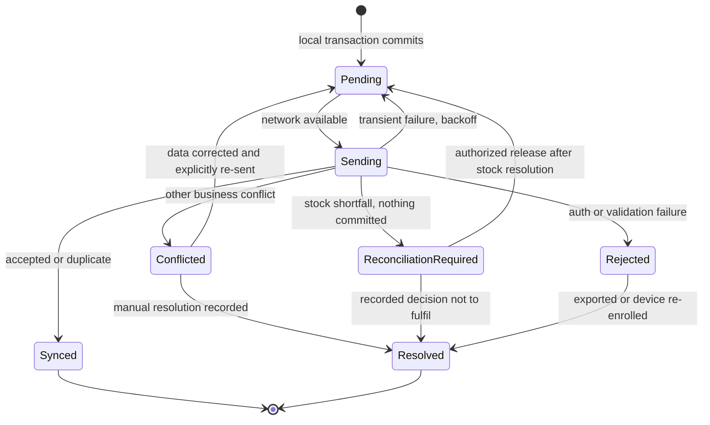
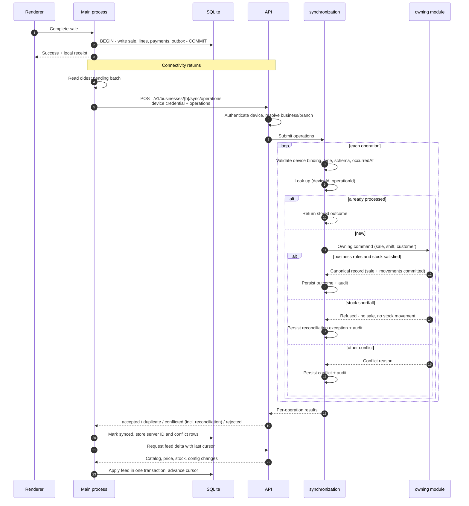
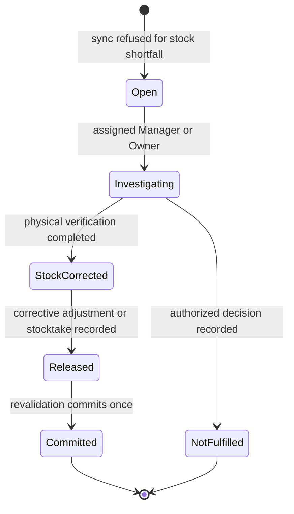

# Offline synchronization architecture

**Status:** Step 2 design baseline. Nothing in this document is implemented. The Electron shell
exists; SQLite, the outbox and the sync endpoints do not.

Decisions: D-017 (SQLite), D-022 (outbox and operation IDs), D-025 (strict stock protection for
offline transactions, approved), D-027 (roles). Security rules are in
[`MULTI_TENANT_SECURITY_ARCHITECTURE.md`](MULTI_TENANT_SECURITY_ARCHITECTURE.md). The wire contract
is in [`../api/API_ARCHITECTURE.md`](../api/API_ARCHITECTURE.md) §12.11.

## 1. Goals and non-goals

**Goals**

1. A cashier can complete a sale with no network and see success only after it is durably stored.
2. No offline transaction is lost, duplicated or silently altered.
3. An offline transaction is a locally recorded transaction awaiting validation, never permission to
   bypass authoritative inventory constraints.
4. No accepted stock movement can make available inventory negative, whether it originated online or
   offline. A shortfall becomes a visible reconciliation exception instead of a negative balance.
5. Conflicts are visible, attributable and resolvable by an authorized person.
6. Local reads (catalog, prices, stock, configuration) are good enough to sell, and visibly marked
   with their age.
7. The server remains the authority for identity, authorization, prices at ingest time, stock ledger
   and financial records.

**Non-goals**

- Guaranteeing globally consistent stock while multiple devices are offline.
- Offline administration, purchasing, refunds or subscription changes.
- Automatic conflict resolution that rewrites financial facts.
- Multi-master editing of the same product, price or purchase order.

## 2. What works offline

| Operation                           | Offline | Notes                                                                                                                                                 |
| ----------------------------------- | ------- | ----------------------------------------------------------------------------------------------------------------------------------------------------- |
| POS cash sale                       | Yes     | Local commit, outbox, receipt printed locally; server may reject at sync when authoritative stock is insufficient, leaving a reconciliation exception |
| Card / mobile-money sale            | No      | Requires provider confirmation; POS shows "online required"                                                                                           |
| Open shift                          | Yes     | Queued with the first sale or immediately                                                                                                             |
| Close shift / cash count            | Yes     | Queued; server verifies totals; conflict if the shift was closed elsewhere                                                                            |
| Reprint own receipt                 | Yes     | Local receipt data                                                                                                                                    |
| Customer create / lookup            | Partial | Local cache for lookup; creation queued and deduplicated server-side                                                                                  |
| Catalog / price / stock reads       | Yes     | From cache with `asOf`; read-only                                                                                                                     |
| Product / category / price change   | No      | Online only; offline UI is read-only                                                                                                                  |
| Stock adjustment / count / transfer | No      | Online only; requires physical verification and permissions                                                                                           |
| Purchase order / receiving          | No      | Online only                                                                                                                                           |
| Return / refund / exchange          | No      | Online only; money and stock must be authorized against server state                                                                                  |
| Reports / exports                   | No      | Online only; cached dashboards may be shown as stale read-only                                                                                        |
| Users, roles, configuration         | No      | Online only; cached values apply to sales until the next sync                                                                                         |
| Subscription and billing            | No      | Online only (online-first, per the brief)                                                                                                             |
| Device enrolment / re-enrolment     | No      | Online only                                                                                                                                           |

Offline edits are blocked in the UI **and** rejected by the server if a forged request arrives. POS
is the only write surface that works without the network.

## 3. Local storage

The Electron main process owns the SQLite database. The renderer calls narrow IPC commands; it never
opens a file or a database connection (D-017, D-029).

Conceptual tables (not the Step 3 schema):

| Area             | Contents                                                                                                                      |
| ---------------- | ----------------------------------------------------------------------------------------------------------------------------- |
| `local_identity` | Device ID, enrolled user, business, branch, device credential reference, keychain handle                                      |
| `cache_products` | Sellable product/variant subset, barcodes, units, attributes, `asOf`, catalog version                                         |
| `cache_prices`   | Effective price per variant/branch with validity window and `asOf`                                                            |
| `cache_stock`    | Branch stock snapshot per variant with `asOf` (advisory only)                                                                 |
| `cache_config`   | Business type, capabilities, tax/config needed at the till, template version                                                  |
| `local_sales`    | Locally completed sales with totals, lines, payments, receipt number, local timestamps                                        |
| `outbox`         | One row per operation: `operationId`, type, payload, status, attempts, last error, ordering                                   |
| `sync_state`     | Last feed cursor, last successful sync, server time offset                                                                    |
| `conflicts`      | Server outcome, reason, affected local operation, reconciliation exception ID/status, resolution status, resolver, timestamps |
| `sync_history`   | Completed batches, outcomes, durations, bytes                                                                                 |

Requirements:

- **Durability.** WAL mode, synchronous commits for sales and outbox rows in a single transaction,
  integrity check on startup.
- **Encryption.** The database file is encrypted at rest; the key is protected by the OS keychain,
  never stored in the renderer or in a plain config file.
- **Single writer.** Only the main process writes. Renderer requests are serialized through IPC.
- **No auto-delete.** Rows leave `outbox` only by reaching a terminal state (`synced`, `resolved`);
  nothing is dropped because it is old or because it failed.
- **Size bounds.** Retention policies may archive synced sales locally after the server retains them,
  but never before a successful sync and never without a server-confirmed acknowledgement.

## 4. Identity and numbering

| Identifier        | Generated by           | Properties                                                                                    |
| ----------------- | ---------------------- | --------------------------------------------------------------------------------------------- |
| `deviceId`        | Server at enrolment    | Bound to user, business, branch, device fingerprint                                           |
| Device credential | Server at enrolment    | Stored in OS keychain, revocable, bounded offline validity, never exposed to the renderer     |
| `operationId`     | Device at local commit | UUID, immutable, unique per device, generated once and reused on every retry                  |
| `localSaleId`     | Device                 | Primary key inside the local database                                                         |
| `saleId`          | Server                 | Canonical ID returned on sync; mapped locally to `localSaleId`                                |
| Receipt number    | Device                 | Device-reserved prefix + zero-padded sequence (e.g. `BOL-T03-000148`), unique by construction |

Receipt numbers are reserved in blocks issued by the server at enrolment or re-sync. The server
validates that the prefix belongs to the device and that the sequence is inside a reserved block.
Exhausting a block requires a sync before more offline sales; the UI warns before that point.
Because the prefix is device-specific, two offline devices can never issue the same receipt number.

## 5. Offline sale commit protocol

1. Cashier confirms payment.
2. Main process starts one SQLite transaction and writes: sale header, lines, payments, the receipt
   number, the advisory local stock delta, and an `outbox` row of type `sale.completed` with a fresh
   `operationId`. The cached stock is a display aid only: its presentation never goes below zero and
   is marked "unverified"; the sale's recorded quantities are never reduced or altered.
3. Transaction commits. Only now does the UI show success and print the receipt.
4. If the transaction fails or the app crashes before commit, no sale exists and no success is shown.
   On restart the WAL recovery leaves a consistent state; a sale is either fully recorded or absent.
5. A committed sale sits in `outbox` until the server acknowledges it. The UI shows a clear
   "not synced yet" indicator per sale and per shift.
6. Local success means "durably recorded on this device", not "accepted by the server". A sale the
   server later rejects for insufficient stock stays visible on both sides as requiring
   reconciliation; it is never deleted, renumbered or silently rewritten.

Printing failure does not roll back the local sale; the receipt can be reprinted from local data.
The local transaction is the record of what happened at the till, not proof of server acceptance.

## 6. Outbox lifecycle

- Ordering is FIFO per device, with sales ahead of shift close and customer creation. A failed
  operation blocks later operations of the **same aggregate** (for example, a shift close waits for
  its sales) but not unrelated aggregates.
- Retries use exponential backoff with jitter. Transient failures (network, 5xx, 429) keep the
  operation `Pending`. Permanent failures (revoked device, schema rejection) become `Rejected` and
  stop retrying until a human acts.
- A stock shortfall is not retried on a timer. It enters `ReconciliationRequired` and moves only
  when an authorized resolution is recorded: either a corrective stock workflow is completed and
  the operation is explicitly released for one revalidation, or the business records that the
  transaction will not be fulfilled. There is no blind retry loop and no automatic adjustment.
- Only one batch is in flight at a time per device. The batch size is bounded; a large backlog is sent
  in multiple batches.
- The outbox survives app updates and restarts. Uninstall or device wipe is the only way to lose it,
  and the app warns before either.

## 7. Sync flow

Rules:

- The client never deletes an operation because the server rejected it.
- A `duplicate` result is a success: the client marks the operation synced and stores the canonical
  server record.
- A `conflicted` result stores the conflict locally and keeps the operation visible. It is not
  retried automatically until a resolution changes the data. A stock shortfall is returned in this
  outcome with code `INSUFFICIENT_STOCK` and a `reconciliationExceptionId`; it is not retried until
  an authorized resolution releases it.
- A `rejected` result is terminal on the device; it stays in the history with the reason and an
  export path. A stock shortfall is never reported as `rejected`, because it has a resolution path.

## 8. Server-side validation

Validation happens in this order; a failure stops the operation at that step:

1. Device credential is valid, not expired, not revoked.
2. `businessId` and `branchId` match the device binding.
3. The enrolled user still has an active membership and branch assignment.
4. The operation type is allowed offline.
5. Envelope schema is valid; IDs and quantities are well formed.
6. `occurredAt` is within the accepted skew window (past and future).
7. Idempotency record does not exist or matches the same request hash.
8. The owning module validates product, pricing, payment and transaction constraints. Recorded
   prices are never silently changed; a drift policy either accepts the recorded total with a flag
   or produces a conflict, never an edited figure.
9. For a sale, authoritative stock is checked and the stock movement is committed in the same
   atomic operation as the sale and payment rows. The check inside the transaction is authoritative;
   the cached availability read is advisory only.
10. If the atomic commit would make available inventory negative, it aborts in full: no sale, no
    movement, no payment row. `synchronization` records a reconciliation exception containing the
    original operation and the shortfall details instead.
11. Outcome, canonical record or exception, and audit are persisted in one transaction.

The synchronization module never writes domain tables. It validates the envelope and delegates to the
owning module's public command, exactly as an online request would.

## 9. Duplicate prevention

- The idempotency key is `(deviceId, operationId)`, stored with a request hash and the outcome.
- The client generates `operationId` once, inside the same local transaction as the sale, and never
  regenerates it. Retries, reinstalls of the sync loop and app restarts reuse it.
- If the server commits a sale and the response is lost, the retry returns `duplicate` with the
  canonical sale. No second stock movement is written.
- Sync feed application is idempotent as well: applying the same delta twice is harmless because the
  cursor and upserts are guarded.
- Sale creation by an online client uses `Idempotency-Key` with the same semantics (API §9).

A duplicate is never treated as a conflict and never creates a manual task.

## 10. Conflicts and resolution

### 10.1 Conflict taxonomy

| Conflict                   | Example                                                  | Server behavior                                                                  | Who resolves                                                   |
| -------------------------- | -------------------------------------------------------- | -------------------------------------------------------------------------------- | -------------------------------------------------------------- |
| Shared-stock shortfall     | Device A and B both sell the last unit offline           | Reject the sale commit, record reconciliation exception, write no stock movement | Manager/Owner via physical verification and adjusted stocktake |
| Price drift                | Local price differs from current effective price         | Accept the recorded sale total; flag drift for review                            | Manager (review only)                                          |
| Product archived           | Product was archived while the device was offline        | Accept sale as historical fact; flag the reference                               | Manager                                                        |
| Customer duplicate         | Two devices created the same customer                    | Apply deduplication policy; return canonical customer                            | Manager                                                        |
| Shift closed elsewhere     | Manager closed the shift online before the device synced | Keep the offline close as a conflict; do not merge blindly                       | Manager/Owner                                                  |
| Clock skew                 | Device clock is far ahead or behind                      | Reject outside the skew window; preserve locally                                 | Support/Manager                                                |
| Membership revoked         | User removed from the business before sync               | Reject operation; preserve and export                                            | Owner/Manager                                                  |
| Device revoked             | Device lost or stolen                                    | Reject all operations; preserve and export                                       | Owner                                                          |
| Schema/version unsupported | Old app sends an unknown operation type                  | Reject with upgrade instruction; preserve                                        | Support                                                        |

The system never resolves a conflict by deleting a sale, changing its totals or silently discarding
an operation.

### 10.2 Strict stock protection for offline transactions (D-025, approved)

The no-negative rule has no offline exception. The server accepts a stock movement only if the
resulting available quantity at the branch/location is zero or greater. When an offline sale would
require more than is available:

1. the sale and all its stock movements are refused; no authoritative sale is created;
2. a reconciliation exception is created — or reused, for a replay — with the original operation ID,
   device, cashier, branch, products, quantities, recorded prices, payments and timestamps, plus the
   shortfall per product and the rejection reason;
3. the operation is marked as requiring reconciliation and is not retried on a timer;
4. Manager and Owner are notified; the exception is visible in the reconciliation queue and audit;
5. the original local transaction is preserved on the device and on the server exception record;
   nothing is deleted, renumbered, price-edited or quantity-reduced.

The cached branch stock remains advisory. Because the check and commit are atomic, two concurrent
sync batches cannot both pass for the last unit; the loser receives the same shortfall outcome.

### 10.3 Reconciliation and resolution workflow

- Only an Owner or Manager with the reconciliation permission (for example
  `inventory:reconciliation:resolve`) may resolve, and only within their branch scope. Business Admin
  may view the queue but can never resolve a physical stock outcome.
- Physical verification is required whenever the discrepancy is a physical stock question. The
  verifier records what was found; the stocktake or adjustment is a separate workflow with its own
  audit history.
- Resolution history records the investigator, evidence and notes, the decision, the time, and the
  IDs of any separate adjustment or stocktake. It is append-only.
- **Honoured path.** After the authorized adjustment or stocktake, the operation is explicitly
  released and revalidated once with the same operation ID. If it commits, that sale and its
  movements are the only ones ever written; idempotency prevents a second commit. If it fails again
  (for example, another device sold the stock), a further exception state is recorded, never an
  overwrite.
- **Not-fulfilled path.** The business records the decision. Any customer or financial remedy follows
  the approved business requirements; where none defines it, it requires an authorized business
  decision. The architecture provides no automatic refund, adjustment or approval.
- There is no automatic resolution and no timer-based retry. The exception stays visible until an
  authorized resolution is recorded.
- Other conflicts still appear in the same queue with the device, user, time, sale and reason; a
  resolution marks the local operation `Resolved` without rewriting the local sale. The device keeps
  the original operation and its complete history.

## 11. Caching and feeds

| Feed                 | Content                                                        | Cursor semantics                                  |
| -------------------- | -------------------------------------------------------------- | ------------------------------------------------- |
| Catalog              | Products, variants, barcodes, units, attributes, archive state | Monotonic change cursor; deletions are tombstones |
| Prices               | Effective price rows per branch/variant with validity windows  | Change cursor                                     |
| Stock                | Branch balances snapshot (advisory)                            | Snapshot ID + `asOf`; deltas are best-effort      |
| Configuration        | Business type, capabilities, tax/config, receipt template      | Version number                                    |
| Customers (optional) | Minimal lookup subset for the branch                           | Change cursor                                     |

- Every cached read carries `asOf` and is displayed as stale when older than the configured threshold.
- Stock is explicitly advisory: the server re-checks at ingest and the UI warns that offline stock may
  be stale.
- A gap or corrupt cursor causes a full snapshot for that feed, never a silent partial merge.
- Feeds are scoped by business and branch; switching business on a device requires a feed reset and a
  fresh snapshot.

## 12. Recovery scenarios

| Scenario                          | Expected behavior                                                                                                       |
| --------------------------------- | ----------------------------------------------------------------------------------------------------------------------- |
| Crash during sale commit          | SQLite rolls back; no sale, no success shown; user retries                                                              |
| Crash after commit, before print  | Sale exists and is queued; on restart it is listed as unsynced and can be reprinted                                     |
| Network drops mid-batch           | Unacknowledged operations stay `Pending`; the server has either processed them or not; replay is duplicate-safe         |
| Server 500 on one operation       | That operation stays pending with backoff; later operations of the same aggregate wait                                  |
| App update during backlog         | Outbox and local sales survive; the new version resumes with the same operation IDs                                     |
| Device clock changed              | Sync still uses stored `occurredAt`; skew outside the window becomes a conflict, not a silent accept                    |
| Local database corruption         | Integrity check fails; new sales are blocked; the file is quarantined, an export is attempted, re-enrolment is required |
| Device credential expired offline | Sales stop until the device reconnects and refreshes; existing outbox is preserved                                      |
| Device revoked                    | Sync stops; data remains and can be exported; a new device must be enrolled                                             |
| Duplicate feed application        | Upserts and cursor guard make it harmless                                                                               |

## 13. Local security

- Renderer has no filesystem, database or credential access; all through validated IPC commands.
- Local database encrypted; key in the OS keychain; no key in logs or config.
- Device credential revocable server-side; revoked devices cannot sync.
- The local UI requires an unlock (OS session or app PIN) before showing sales; the enrolled user is
  recorded on every offline operation.
- Export of local data is an explicit, audited, user-initiated action that produces an encrypted file.
- Logs contain operation IDs and counts, never card data, full customer PII or credentials.

## 14. Observability

| Signal                             | Where                                                       |
| ---------------------------------- | ----------------------------------------------------------- |
| Pending/conflicted/rejected counts | Device UI and a business-level sync dashboard               |
| Last successful sync per device    | `sync_state`, shown in device management                    |
| Batch outcomes and durations       | `sync_history` locally; sync session records server-side    |
| Duplicate rate                     | Server metrics; expected after crashes, anomalous otherwise |
| Stock-shortfall reconciliation     | Reconciliation queue, alerts and audit; age and open count  |
| Rejected operations                | Conflict queue with reason codes                            |

## 15. Testing requirements

Blocking scenarios (see [`../testing/TESTING_ARCHITECTURE.md`](../testing/TESTING_ARCHITECTURE.md)):

1. offline sale commits before UI success, proven by killing the app at each step;
2. duplicate delivery returns the original outcome and writes one sale and one stock movement;
3. two devices sell the last unit offline: the first acceptable sync commits; the second is refused
   with no sale and no stock movement, its transaction and a reconciliation exception are preserved,
   and stock never goes negative;
4. replaying the refused operation returns the same exception instead of creating a second one;
5. an authorized resolution records a separate adjustment/stocktake, releases the operation, and the
   revalidation commits exactly once (or records a further exception without overwriting history);
6. Business Admin is denied resolution of a physical stock outcome; Owner/Manager branch scope is
   enforced;
7. price drift does not rewrite the sale total;
8. revoked device and revoked membership reject and preserve;
9. shift close conflict is visible and resolvable;
10. outbox survives restart and app update;
11. clock skew outside the window is rejected, inside is accepted with server timestamps;
12. feed gap triggers a full snapshot;
13. local database corruption fails closed with an export path.

Integration tests run against a real PostgreSQL instance, not a mock. Desktop tests exercise the main
process and SQLite, not only the renderer.

## 16. Open questions

| Question                                                     | Owner      | Needed by              |
| ------------------------------------------------------------ | ---------- | ---------------------- |
| Offline credential validity window                           | M4 with M1 | Before sync slice      |
| Reconciliation permission names and adjustment thresholds    | M1 with M3 | Before sync slice      |
| Receipt block size and exhaustion policy                     | M4         | Before offline POS     |
| Whether shift close is allowed offline in all business types | M4         | Before offline POS     |
| Conflict and reconciliation SLA, escalation to Owner         | M4         | Before pilot           |
| Local database driver and encryption library                 | M4         | Desktop implementation |
| Device wipe and data-retention policy                        | M4 with M1 | Pilot                  |
