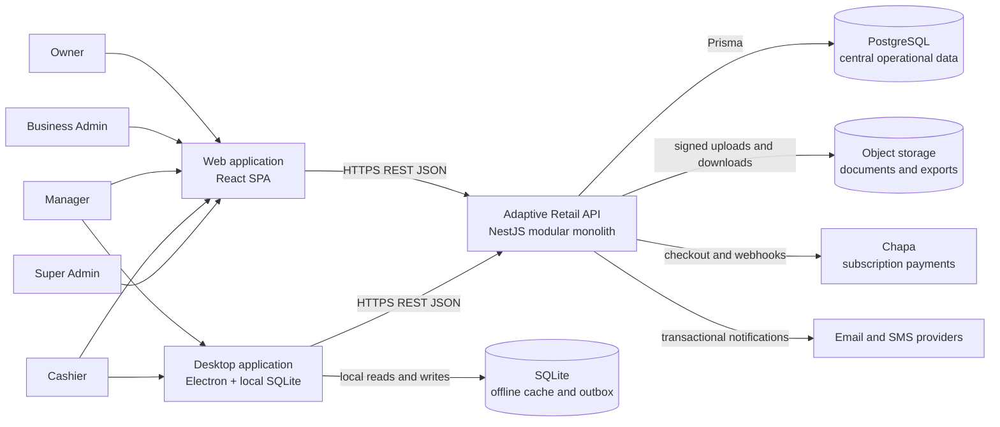
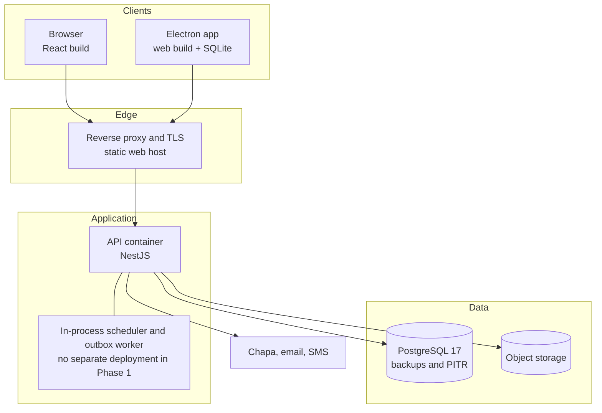
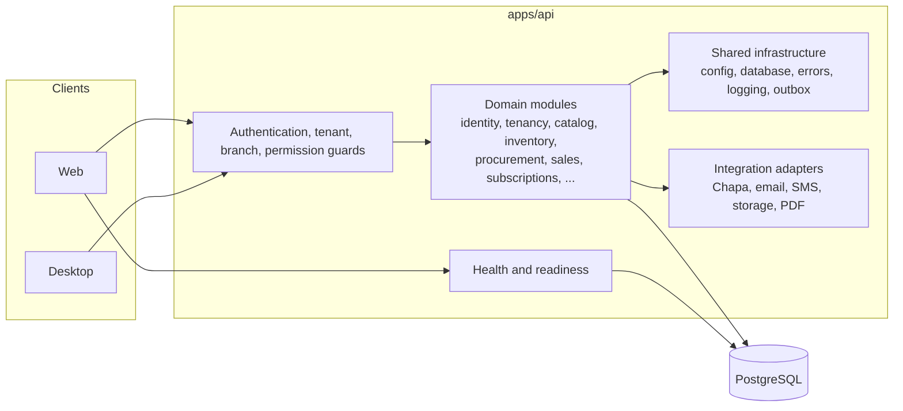

# System architecture

**Status of this document:** Step 2 architecture baseline. It describes the target system and labels
what already exists. It must not be read as proof that a planned component is implemented.

Status labels used across the architecture set:

| Label       | Meaning                                                               |
| ----------- | --------------------------------------------------------------------- |
| Implemented | Present in this repository and exercised by a check that actually ran |
| Partial     | A shell or part exists; the domain behaviour is not built             |
| Planned     | Designed here, not implemented; must not be reported as working       |

Product scope is defined in [`../product/scope-and-phases.md`](../product/scope-and-phases.md)
(sequencing proposals, not approved requirements). The authoritative requirements baseline is the
owner-confirmed
[`../requirements/MASTER_PROJECT_REQUIREMENTS_AND_DECISION_DOCUMENT.md`](../requirements/MASTER_PROJECT_REQUIREMENTS_AND_DECISION_DOCUMENT.md)
(MRDD v1.0); binding constraints supplied with the original brief are retained in
[`../requirements/master-requirements.md`](../requirements/master-requirements.md) as a legacy
working reference.

## 1. Architectural drivers

| Driver                  | Consequence                                                                                   |
| ----------------------- | --------------------------------------------------------------------------------------------- |
| Four business types     | One platform, configuration-driven differences; no forked applications or module sets         |
| Multi-tenant SaaS       | Every business-owned record is tenant-scoped; backend authorization is mandatory              |
| Branch operations       | Branch scope on operational data and permissions, not only on screens                         |
| Correct stock and money | Append-only stock ledger, explicit workflows, transactions, concurrency control               |
| Offline POS             | Local SQLite store, durable sale queue, idempotent sync, manual conflict resolution           |
| Advisory AI             | Forecasts and recommendations are proposals; authorized humans approve and execute            |
| Small team, large scope | Modular monolith, clear ownership boundaries, one deployable API, one shared React renderer   |
| Operability             | Stable probes, readiness that reflects PostgreSQL, structured logs, correlation IDs (planned) |
| Subscription access     | Entitlements enforced on the backend, Chapa-hosted checkout, reconciled webhooks              |

## 2. System context

Actors interact with one product. The only external systems are the payment provider, email/SMS
delivery and optional object storage/AI runtime. No service calls another business service over the
network; modules are in-process.

**Implemented:** web shell, Electron shell, API probes, PostgreSQL connection through Prisma.
**Planned:** authentication, all business flows, storage, Chapa and messaging clients.

## 3. Container responsibilities

| Container      | Responsibility                                                                                                | Source                        |
| -------------- | ------------------------------------------------------------------------------------------------------------- | ----------------------------- |
| Web SPA        | Role-aware interface, feature modules, server-state coordination, no business authority                       | `apps/web`                    |
| Desktop app    | Same React renderer inside Electron; main process owns SQLite, sync and device capabilities                   | `apps/desktop`                |
| API            | All business rules, authorization, transactions, integrations, event/outbox processing, OpenAPI documentation | `apps/api`                    |
| PostgreSQL     | System of record for businesses, access, catalog, stock, procurement, sales, subscriptions, audit             | Docker Compose (development)  |
| SQLite         | Subset of catalog/prices/stock/config plus the outbox and sync metadata needed by an offline branch           | Desktop main process, planned |
| Object storage | Uploaded product/supplier documents, generated PDFs and exports; metadata stays in PostgreSQL                 | Planned                       |
| Reverse proxy  | TLS termination, static web hosting, request forwarding and size/rate limits                                  | Deployment, planned           |

The desktop renderer never opens a database connection. The desktop main process never opens a
PostgreSQL connection. Only the API talks to PostgreSQL.

## 4. Runtime and deployment view

Development uses Docker Compose for PostgreSQL and runs the API and Vite server on the host. The
production blueprint is a small container set behind TLS; the API remains a single deployable and
runs background workers in-process (no broker).

Scale-out constraint: the API is stateless except for database state, but scheduled/outbox workers
must use database locks so multiple replicas do not process the same job twice. The API can start
without PostgreSQL and report `degraded` on `/ready` (implemented; see
[`../api/API_ARCHITECTURE.md`](../api/API_ARCHITECTURE.md)).

## 5. Backend shape

One NestJS process, one PostgreSQL database and one schema. Modules own their data and expose
narrow application interfaces. The complete module catalogue, boundaries and communication rules
are in [`../architecture/BACKEND_ARCHITECTURE.md`](../architecture/BACKEND_ARCHITECTURE.md); the
dependency DAG and ownership are in
[`../architecture/MODULE_DEPENDENCY_MAP.md`](../architecture/MODULE_DEPENDENCY_MAP.md).

## 6. Data flow of a business request

1. The client sends an HTTPS request to `/api/v1/...` with an access token.
2. Correlation middleware assigns a request ID (planned).
3. The authentication guard resolves the user and session.
4. The business guard validates membership for the `businessId` in the path.
5. The branch guard validates the branch assignment where the route is branch-scoped.
6. The permission guard evaluates the required permission for the actor's role assignment.
7. The controller validates the DTO and delegates to an application service.
8. The service builds a domain decision inside a database transaction, using module-owned
   repositories and explicit scope.
9. The transaction writes domain rows, an append-only audit record and an outbox row where an
   external side effect is needed.
10. The controller returns the defined response envelope; errors use the problem-details contract.

Controllers never contain business decisions. Guards never replace service-level authorization
checks for state transitions.

## 7. Shared data boundaries

| Data                                        | Owner                                     | Notes                                                             |
| ------------------------------------------- | ----------------------------------------- | ----------------------------------------------------------------- |
| Users, sessions, credentials                | `identity`                                | Passwords are hashes; no other module reads credentials           |
| Businesses, memberships, branches           | `tenancy`                                 | Authorization consumes membership data through a port             |
| Roles, permissions, assignments             | `authorization`                           | Deny-by-default catalog; evaluation is a backend concern          |
| Business type, settings, industry profiles  | `business-configuration`                  | Consumed by catalog, inventory and UI registry                    |
| Products, variants, attributes, media links | `catalog`                                 | Media bytes live in object storage                                |
| Stock balances, movements, batches          | `inventory`                               | Append-only ledger; only workflows append movements               |
| Suppliers and purchasing                    | `suppliers`, `procurement`                | Receiving asks inventory to apply movements; it never edits stock |
| Prices and discounts                        | `pricing`                                 | Sales reads effective price via a public contract                 |
| Sales, payments, shifts, receipts           | `sales`                                   | Financial facts are never deleted                                 |
| Returns, refunds, exchanges                 | `after-sales`                             | Refund execution uses `sales`/payment contracts                   |
| Subscriptions, entitlements                 | `subscriptions`                           | Backend gates features by entitlement                             |
| Audit events                                | `audit`                                   | Append-only, written by all modules through an audit port         |
| Outbox and sync state                       | `synchronization` / shared infrastructure | Server-side idempotency and conflict outcomes                     |

No module reads another module's tables directly. Cross-module reads use exported query contracts;
cross-module state changes use public command services or events.

## 8. Quality attributes

| Attribute       | Target                                                                                                                 | Design response                                                                                                     |
| --------------- | ---------------------------------------------------------------------------------------------------------------------- | ------------------------------------------------------------------------------------------------------------------- |
| Tenant safety   | Zero cross-business data exposure                                                                                      | Scoped URLs, guards, scope-required services, isolation tests, audit                                                |
| Financial truth | No silent loss or duplication of sales, receiving, payments or refunds                                                 | Transactions, idempotency keys, append-only ledger, compensating entries                                            |
| Offline safety  | No lost offline transaction; no duplicate sale; no negative stock from any accepted movement; stock shortfalls visible | SQLite-first commit, outbox, unique operation IDs, atomic stock guard, reconciliation exceptions, manual resolution |
| Availability    | API probes remain truthful when PostgreSQL is down                                                                     | Lazy Prisma connection, readiness 503, no boot-time crash                                                           |
| Maintainability | Module changes stay local                                                                                              | Public interfaces, dependency DAG, no cross-module repositories                                                     |
| Performance     | Bounded list queries; reporting isolated from OLTP hot paths                                                           | Pagination, indexes, read models for analytics                                                                      |
| Security        | Backend authorization, least privilege, auditability                                                                   | Deny-by-default permissions, scoped sessions, step-up confirmation for money                                        |
| Adaptability    | Four business types without code forks                                                                                 | Configuration registry, capabilities, industry profiles                                                             |
| Testability     | Each invariant proven at the right layer                                                                               | Real PostgreSQL for stock/money, duplicate-delivery tests for sync                                                  |

## 9. Non-goals

- Microservices, message brokers, per-module databases or network calls between modules.
- Four separate applications for the four business types.
- Client-side-only authorization.
- Storing secrets in the renderer or in `VITE_` variables.
- AI autonomously approving or executing operational actions.
- A complete database schema in Step 2 (belongs to Step 3).
- Claiming Chapa, email, storage, AI or Playwright are working before they are verified.

## 10. Architecture document map

| Concern                           | Document                                                                                     |
| --------------------------------- | -------------------------------------------------------------------------------------------- |
| Overall system, deployment        | `SYSTEM_ARCHITECTURE.md` (this file)                                                         |
| Backend modules, layers, services | [`BACKEND_ARCHITECTURE.md`](BACKEND_ARCHITECTURE.md)                                         |
| Module ownership and dependencies | [`MODULE_DEPENDENCY_MAP.md`](MODULE_DEPENDENCY_MAP.md)                                       |
| Tenant, branch, roles, security   | [`MULTI_TENANT_SECURITY_ARCHITECTURE.md`](MULTI_TENANT_SECURITY_ARCHITECTURE.md)             |
| REST contract                     | [`../api/API_ARCHITECTURE.md`](../api/API_ARCHITECTURE.md)                                   |
| React application                 | [`../web/FRONTEND_ARCHITECTURE.md`](../web/FRONTEND_ARCHITECTURE.md)                         |
| Electron, SQLite, IPC             | [`../desktop/DESKTOP_ARCHITECTURE.md`](../desktop/DESKTOP_ARCHITECTURE.md)                   |
| Offline POS and sync              | [`OFFLINE_SYNCHRONIZATION_ARCHITECTURE.md`](OFFLINE_SYNCHRONIZATION_ARCHITECTURE.md)         |
| External integrations             | [`../integrations/INTEGRATION_ARCHITECTURE.md`](../integrations/INTEGRATION_ARCHITECTURE.md) |
| Tests and quality gates           | [`../testing/TESTING_ARCHITECTURE.md`](../testing/TESTING_ARCHITECTURE.md)                   |
| Four-member workflow              | [`../team/TEAM_DEVELOPMENT_GUIDELINES.md`](../team/TEAM_DEVELOPMENT_GUIDELINES.md)           |
| Decision records                  | [`ARCHITECTURE_DECISION_RECORDS.md`](ARCHITECTURE_DECISION_RECORDS.md)                       |

Document paths follow the directory layout of this repository; all twelve Step 2 deliverables sit
under `docs/`.
