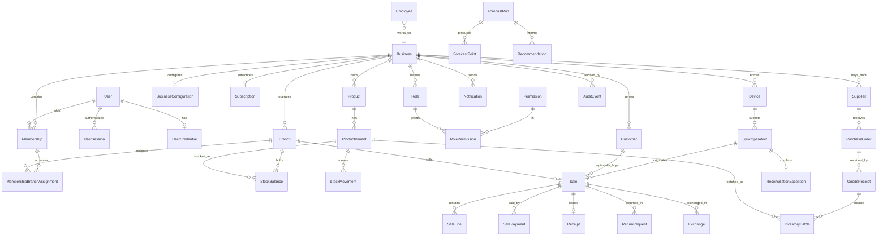
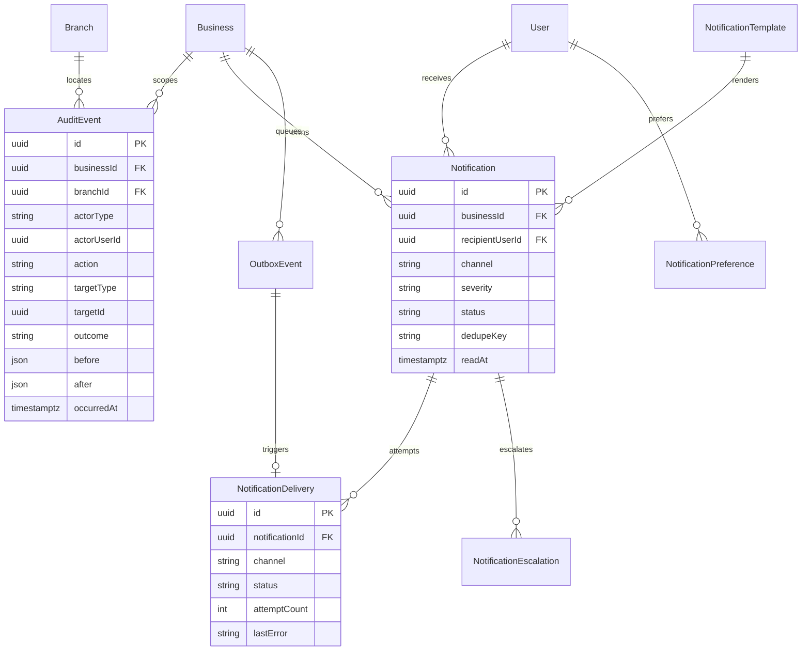
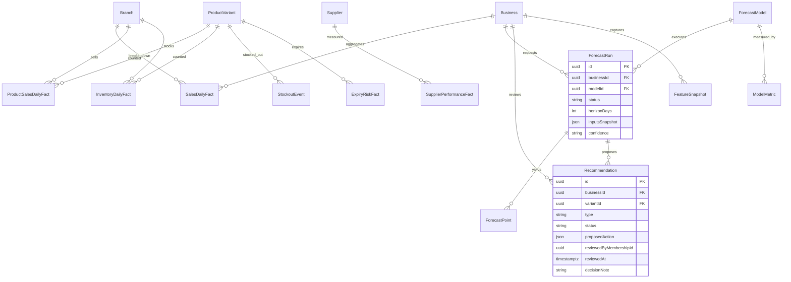

# Conceptual data model

**Status:** Step 3 baseline. One platform, one shared database.
**Schema:** [`apps/api/prisma/schema.prisma`](../../apps/api/prisma/schema.prisma).
**Related:** [Entity catalog](DATABASE_REQUIREMENTS_AND_ENTITY_CATALOG.md),
[ER diagrams](ENTITY_RELATIONSHIP_DIAGRAM.md), [Multi-tenant design](MULTI_TENANT_DATABASE_DESIGN.md).

## 1. Modelling approach

The platform is a shared-schema, multi-tenant modular monolith. A single PostgreSQL 17 database
holds all modules, all four business types and all tenants. Tenant ownership is a column, not a
separate database.

Four conceptual layers:

1. **Platform layer** — users, plans, platform settings, support grants, audit and outbox. Not
   owned by any business.
2. **Tenant layer** — business, branches, memberships, roles and configuration. Every operational
   row hangs from this layer.
3. **Operational layer** — catalog, pricing, inventory, procurement, sales, after-sales,
   synchronization and notifications.
4. **Analytical layer** — fact tables, forecasts, recommendations and model metrics. Derived from
   operational history; never authoritative for stock, price or money.

A business membership is the unit of authorization, not a user account. One account can be an
Owner in one business and a Cashier in another; each membership has its own role and branch
assignments. Super Admin is a platform-level role and has no business membership.

## 2. Core entity groups

| Group           | Representative entities                                              | Nature                           |
| --------------- | -------------------------------------------------------------------- | -------------------------------- |
| Identity        | User, UserCredential, UserSession, tokens                            | Global, security-sensitive       |
| Tenancy         | Business, Branch, Membership, Invitation, Role, Permission           | Tenant root, authorization       |
| Employment      | Employee, EmployeeBranchAssignment, EmploymentStatusHistory          | Organizational, historical       |
| Subscription    | Plan, PlanFeature, PlanPrice, Subscription, PaymentAttempt, webhooks | SaaS, financial                  |
| Configuration   | BusinessConfiguration, settings, AttributeDefinition, Unit           | Tenant-defined definitions       |
| Catalog         | Product, ProductVariant, Brand, Category, Barcode, Media             | Shared across business types     |
| Pricing         | PriceList, ProductPrice, BranchPriceOverride, PriceChangeHistory     | Effective-price history          |
| Inventory       | StockBalance, StockMovement, InventoryBatch, stocktakes, transfers   | Branch stock, append-only ledger |
| Procurement     | Supplier, SupplierPricingAgreement, Rfq, PurchaseOrder, GoodsReceipt | Order-to-receipt history         |
| Sales           | PosTerminal, CashierShift, Sale, SaleLine, SalePayment, Receipt      | Financial, immutable originals   |
| After-sales     | ReturnRequest, ReturnInspection, Refund, Exchange                    | Compensating records             |
| Synchronization | Device, SyncOperation, ReconciliationException, ConflictRecord       | Offline idempotency and D-025    |
| Notifications   | Notification, NotificationDelivery, preferences                      | Delivery side effects            |
| Analytics       | Daily fact tables, StockoutEvent, ExpiryRiskFact                     | Derived read models              |
| Intelligence    | ForecastModel, ForecastRun, ForecastPoint, Recommendation            | Advisory only                    |

## 3. Overall platform ERD

The diagram is a relationship overview. Every entity and its scope is listed in the
[entity catalog](DATABASE_REQUIREMENTS_AND_ENTITY_CATALOG.md); domain diagrams are in
[ER diagrams](ENTITY_RELATIONSHIP_DIAGRAM.md).

## 4. Audit and notification data

Audit events are append-only. A dismissed notification is **not** a resolved business problem:
`Notification.status = DISMISSED` and `NotificationEscalation.status = OPEN` remain distinct.

## 5. AI and analytics data

**Advisory boundary.** Fact tables are derived from operational records and can be rebuilt.
`ForecastRun`, `ForecastPoint` and `Recommendation` are analytical outputs with no foreign key or
command path that can change stock, price, payment or a purchase order. Accepting a recommendation
only writes `status`, reviewer and note; the resulting action is a normal command in the owning
module (D-014, D-033).

## 6. Relationship rules that prevent contradictions

1. **One stock authority.** `StockBalance` is unique per `(branchId, variantId)`; batches and
   movements explain it but never replace it.
2. **No PO stock.** `PurchaseOrder` and `SupplierConfirmation` have no stock side effect. Only
   `GoodsReceipt` + `GoodsReceiptLine` accepted quantity creates stock and a `StockMovement`.
3. **No negative stock.** Available stock is a database-checked invariant, including offline
   origin; an offline shortfall becomes a `ReconciliationException`, not a sale.
4. **Immutable money history.** `Sale`, `SaleLine`, `SalePayment`, `Refund`, `SupplierInvoice`
   and `PaymentAttempt` carry explicit money and status records. Corrections are new records.
5. **Tenant-safe links.** Tenant-scoped parent/child relations use composite keys so a child cannot
   reference a parent from another business.
6. **History over deletion.** Operational rows carry status, archive timestamp or an append-only
   history table; hard deletes are reserved for transient rows such as expired upload sessions.

## 7. Deliberate non-goals

- Four separate product schemas: rejected in favour of one product/variant model with attributes,
  units and batches.
- A general-purpose JSON document store for money, stock or identity: rejected.
- Row-level security at this stage: evaluated and deferred in
  [Multi-tenant design](MULTI_TENANT_DATABASE_DESIGN.md).
- Application workflows, endpoints and background jobs: out of scope for Step 3.
