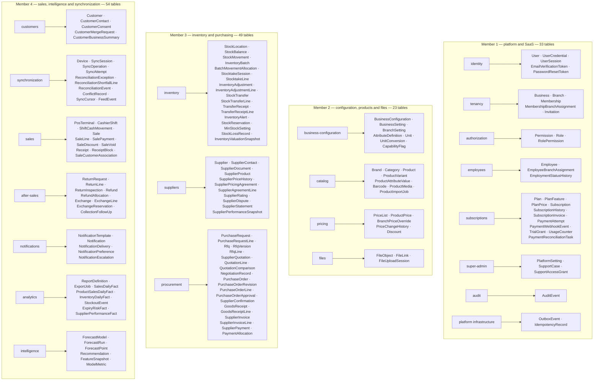

# Database module ownership

**Status:** Step 3 baseline. One schema, 21 modules, four accountable owners.

This document maps every module to the member who owns its tables, states how shared tables are
governed, and defines the review process for a schema change. It is the database companion to
[`../architecture/MODULE_DEPENDENCY_MAP.md`](../architecture/MODULE_DEPENDENCY_MAP.md) §3 and the
approved four-member allocation (D-034).

Ownership means accountability for the table design, constraints, indexes, history rules,
documentation, migration note and test specification for that module's data. It does not mean
exclusive write access to every line of code. Cross-module work goes through the contracts in the
module map.

## 1. Allocation

| Member    | Domain                                  | Modules                                                                                                 | Tables  |
| --------- | --------------------------------------- | ------------------------------------------------------------------------------------------------------- | ------- |
| M1        | Platform and SaaS                       | identity, tenancy, authorization, employees, subscriptions, super-admin, audit, platform infrastructure | 33      |
| M2        | Configuration, products and files       | business-configuration, catalog, pricing, files                                                         | 23      |
| M3        | Inventory and purchasing                | inventory, suppliers, procurement                                                                       | 49      |
| M4        | Sales, intelligence and synchronization | customers, sales, after-sales, analytics, intelligence, synchronization, notifications                  | 54      |
| **Total** |                                         | **21 modules**                                                                                          | **159** |

The allocation is by estimated data complexity, not by equal table count. Inventory, procurement
and sales carry the transaction-heavy tables; identity, configuration and files carry fewer but
more widely referenced tables.

## 2. Module-to-database ownership diagram

The diagram lists every table exactly once. A table that appears to serve several modules still
has one owner; the other modules consume it through a published contract, not by writing to it.

## 3. Shared and cross-cutting tables

| Table group                                               | Schema owner               | Read / write rule                                                                                                       |
| --------------------------------------------------------- | -------------------------- | ----------------------------------------------------------------------------------------------------------------------- |
| `Business`, `Branch`, `Membership`, `Invitation`          | M1 tenancy                 | All modules read through `BusinessDirectory`, `BranchDirectory`, `MembershipService`; only tenancy writes               |
| `Permission`, `Role`, `RolePermission`                    | M1 authorization           | All modules ask `PermissionEvaluator`; only authorization writes                                                        |
| `AuditEvent`                                              | M1 audit                   | Every module writes through `AuditPort` inside its transaction; only audit queries the table                            |
| `OutboxEvent`, `IdempotencyRecord`                        | M1 platform infrastructure | Shared kernel; modules publish events and use idempotency, never query the outbox directly                              |
| `Plan`, `Subscription`, `PaymentAttempt`, webhook records | M1 subscriptions           | Gates call `EntitlementService`; only subscriptions writes                                                              |
| `Product`, `ProductVariant`, `Unit`, `Category`, `Brand`  | M2 catalog/configuration   | Sales, inventory and sync use `ProductReader`; only catalog writes                                                      |
| `PriceList`, `ProductPrice`, `Discount`                   | M2 pricing                 | Sales and sync use `PriceResolver`; only pricing writes                                                                 |
| `FileObject`, `FileLink`                                  | M2 files                   | Other modules store metadata links and call `FileService`; bytes are not business data                                  |
| `StockBalance`, `StockMovement`, `InventoryBatch`         | M3 inventory               | Sales, procurement receiving, after-sales and sync call `InventoryCommandService`; no module writes the ledger directly |
| `Supplier`                                                | M3 suppliers               | Procurement reads through `SupplierDirectory`; only suppliers writes                                                    |
| `Customer`                                                | M4 customers               | Sales and after-sales use `CustomerDirectory`; event-fed projections update summaries                                   |
| `Sale`, `SalePayment`, `Receipt`                          | M4 sales                   | After-sales compensates through `RefundExecutionPort`; sync calls `OfflineSaleIngestService`; no direct writes          |
| `Device`, `SyncOperation`, `ReconciliationException`      | M4 synchronization         | Desktop submits through sync contracts; sales and inventory never bypass them                                           |
| `Notification*`                                           | M4 notifications           | Every module publishes through `NotificationPort`; only notifications writes delivery state                             |
| `ForecastModel`, `ForecastRun`, `Recommendation`          | M4 intelligence            | Advisory only; no module treats a row as an executed action                                                             |

The shared tables are the ones where a careless change has platform-wide impact. They are also the
tables that require multi-owner review in Section 5.

## 4. Table lists by owner

### 4.1 Member 1 — 33 tables

**identity (5):** `User`, `UserCredential`, `UserSession`, `EmailVerificationToken`,
`PasswordResetToken`.

**tenancy (5):** `Business`, `Branch`, `Membership`, `MembershipBranchAssignment`, `Invitation`.

**authorization (3):** `Permission`, `Role`, `RolePermission`.

**employees (3):** `Employee`, `EmployeeBranchAssignment`, `EmploymentStatusHistory`.

**subscriptions (11):** `Plan`, `PlanFeature`, `PlanPrice`, `Subscription`, `SubscriptionHistory`,
`SubscriptionInvoice`, `PaymentAttempt`, `PaymentWebhookEvent`, `TrialGrant`, `UsageCounter`,
`PaymentReconciliationTask`.

**super-admin (3):** `PlatformSetting`, `SupportCase`, `SupportAccessGrant`.

**audit (1):** `AuditEvent`.

**platform infrastructure (2):** `OutboxEvent`, `IdempotencyRecord`.

### 4.2 Member 2 — 23 tables

**business-configuration (7):** `BusinessConfiguration`, `BusinessSetting`, `BranchSetting`,
`AttributeDefinition`, `Unit`, `UnitConversion`, `CapabilityFlag`.

**catalog (8):** `Brand`, `Category`, `Product`, `ProductVariant`, `ProductAttributeValue`,
`Barcode`, `ProductMedia`, `ProductImportJob`.

**pricing (5):** `PriceList`, `ProductPrice`, `BranchPriceOverride`, `PriceChangeHistory`,
`Discount`.

**files (3):** `FileObject`, `FileLink`, `FileUploadSession`.

### 4.3 Member 3 — 49 tables

**inventory (18):** `StockLocation`, `StockBalance`, `StockMovement`, `InventoryBatch`,
`BatchMovementAllocation`, `StocktakeSession`, `StocktakeLine`, `InventoryAdjustment`,
`InventoryAdjustmentLine`, `StockTransfer`, `StockTransferLine`, `TransferReceipt`,
`TransferReceiptLine`, `InventoryAlert`, `StockReservation`, `MinStockSetting`, `StockLossRecord`,
`InventoryValuationSnapshot`.

**suppliers (11):** `Supplier`, `SupplierContact`, `SupplierDocument`, `SupplierProduct`,
`SupplierPriceHistory`, `SupplierPricingAgreement`, `SupplierAgreementLine`, `SupplierRating`,
`SupplierDispute`, `SupplierStatement`, `SupplierPerformanceSnapshot`.

**procurement (20):** `PurchaseRequest`, `PurchaseRequestLine`, `Rfq`, `RfqVersion`, `RfqLine`,
`SupplierQuotation`, `QuotationLine`, `QuotationComparison`, `NegotiationRecord`, `PurchaseOrder`,
`PurchaseOrderRevision`, `PurchaseOrderLine`, `PurchaseOrderApproval`, `SupplierConfirmation`,
`GoodsReceipt`, `GoodsReceiptLine`, `SupplierInvoice`, `SupplierInvoiceLine`, `SupplierPayment`,
`PaymentAllocation`.

### 4.4 Member 4 — 54 tables

**customers (5):** `Customer`, `CustomerContact`, `CustomerConsent`, `CustomerMergeRequest`,
`CustomerBusinessSummary`.

**synchronization (10):** `Device`, `SyncSession`, `SyncOperation`, `SyncAttempt`,
`ReconciliationException`, `ReconciliationShortfallLine`, `ReconciliationEvent`, `ConflictRecord`,
`SyncCursor`, `FeedEvent`.

**sales (11):** `PosTerminal`, `CashierShift`, `ShiftCashMovement`, `Sale`, `SaleLine`,
`SalePayment`, `SaleDiscount`, `SaleVoid`, `Receipt`, `ReceiptBlock`, `SaleCustomerAssociation`.

**after-sales (9):** `ReturnRequest`, `ReturnLine`, `ReturnInspection`, `Refund`,
`RefundAllocation`, `Exchange`, `ExchangeLine`, `ExchangeReservation`, `CollectionFollowUp`.

**notifications (5):** `NotificationTemplate`, `Notification`, `NotificationDelivery`,
`NotificationPreference`, `NotificationEscalation`.

**analytics (8):** `ReportDefinition`, `ExportJob`, `SalesDailyFact`, `ProductSalesDailyFact`,
`InventoryDailyFact`, `StockoutEvent`, `ExpiryRiskFact`, `SupplierPerformanceFact`.

**intelligence (6):** `ForecastModel`, `ForecastRun`, `ForecastPoint`, `Recommendation`,
`FeatureSnapshot`, `ModelMetric`.

## 5. Change review for hotspots

The following tables are referenced across module boundaries. A change to them requires review
from the owning member **and** every listed consumer.

| Hotspot                             | Owner | Required reviewers                |
| ----------------------------------- | ----- | --------------------------------- |
| `Business`, `Branch`                | M1    | M1, M2, M3, M4                    |
| `Membership`, `Role`, `Permission`  | M1    | M1, M3, M4                        |
| `Product`, `ProductVariant`, `Unit` | M2    | M2, M3, M4                        |
| `PriceList`, `ProductPrice`         | M2    | M2, M4                            |
| `StockBalance`, `StockMovement`     | M3    | M3, M4                            |
| `Supplier`                          | M3    | M3                                |
| `Sale`, `SalePayment`               | M4    | M4, M3                            |
| `Subscription`                      | M1    | M1, M3, M4                        |
| `FileObject`                        | M2    | M2 and every module linking files |

A review checks: tenant columns, composite keys, unique rule, index impact, deletion behaviour,
history preservation, idempotency and the migration note. Approval is not a style review; the
reviewer is confirming that their module's queries and invariants still hold.

## 6. Coordination rules for four developers

1. **One canonical schema.** `apps/api/prisma/schema.prisma` is the only schema file. No member
   creates a private schema, migration folder or database as a workaround.
2. **One migration history.** Migrations are merged centrally. A member who works on a branch still
   rebases and regenerates before merge; two migration folders with the same timestamp are never
   hand-merged.
3. **Owning member authors.** A change to a module's tables is authored by that module's owner.
   Another member may propose a patch, but the owner commits and reviews it.
4. **Consumers review contracts.** Adding or changing a column that another module reads requires
   that module owner's approval and a contract update if the public shape changes.
5. **No duplicate entities.** A member who needs data that already exists must use the owning
   module's table and contract. Creating a parallel `CustomerV2`, `StockCache` or `SalesSummary`
   table is a boundary violation unless it is an approved read model with a named owner and
   refresh rule.
6. **No cross-module model access.** Only the owning module's repository queries its tables. This
   applies even inside one monolith and even when the Prisma client makes it technically possible.
7. **Documentation ships with the change.** Entity catalog, ER diagram, this ownership table, index
   doc and integrity doc are updated in the same pull request.
8. **Workstations and credentials.** Computer 1 hosts M1 and M2; computer 2 hosts M3 and M4. Each
   member uses their own GitHub credentials and makes genuine, attributable commits. No shared
   account and no committing on another member's behalf.
9. **Schema freeze windows.** During a migration that touches a hotspot, other members do not merge
   independent schema changes until the migration is applied and the drift check is green.
10. **Escalation.** A disagreement about a shared table is resolved against the approved
    architecture documents, then by an ADR. It is not resolved by one member merging first.

## 7. Ownership checklist for a new table

- [ ] The table is in the owning module's section and has exactly one owner.
- [ ] Purpose, tenant scope, branch scope and lifecycle are stated in the entity catalog.
- [ ] Financial/sensitive classification and audit requirement are stated.
- [ ] `businessId` and, where applicable, `branchId` are present.
- [ ] Composite foreign keys are used for tenant parents where practical; any residual id-only
      reference is added to the tenancy document's exception table.
- [ ] `@@unique([businessId, id])` and the natural-key unique are present.
- [ ] Indexes match a documented query path and do not duplicate a composite unique prefix.
- [ ] Deletion and archival behaviour are explicit.
- [ ] Migration note and companion SQL (CHECK, partial index) are included.
- [ ] Consumer modules are notified if the table is read outside its owner.
- [ ] Validation and test specification are updated.
