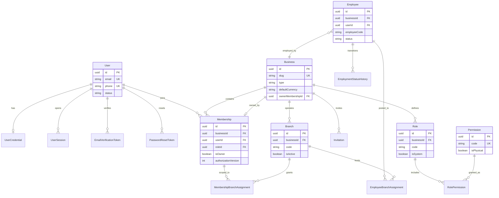
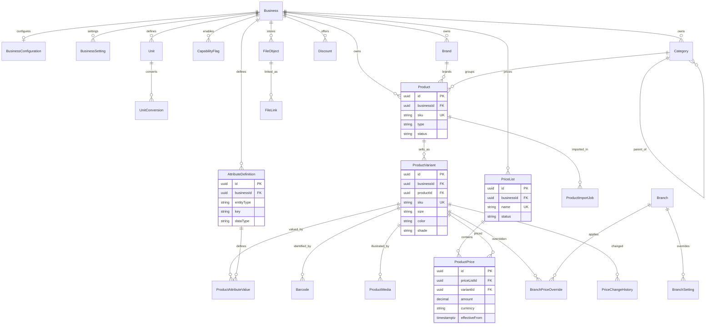
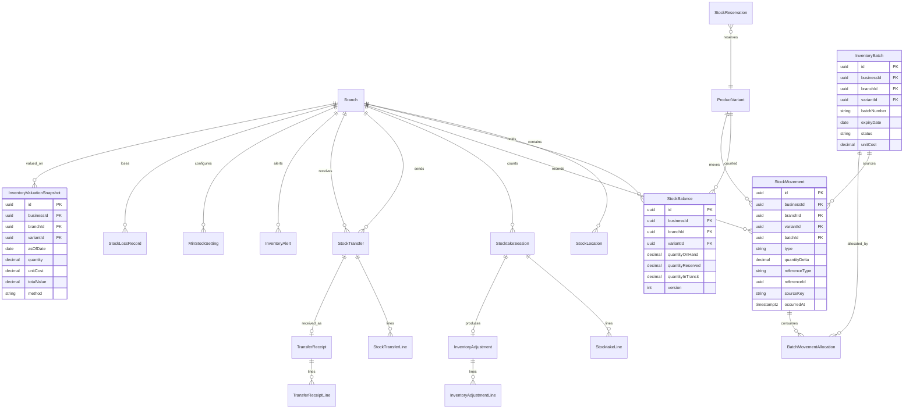
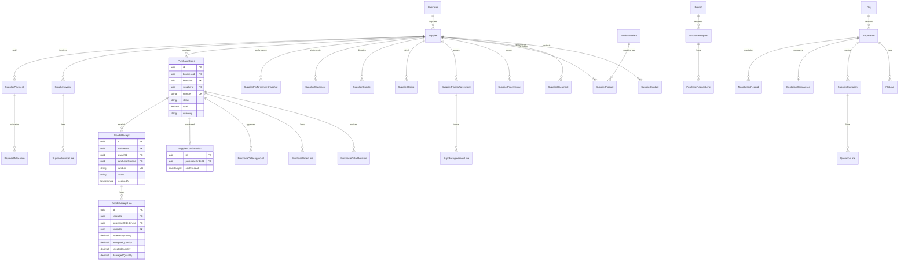
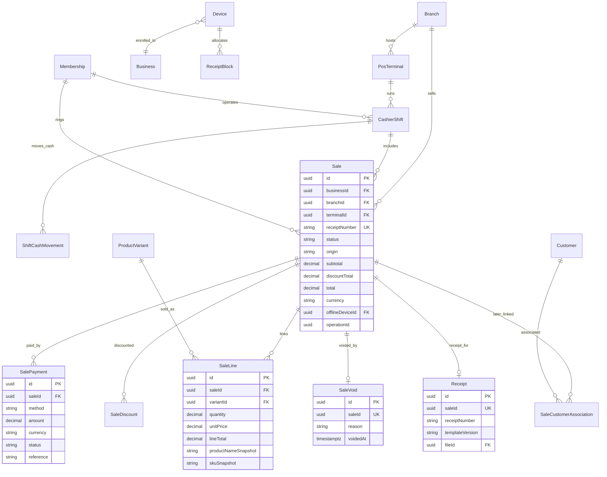
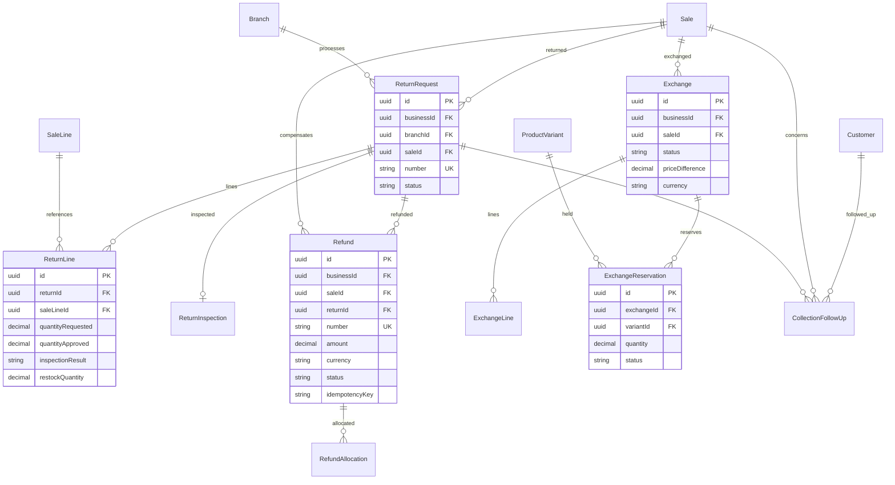

# Entity relationship diagrams

**Status:** Step 3 baseline. Diagrams are derived from the canonical
[Prisma schema](../../apps/api/prisma/schema.prisma); when they disagree, the schema and
migrations win and the diagram is a defect.

The overall platform overview is in [Conceptual data model](CONCEPTUAL_DATA_MODEL.md). This page
holds the domain ERDs: identity and tenancy, configuration and catalog, inventory and batches,
suppliers and procurement, POS and sales, and returns and exchanges.

## 1. Identity and tenancy

Rules:

- `Membership` is unique per `(businessId, userId)`; a user can hold different roles in different
  businesses.
- `Business.ownerMembershipId` is unique and nullable only during creation; a business has one
  official Owner.
- `Permission.isPhysical` distinguishes physical operational permissions from digital ones. The
  seed grants physical stock operations to Owner/Manager roles, never to Business Admin.
- Super Admin has no `Membership` row; platform authority lives in the same `User` identity with a
  platform-level authorization scope.

## 2. Business configuration and catalog

Industry support:

- **Grocery:** `Unit`, `UnitConversion`, `InventoryBatch.expiryDate`, `MinStockSetting`,
  `StockLossRecord`.
- **Fashion:** variant `size` and `color`; variant-level stock and sales.
- **Pharmacy:** variant `shade` unused; batch number, expiry and quarantine status are mandatory
  where the pharmacy configuration enables them.
- **Cosmetics:** variant `shade`, `color`, `size`; batch/expiry where applicable.

One product model serves all four. No per-industry product table exists.

## 3. Inventory, batches and valuation

`StockBalance` is the only authoritative quantity. `StockMovement` is append-only and signed;
`quantityDelta` may be negative, while the resulting **available** balance may not. In-transit is
reported separately and is not available for sale. `InventoryValuationSnapshot` records WAC
history; it never rewrites past costs.

## 4. Suppliers and procurement

The critical procurement rule is structural: a confirmation or approval row has no relation to
`StockMovement`. Only an accepted `GoodsReceiptLine` can produce a stock movement and batch.
`GoodsReceipt.branchId` is bound to `PurchaseOrder.branchId` by a composite foreign key
`(businessId, purchaseOrderId, branchId)` → `PurchaseOrder(businessId, id, branchId)` (approved
U-1 rule): every receipt, partial or full, must use the PO's current destination branch. The
relation declares `onUpdate: NoAction`, so a PO destination change after the first receipt is
rejected by the database and existing `GoodsReceipt.branchId` values are never cascaded or
rewritten.

## 5. POS and sales

Sales keep price, name and cost snapshots, so later catalog or price changes cannot rewrite
history. `SaleVoid`, `ReturnRequest`, `Refund` and `Exchange` are separate records.

## 6. Returns, refunds and exchanges

Refunds cannot exceed the paid amount; that is an application rule backed by stored payment and
refund rows. Restocking on an approved return creates a normal inventory movement. The original
sale is never mutated.

## 7. Rendering and maintenance

All diagrams use Mermaid `erDiagram` syntax and are validated with Mermaid 11. When an entity or
relation changes, update the schema, migration, this page and the
[entity catalog](DATABASE_REQUIREMENTS_AND_ENTITY_CATALOG.md) in the same pull request.
