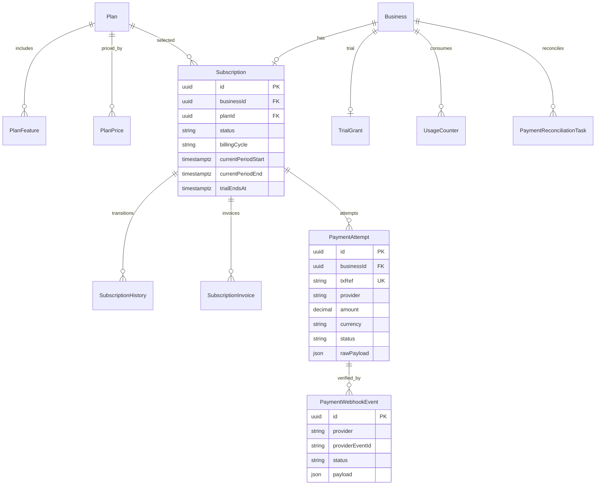

# Logical database design

**Status:** Step 3 baseline. The canonical logical schema is
[`apps/api/prisma/schema.prisma`](../../apps/api/prisma/schema.prisma); this document explains the
conventions and the decisions that are not obvious from reading the models.

## 1. Platform and conventions

| Concern            | Decision                                                                                      |
| ------------------ | --------------------------------------------------------------------------------------------- |
| Database           | PostgreSQL 17, one database, one `public` schema                                              |
| ORM                | Prisma 6.19.3, schema at `apps/api/prisma/schema.prisma`                                      |
| Primary keys       | UUID v7 (`@default(uuid(7)) @db.Uuid`) — time-ordered, non-guessable                          |
| Tenant key         | `businessId String @db.Uuid`, required on every tenant-owned row                              |
| Branch key         | `branchId String @db.Uuid`, required on branch-scoped rows                                    |
| Money              | `Decimal(18, 2)` plus explicit `currency` (`char(3)`, default `ETB`)                          |
| Quantities         | `Decimal(18, 3)`                                                                              |
| Unit costs / rates | `Decimal(18, 4)`                                                                              |
| Timestamps         | `DateTime @db.Timestamptz(6)`; business dates use `@db.Date`                                  |
| Naming             | Prisma models PascalCase, database tables mapped by Prisma, fields camelCase                  |
| Strings            | Bounded `@db.VarChar(n)` for identifiers and labels; `Text` only for narrative                |
| JSON               | Only preserved external payloads, flexible parameters, forecast inputs and audit before/after |
| Deletion           | `Restrict` for history; `Cascade` only for owned child lines and transient sessions           |
| History            | `archivedAt` for master data; status fields and append-only event tables for operations       |

No table uses `Float` or `Double` for money. Currency is stored per monetary record even where it
currently always equals the business default, so a future multi-currency change is additive rather
than destructive.

## 2. Relationship and key rules

1. Every tenant-scoped parent that can be referenced with a tenant key also has
   `@@unique([businessId, id])`. Child relations use
   `@relation(fields: [businessId, parentId], references: [businessId, id])`.
2. Business-owned roots have a direct `businessId` FK. Branch-scoped rows have both a direct
   business FK where useful and a composite branch FK.
3. Natural business keys are unique inside a tenant, for example
   `Product @@unique([businessId, sku])`, `Sale @@unique([businessId, receiptNumber])`,
   `Supplier @@unique([businessId, code])` and `Branch @@unique([businessId, code])`.
4. Idempotency keys are unique at the boundary where they are accepted:
   - API: `IdempotencyRecord @@unique([businessId, scope, key])` and `Refund @@unique([businessId, idempotencyKey])`
   - sync: `SyncOperation @@unique([businessId, deviceId, operationId])` and
     `Sale @@unique([businessId, offlineDeviceId, operationId])`
   - provider webhook: `PaymentWebhookEvent @@unique([provider, providerEventId])`
5. One-to-one relations have a unique referencing field on the defining side, for example
   `Receipt.saleId @unique` plus `@@unique([businessId, saleId])`.
6. A line item belongs to exactly one header and cannot exist without it (`Cascade` on the owned
   line relation). A line never cascades from a tenant or a product (`Restrict`).

## 3. Domain summary

### 3.1 Identity, tenancy, authorization, employees

- `User` is global; `email` and optional `phone` are unique across the platform.
- `UserCredential` stores only a salted verifier (`passwordHash`, `algorithm`, `pepperVersion`).
- `UserSession` groups refresh tokens by `familyId`; reuse detection is a later service concern,
  but the family and revocation columns exist.
- `Business` owns `Branch`, `Membership`, `Role`, `Invitation` and all operational roots.
- `Membership` is unique per `(businessId, userId)` and carries `authorizationVersion`, allowing
  cached permissions to be invalidated without deleting history.
- `Permission.isPhysical` is the structural distinction between digital administration and
  physical operational authority. The seed assigns physical permissions to Owner and Manager only.
- `Employee` is deliberately separate from `User`: an employee record can exist before activation
  or after an account is deactivated. `EmploymentStatusHistory` preserves status changes.

### 3.2 Subscription and payment

`PaymentAttempt.status` distinguishes pending, success, failure and cancellation.
`SubscriptionInvoice.status` distinguishes issuance from payment. No payment path grants an
entitlement from a redirect alone; the webhook event and attempt are separate stored rows.

### 3.3 Catalog, pricing, files

- `Product` is business-wide; `ProductVariant` is the saleable unit. SKU is unique per business at
  both levels; barcodes are optional and unique per business when present.
- `Category.parentId` is a self-relation; the service layer must reject cycles. The schema permits a
  tree, not a graph.
- `AttributeDefinition` supplies configurable fields; `ProductAttributeValue` references either a
  product or a variant. Storage of attribute values is relational, not a single JSON blob.
- `PriceList` has a status and effective window; `ProductPrice` is unique per
  `(priceListId, variantId, effectiveFrom)`. `BranchPriceOverride` and `PriceChangeHistory` preserve
  the effective change trail.
- `FileObject` stores metadata and checksum; bytes live in object storage. `FileLink` attaches a
  file to any entity using `(entityType, entityId, role)`.

### 3.4 Inventory

- `StockBalance` is unique per `(branchId, variantId)`; it is the single source of on-hand,
  reserved and in-transit quantities.
- `StockMovement` is append-only, signed, and has a business-unique `sourceKey` so a retried sync or
  duplicate receiving cannot post the same movement twice.
- `InventoryBatch` carries batch number, expiry, quarantine status and unit cost per branch and
  variant. `BatchMovementAllocation` explains which batch a movement consumed.
- `StocktakeSession` + `StocktakeLine` capture physical counts and variances; an approved
  `InventoryAdjustment` + lines is a separate, auditable correction.
- `StockTransfer` + lines + `TransferReceipt` + lines model dispatch, in-transit and destination
  receiving. In-transit is not available stock.
- `StockReservation` holds quantity for a sale or exchange until consumed, released or expired.
- `InventoryValuationSnapshot` records WAC valuation per branch, variant and date.

### 3.5 Suppliers and procurement

- `Supplier` is business-scoped with unique code. Contacts, documents, product associations,
  price history, agreements and performance are separate tables.
- `SupplierPricingAgreement` + `SupplierAgreementLine` carry versioned terms; changing terms means a
  new version, not an overwrite.
- Procurement follows `PurchaseRequest` → `Rfq`/`RfqVersion` → `SupplierQuotation` →
  `QuotationComparison` → `NegotiationRecord` → `PurchaseOrder` → `PurchaseOrderRevision` →
  `PurchaseOrderApproval` → `SupplierConfirmation` → `GoodsReceipt`.
- `SupplierInvoice` and `SupplierPayment` are independent financial records; `PaymentAllocation`
  links a payment to one or more invoices. No stock change occurs before an accepted receipt.
- `SupplierInvoiceLine` may link to a `PurchaseOrderLine` through a composite foreign key that
  binds business, purchase order and variant, plus a second binding foreign key that ties the
  line's `purchaseOrderId` to the invoice header's purchase order; the remaining rule — every
  line of a PO-backed invoice must carry that PO — is enforced inside the invoice transaction.
- `GoodsReceipt.branchId` is bound to `PurchaseOrder.branchId` by the composite foreign key
  `(businessId, purchaseOrderId, branchId)` → `PurchaseOrder(businessId, id, branchId)` (U-1,
  same-branch-only, `onUpdate: NoAction`). Enforcement is split into two layers:
  - **Database-enforced:** the composite FK guarantees `GoodsReceipt.branchId =
PurchaseOrder.branchId` at insert time, and `onUpdate: NoAction` makes PostgreSQL reject any
    PO destination-branch update while a receipt references the old key — historical
    `GoodsReceipt.branchId` values are never cascaded or rewritten.
  - **Application-service-enforced (not yet implemented — Step 4):** before the first receipt
    exists, the FK alone does not enforce the approval workflow. The receiving/PO service must
    require an authorized Owner or Manager to initiate or approve the destination change (a
    Business Admin may prepare but never approves a physical receiving destination change), record
    it as a `PurchaseOrderRevision` preserving previous branch, new branch, actor, timestamp and
    reason, apply the `PurchaseOrder.branchId` update transactionally with `version`/`currentRevision`
    bookkeeping, and serialize receipt creation against destination revision with row locking
    (`SELECT ... FOR UPDATE` on the PO) so no concurrent pair can produce a mismatched accepted
    receipt. Once any receipt exists, the destination cannot change — the database enforces this
    regardless of the service.

### 3.6 Sales, returns, exchanges

- `Sale` stores immutable totals, receipt number, origin, terminal/shift, optional customer and the
  offline `(offlineDeviceId, operationId)` identity.
- `SaleLine` snapshots product name, SKU, unit price and unit cost so history survives catalog and
  price edits. `SalePayment` supports split payment. `SaleDiscount` records the applied rule.
- `SaleVoid` is a separate record; `Sale.status` also moves to `VOIDED`. The original sale remains.
- `ReturnRequest` → `ReturnLine` → `ReturnInspection` → `Refund`/`RefundAllocation` is a separate
  flow. `ReturnLine` references the original `SaleLine`.
- `Exchange` and `ExchangeLine` are separate from refunds; `ExchangeReservation` holds stock while
  an exchange is open. `CollectionFollowUp` tracks later customer contact.

### 3.7 Synchronization and reconciliation

See [Offline and reconciliation data model](OFFLINE_AND_RECONCILIATION_DATA_MODEL.md). Key tables:
`Device`, `SyncSession`, `SyncOperation`, `SyncAttempt`, `ReconciliationException`,
`ReconciliationShortfallLine`, `ReconciliationEvent`, `ConflictRecord`, `SyncCursor`, `FeedEvent`.

### 3.8 Notifications, analytics, intelligence

- Notification templates are versioned; notifications store rendered text and recipient state.
  Delivery attempts are per channel with bounded retry metadata.
- Fact tables are rebuilt from operational history and keyed by business date and branch/variant.
- Forecast runs store the input snapshot and model version. Recommendations store a proposal and,
  separately, the human review decision. No analytical row has a relation to a stock movement or a
  purchase order.

## 4. Constraints added in migration SQL

Prisma cannot express every PostgreSQL constraint. The initial migration adds:

| Constraint                                                                   | Purpose                             |
| ---------------------------------------------------------------------------- | ----------------------------------- |
| `CHECK ("quantityOnHand" >= 0)` on `StockBalance`                            | No negative on-hand quantity        |
| `CHECK ("quantityReserved" >= 0 AND "quantityReserved" <= "quantityOnHand")` | Reservations never exceed stock     |
| `CHECK ("quantityInTransit" >= 0)`                                           | In-transit is a non-negative count  |
| `CHECK ("quantityDelta" <> 0)` on `StockMovement`                            | A movement must change something    |
| `CHECK ("amount" >= 0)` on monetary rows where sign is implied by type       | Prevent accidental negative totals  |
| Partial unique index on `CashierShift` where `"status" = 'OPEN'`             | One open shift per terminal         |
| Partial unique index on `Membership` where `"isOwner" = true`                | One Owner per business              |
| `CHECK ("currency" ~ '^[A-Z]{3}$')`                                          | Currency is ISO-4217 shaped         |
| `CHECK (jsonb_typeof("originalPayload") = 'object')`                         | Preserved sync payload is an object |

The exact SQL is maintained in the initial migration and documented in
[Migration and seed strategy](DATABASE_MIGRATION_AND_SEED_STRATEGY.md). Application code must not
rely on Prisma for these invariants.

## 5. Deletion and archival behaviour

| Data                                           | Behaviour                                                                |
| ---------------------------------------------- | ------------------------------------------------------------------------ |
| User                                           | Deactivate (`DEACTIVATED`), never delete; audit and sales history remain |
| Business / Branch                              | Archive (`archivedAt`, `isActive = false`), never delete                 |
| Membership / Employee                          | Deactivate; history remains                                              |
| Product / Variant / Brand / Category           | Archive; historical sale and movement rows remain                        |
| Supplier                                       | Archive/`INACTIVE`; POs, invoices and payments remain                    |
| Sale / Receipt / Refund / Exchange             | Never delete; void or compensate                                         |
| StockMovement / ValuationSnapshot / AuditEvent | Append-only; no update or delete path                                    |
| Notification                                   | Archive/dismiss; no hard delete of delivered records                     |
| FileObject                                     | Archive metadata; bytes retention follows business policy                |
| Transient sessions (upload, sync, auth)        | May expire; never referenced as financial history                        |

Cascade is limited to owned child rows: sale lines/payments/discounts, purchase order lines,
receipt lines, return lines, agreement lines and similar. It never cascades from a tenant, a
product, a customer, a supplier or a user into financial history.

## 6. Cardinality highlights

| Relationship                            | Cardinality           | Enforcement                                       |
| --------------------------------------- | --------------------- | ------------------------------------------------- |
| Business → Branch                       | 1:N                   | `Branch.businessId` required                      |
| User ↔ Business                         | M:N via Membership    | `@@unique([businessId, userId])`                  |
| Business → Owner membership             | 1:1                   | `Business.ownerMembershipId @unique`              |
| Business → Subscription                 | 1:1 current           | `Subscription.businessId @unique`                 |
| Product → Variant                       | 1:N                   | `ProductVariant.productId` required               |
| Branch + Variant → StockBalance         | 1:1                   | `@@unique([branchId, variantId])`                 |
| PurchaseOrder → GoodsReceipt            | 1:N (partial receipt) | `GoodsReceipt.purchaseOrderId`                    |
| Sale → Receipt                          | 1:1                   | `Receipt.saleId @unique`                          |
| Sale → SaleVoid                         | 0..1                  | `SaleVoid.saleId @unique`                         |
| SyncOperation → ReconciliationException | 0..1                  | `ReconciliationException.syncOperationId @unique` |
| ForecastRun → ForecastPoint             | 1:N                   | `ForecastPoint.forecastRunId`                     |

## 7. Step 3 audit decision register (C-5)

Decisions recorded for audit findings F-007, F-009, F-010, F-011 and F-013. Enforcement layers:
DB = constraint in `schema.prisma` or companion migration SQL; SVC = service-layer rule;
DOC = documented accepted design.

| Finding | Issue                                                                                                       | Decision                                                                                                                                                                                                                                                                                                                                                                                                                                                                                                                                                                                                                                                                                       | Enforcement                                                                                                                                                                                                                                                                                                                                                        | Status                                    |
| ------- | ----------------------------------------------------------------------------------------------------------- | ---------------------------------------------------------------------------------------------------------------------------------------------------------------------------------------------------------------------------------------------------------------------------------------------------------------------------------------------------------------------------------------------------------------------------------------------------------------------------------------------------------------------------------------------------------------------------------------------------------------------------------------------------------------------------------------------- | ------------------------------------------------------------------------------------------------------------------------------------------------------------------------------------------------------------------------------------------------------------------------------------------------------------------------------------------------------------------ | ----------------------------------------- |
| F-007   | Intra-tenant branch consistency                                                                             | A POS `Sale` cannot reference a `CashierShift` or `PosTerminal` of another branch; a `CashierShift` cannot reference a terminal of another branch. `StockTransfer` cannot have identical source and destination branches. `ReturnRequest`, `Refund` and `Exchange` keep an independent `branchId`: cross-branch returns/exchanges are legitimate, and the branch records the _processing_ location while stock effects post to that branch per the returns workflow. `GoodsReceipt.branchId` must equal `PurchaseOrder.branchId` (approved U-1, Option A — same branch only); a destination change requires an authorized, audited `PurchaseOrderRevision` completed before the first receipt. | DB: composite FKs `(businessId, branchId, id)` on `Sale.terminal`, `Sale.shift`, `CashierShift.terminal`; CHECK `stock_transfer_distinct_branches`; `GoodsReceipt.purchaseOrder` composite FK `(businessId, purchaseOrderId, branchId)` → `PurchaseOrder(businessId, id, branchId)`. SVC: returns/exchange branch policy; PO revision + receipt transaction rules. | RESOLVED                                  |
| F-009   | `Membership`/`Invitation` dual role relations (`role` + `scopedRole`, `roleBusinessId` not bound to tenant) | `role` (id-only) is the storage relation; `scopedRole` is the tenant-binding relation. A business-scoped role must have `roleBusinessId = membership.businessId` (or `invitation.businessId`); a global system role (`Role.businessId IS NULL`) uses `role` with `scopedRole` empty. Database binding to `businessId` is impossible without breaking global roles, so the authorization service must resolve the effective role as: if `scopedRole` is set, use it after verifying `roleBusinessId = :tenant`; else require `role.isSystem`/global. Any other combination is rejected.                                                                                                         | SVC: role resolution + invitation acceptance validation; TEN-16 test. DOC: §3.1 of the tenancy design.                                                                                                                                                                                                                                                             | RESOLVED — service-enforced contract      |
| F-010   | `MembershipBranchAssignment @@unique([membershipId, branchId])` blocks reassignment after revoke            | Active-assignment uniqueness only. The unconditional Prisma unique was removed; companion partial unique `membership_branch_assignment_active_unique ... WHERE "revokedAt" IS NULL` allows a new assignment after revocation while forbidding two simultaneous active rows. Revoked rows are preserved history. `EmployeeBranchAssignment` uses period keys `(employeeId, branchId, startAt)` and is unchanged; overlapping active employee assignments remain a service-validated concern.                                                                                                                                                                                                    | DB: partial unique index (companion SQL). SVC: revoke-then-reassign flow, overlap checks for employee assignments.                                                                                                                                                                                                                                                 | RESOLVED                                  |
| F-011   | ~44 `*UserId`/`actorUserId` scalar fields without `User` FK                                                 | Accepted design. Actor columns are UUID snapshots, not foreign keys: actors may be platform staff, system processes, support agents or deactivated users, and audit/financial history must survive user lifecycle changes. Convention documented in `PRISMA_SCHEMA_GUIDE.md` §7. Relational FKs are kept only where the actor is a required operational participant (`Sale.cashierMembershipId`, `Membership.userId`, `Device.enrolledUserId`).                                                                                                                                                                                                                                                | DOC: actor-reference convention. SVC: resolve snapshots against `User.id` where display requires it.                                                                                                                                                                                                                                                               | ACCEPTED — intentional design             |
| F-013   | `Business.type` vs `BusinessConfiguration.businessType` duplication                                         | `Business.type` is the single authoritative classification. `BusinessConfiguration.businessType` is a synchronized convenience copy written in the same transaction at provisioning; any later divergence is a defect. The field is retained because API/frontend architecture documents already reference the configuration shape; removing it is deferred to a reviewed contract change.                                                                                                                                                                                                                                                                                                     | SVC: write both atomically; reject divergent updates; consistency test.                                                                                                                                                                                                                                                                                            | RESOLVED — single source of truth defined |

U-1 (goods-receipt branch policy) was decided as Option A — same branch only — and is
implemented in the schema; see `STEP_3_U1_IMPLEMENTATION_AND_DOCUMENTATION_COMPLETION_REPORT.md`.
No C-5 finding is left open.
