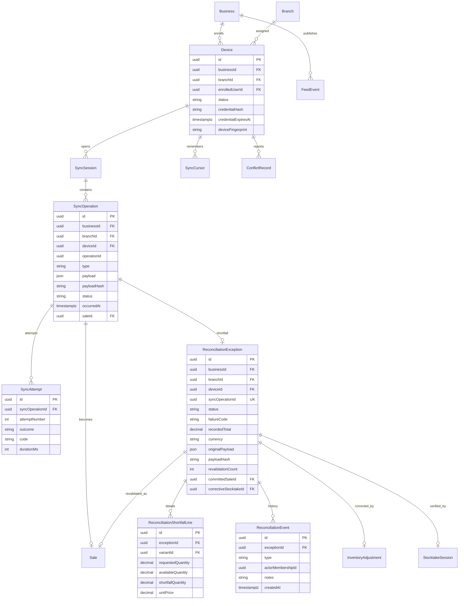
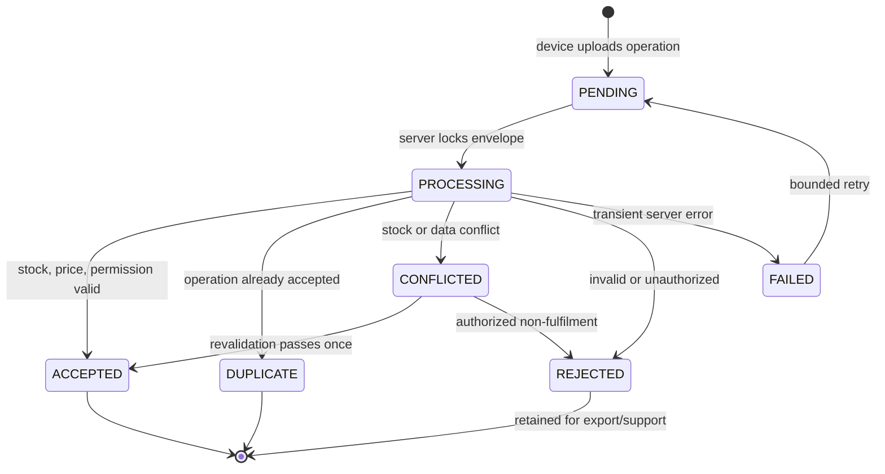

# Offline and reconciliation data model

**Status:** Step 3 baseline for approved decision **D-025 (strict stock protection)**.
**Related:** [Offline synchronization architecture](../architecture/OFFLINE_SYNCHRONIZATION_ARCHITECTURE.md),
[API architecture §12.11](../api/API_ARCHITECTURE.md), [Desktop architecture](../desktop/DESKTOP_ARCHITECTURE.md).

This document defines storage. It does not implement a sync endpoint, worker or device client.

## 1. Invariants

1. An offline transaction is a **locally recorded transaction awaiting authoritative server
   validation**. Recording it is not acceptance.
2. No accepted stock movement may result in negative available inventory.
3. On a shortfall: no sale is created, no stock movement is written, the original payload is
   preserved in a server-side reconciliation exception, and nothing is silently edited or deleted.
4. Idempotency is enforced at two levels: `(businessId, deviceId, operationId)` for the envelope
   and `Sale(businessId, offlineDeviceId, operationId)` for the resulting sale.
5. Resolution can apply a separate, audited stock correction and then a **single** revalidation.
   That revalidation either commits the sale and its movements or leaves the exception unresolved.
6. The original transaction is never overwritten. Resolution adds records; it does not mutate the
   stored payload or the historical totals.
7. Manager and Owner may resolve stock reconciliation. **Business Admin is view-only**.
8. A device may keep local data after revocation; it cannot renew credentials or push operations.

## 2. Relational model

## 3. Operation lifecycle

Status is stored on `SyncOperation.status` (`PENDING`, `PROCESSING`, `ACCEPTED`, `DUPLICATE`,
`CONFLICTED`, `REJECTED`, `FAILED`). Every attempt appends `SyncAttempt` so retries are visible.

## 4. Validation order

The server must validate, in order:

1. Device credential, revocation state and branch enrollment.
2. Operation shape and `payloadHash` integrity.
3. Idempotency: existing `(businessId, deviceId, operationId)` or a sale with the same
   `(businessId, offlineDeviceId, operationId)`.
4. Membership, role and permission snapshot at sync time.
5. Catalog/price authority; the client price is a claim, not the truth.
6. Authoritative stock inside the atomic transaction (`SELECT ... FOR UPDATE` on balances).
7. Commit or conflict.

No step is skipped because the operation was recorded locally.

## 5. Stock shortfall and reconciliation

A shortfall produces `outcome = conflicted`, `code = INSUFFICIENT_STOCK` and a
`ReconciliationException` linked one-to-one to the `SyncOperation`. The response includes
`reconciliationExceptionId`.

```mermaid
stateDiagram-v2
    [*] --> OPEN: exception created
    OPEN --> INVESTIGATING: Manager/Owner assigned
    INVESTIGATING --> STOCK_CORRECTED: audited adjustment or stocktake
    INVESTIGATING --> NOT_FULFILLED: authorized non-fulfilment
    STOCK_CORRECTED --> RELEASED: ready for the single revalidation
    RELEASED --> COMMITTED: revalidation passes
    RELEASED --> INVESTIGATING: revalidation fails; remains unresolved
    COMMITTED --> [*]
    NOT_FULFILLED --> [*]
```

`ReconciliationStatus` stores this lifecycle (`OPEN`, `INVESTIGATING`, `STOCK_CORRECTED`,
`RELEASED`, `COMMITTED`, `NOT_FULFILLED`). `ReconciliationEvent` is append-only and records
creation, assignment, investigation, correction, release, revalidation result, commitment or
non-fulfilment, with actor membership and notes.

### Resolution rules

- The original payload (`originalPayload`, `payloadHash`, `recordedTotal`, currency) is immutable.
- The shortfall lines preserve requested, available and shortfall quantities and the unit price as
  recorded. They are evidence, not editable order lines.
- Correcting stock means a **separate** `InventoryAdjustment` or `StocktakeSession` with its own
  audit trail and authorization. It may not be created by mutating the sale payload.
- `revalidationCount` starts at 0 and may reach 1. A second attempt is rejected; a failed first
  revalidation returns the exception to `INVESTIGATING`.
- A successful revalidation creates the sale and its stock movements in one transaction, sets
  `committedSaleId`, and marks the exception `COMMITTED`.
- A non-fulfilment decision marks `NOT_FULFILLED` with a reason, preserves the payload and does not
  create a sale. It is visible for export/support.
- Business Admin has read access only. Resolution requires an Owner/Manager membership with the
  physical reconciliation permission; the database stores the actor on each event.

## 6. Idempotency and duplicate prevention

| Boundary       | Key                                                           | Effect of replay                        |
| -------------- | ------------------------------------------------------------- | --------------------------------------- |
| Sync envelope  | `SyncOperation @@unique([businessId, deviceId, operationId])` | Returns the stored outcome; no new work |
| Sale           | `Sale @@unique([businessId, offlineDeviceId, operationId])`   | Returns the original sale               |
| Attempt        | `SyncAttempt @@unique([syncOperationId, attemptNumber])`      | Attempt history stays unique            |
| Stock movement | `StockMovement @@unique([businessId, sourceKey])`             | Duplicate movement rejected             |
| Exception      | `ReconciliationException.syncOperationId @unique`             | One exception per operation             |
| Receipt block  | `ReceiptBlock @@unique([deviceId, prefix, startNumber])`      | No duplicate receipt ranges             |

`SyncOperation.payload` is preserved for audit and support. `payloadHash` detects tampering between
attempts; a changed hash is a validation failure, not a new operation.

## 7. Conflicts other than stock

`ConflictRecord` stores conflicts that are not stock shortfalls (for example, a price change or a
version mismatch) with `ConflictType`, status, original and authoritative values, and resolution
notes. It never blocks the device indefinitely; the operation remains visible and exportable.

## 8. Feeds and cursors

`FeedEvent` is the ordered feed of catalog, price, stock, configuration, permission and receipt
template changes. `SyncCursor` stores the last delivered position per `(deviceId, feedType)`, so a
reconnect resumes without gaps. Feed retention must cover the maximum offline period approved by
the business; pruning is a later policy decision and must never prune an event a registered device
has not acknowledged **and** still needs under the retention policy.

## 9. What this model deliberately does not do

- It does not accept a sale because the device says it succeeded.
- It does not allow a negative balance to make an offline sale fit.
- It does not silently reduce quantities or change prices.
- It does not delete rejected operations or reconciliation evidence.
- It does not let Business Admin resolve physical stock discrepancies.
- It does not implement the sync worker, device client or API endpoint.

## 10. Integrity test specifications

1. Upload the same `operationId` twice: one sale, one `DUPLICATE` outcome.
2. Offline sale for more than authoritative stock: `CONFLICTED`, no sale, no movement, exception
   with the full payload and shortfall lines.
3. Correct stock through a separate approved adjustment, then revalidate: one sale and one set of
   movements.
4. Attempt a second revalidation: rejected; `revalidationCount` remains 1.
5. Business Admin attempts resolution: denied; event/audit records the denied actor.
6. Owner marks non-fulfilment: exception `NOT_FULFILLED`; payload retained; no sale.
7. Duplicate `sourceKey` movement: second insert fails; balance changes once.
8. Tampered payload hash: validation failure; original payload unchanged.
9. Device revocation: push rejected; local data remains exportable.
10. Concurrent sync of two operations sharing stock: one commits, one conflicts; no negative
    balance.
