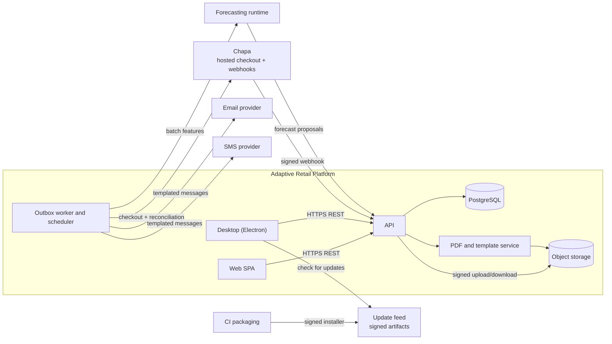
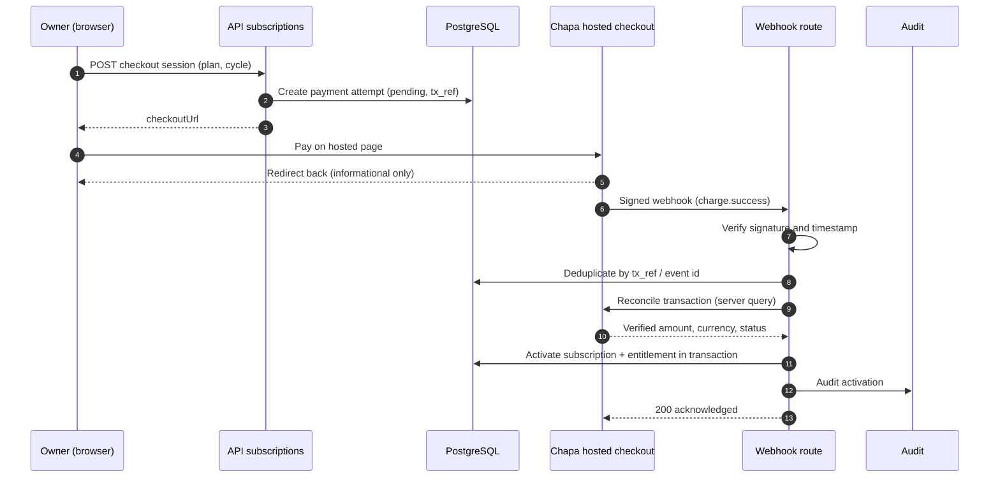

# Integration architecture

**Status:** Step 2 boundary design. No external integration is implemented or verified. Chapa, email,
SMS, object storage, PDF generation, AI and installer packaging are all **planned**; none may be
reported as working until a sandbox or staging test has actually run.

Decisions: D-014 (advisory AI), D-026 (outbox), D-029 (shared renderer), D-031 (secrets), D-032
(Chapa), D-033 (forecasting).

## 1. Principles

1. **Adapters at the edge.** Each provider sits behind a port owned by one module. Business code calls
   the port, never an SDK or `fetch` directly.
2. **Server-side only.** Provider credentials and calls live in the API. The renderer receives only
   public configuration and, where needed, short-lived signed URLs.
3. **Failure isolation.** A provider outage must not roll back a sale, a receiving or a refund.
   Notifications and documents are side effects; they retry through the outbox and surface failure.
4. **Explicit state.** Every external attempt has a stored status (`pending`, `sent`, `failed`,
   `verified`), attempt count and last error. "Sent" is not "delivered", and neither is "paid".
5. **Idempotency everywhere.** Outbound calls carry an idempotency reference; inbound webhooks are
   verified and deduplicated before any state change.
6. **No silent degradation.** When an integration is unavailable, the UI says so and the business
   process either continues in a defined degraded mode or stops with a clear message.

## 2. Integration map

No provider calls another provider through the platform. No client calls a provider with a platform
secret. The update feed serves artifacts signed by CI; it never carries credentials.

## 3. Integration registry

| Integration       | Direction        | Owner module                        | Port / adapter                    | Auth                           | Retry                            | On failure                                      | State   |
| ----------------- | ---------------- | ----------------------------------- | --------------------------------- | ------------------------------ | -------------------------------- | ----------------------------------------------- | ------- |
| Chapa checkout    | outbound         | `subscriptions`                     | `PaymentGatewayPort`              | Secret key (server)            | Bounded, idempotent by `tx_ref`  | Attempt marked failed; Owner can retry          | Planned |
| Chapa webhook     | inbound          | `subscriptions`                     | Signed webhook route              | HMAC signature + timestamp     | Provider-driven; dedupe by ref   | 5xx so the provider retries; reconciliation job | Planned |
| Email             | outbound         | `notifications`                     | `EmailChannelPort`                | Provider API key / SMTP        | Outbox, exponential backoff      | Delivery marked failed; business unaffected     | Planned |
| SMS               | outbound         | `notifications`                     | `SmsChannelPort`                  | Provider API key               | Outbox, exponential backoff      | Delivery marked failed; fallback to in-app      | Planned |
| Object storage    | outbound/inbound | `files`                             | `FileStoragePort`                 | Scoped access key / signed URL | Limited retry for idempotent ops | Upload fails cleanly; no partial metadata       | Planned |
| CSV/Excel import  | inbound file     | `catalog` (also suppliers)          | `TabularImportService`            | Authenticated upload           | User re-runs                     | Validation report; nothing partially applied    | Planned |
| CSV/Excel export  | outbound file    | `analytics`                         | `ExportService`                   | Authenticated request          | Async job retry                  | Job fails visibly; file not delivered           | Planned |
| PDF receipts/docs | internal         | `sales`, `procurement`, `analytics` | `DocumentRendererPort`            | None (in-process)              | Deterministic regeneration       | Sale unaffected; document retried               | Planned |
| Desktop packaging | build pipeline   | platform                            | CI packaging + signed update feed | Signing key in CI secrets      | Manual re-run                    | Release blocked; no partial rollout             | Planned |
| AI forecasting    | outbound batch   | `intelligence`                      | `ForecastModelPort`               | Provider key (if external)     | Next scheduled run               | Forecast run failed; operations unaffected      | Planned |

## 4. Chapa subscription payments

### 4.1 Flow

### 4.2 Rules

- The API creates the payment attempt and computes the amount server-side from the plan. The client
  cannot set price, currency or plan duration.
- The return redirect is a UX hint only. **Entitlement changes only after a verified webhook or a
  server-side reconciliation query.**
- Signature verification uses the raw request body and the provider secret; a timestamp tolerance
  blocks stale replays. A failed signature returns `401`, is rate-limited and audited.
- Deduplication key: provider transaction reference plus event type. Replaying the same event is a
  no-op with the original outcome.
- Amount, currency and plan reference from the provider must match the stored attempt. A mismatch
  never activates; it creates a reconciliation task.
- A payment can activate, extend, or fail to renew. Past-due follows the subscription grace policy;
  data is never deleted on expiry.
- Refunds or reversals are reconciled, not assumed; an owner-initiated cancellation does not cancel
  an already-captured provider charge without a provider-side action.

### 4.3 Configuration and secrets

`CHAPA_BASE_URL`, `CHAPA_SECRET_KEY`, `CHAPA_WEBHOOK_SECRET` (names are proposed; they do not exist
in the current environment schema). Only the API reads them. They are never placed in `VITE_`
variables. Rotation invalidates in-flight attempts; the attempt table makes this recoverable.

### 4.4 Failure behavior

Provider down: checkout creation returns `503 PAYMENT_PROVIDER_UNAVAILABLE`; the subscription remains
unchanged. Webhook processing failure returns 5xx so the provider retries; a scheduled reconciliation
job re-queries pending attempts. No entitlement is granted before verification.

### 4.5 Verification

Sandbox checkout for success, failure and cancellation; signature tests with valid, invalid and stale
payloads; duplicate delivery; amount mismatch; reconciliation after a missed webhook. Until these run
against a real sandbox, Chapa is "planned".

## 5. Email and SMS

- Transactional only: verification, password reset, invitations, subscription receipts and failures,
  conflict alerts, purchase-order notifications. Marketing is out of scope.
- Templates are versioned and rendered server-side with escaped values. No user-supplied HTML is
  rendered.
- Delivery is queued through the outbox; the business transaction commits first. A mail outage never
  blocks registration, a sale or a receiving.
- Retries are bounded with backoff; after the last attempt the delivery is `failed` and visible to the
  sender and administrators. In-app notification remains the fallback channel.
- Preferences are respected per user and channel, except security-critical messages (verification,
  password reset, subscription failure), which are always sent.
- Logs store recipient user ID, template, attempt and provider message ID. They do not store full
  message bodies or secrets. PII is minimized in provider payloads.
- Development and CI use a capture transport or a local mail sink; CI never sends real email or SMS.

## 6. Object storage and file handling

- `files` owns metadata; bytes live in storage. Storage keys include `businessId` and are never
  guessable or reused across tenants.
- Upload: authenticated user requests a session, uploads directly using a short-lived signed URL,
  then confirms. The API verifies size and checksum, sniffs the MIME type and stores metadata only
  after validation. An unconfirmed session expires and leaves no metadata.
- Download: short-lived signed URL issued after a permission check. URLs are never public, never
  long-lived and never reused across users.
- Filename traversal, double extensions, macro-enabled documents and executable types are rejected by
  allowlist. Images are re-encoded where feasible.
- Malware scanning is a planned quarantine step (`files.file-quarantined`); until it exists, uploads
  are restricted to low-risk types.
- Retention: product images and supplier documents follow business retention; deleted business data
  may be archived but financial evidence is retained per policy.
- Development may use a local storage adapter; production uses S3-compatible storage. Both implement
  the same port, and integration tests run against a local emulator (for example MinIO), not a mock
  of the port.

## 7. CSV and Excel

### 7.1 Import (catalog, suppliers)

Pipeline: upload → parse → map headers → validate every row → dry-run report → user confirms → apply
in batches → completion report.

- Accepted formats: UTF-8 CSV and `.xlsx`. Macros (`.xlsm`), formulas in cells and unsupported
  encodings are rejected or neutralized.
- Limits: file size, row count and column count per import. Larger imports are split by the user.
- Validation reports per row and column; nothing is applied on a failed validation unless the user
  explicitly confirms a partial import policy for that import type. The default is all-or-nothing per
  batch.
- Idempotency: each import run has an ID; re-running the same file does not duplicate products.
  Duplicate SKUs/barcodes are conflicts, not silent overwrites.
- Import never deletes products; it can create, update allowed fields and archive where the import
  type says so.
- Every import is audited with row counts, outcome and actor.

### 7.2 Export (reports, lists)

- Exports run asynchronously for large ranges and produce a stored file with an expiry.
- The export query is built from the requester's business/branch scope and permission, never from
  client-supplied SQL or field lists.
- CSV output prefixes cells beginning with `=`, `+`, `-` or `@` so spreadsheet software cannot
  execute formulas (CSV injection).
- Export generation and download are both audited.

## 8. PDF documents

- Receipts, purchase orders, invoices and report PDFs are rendered server-side into object storage.
  Template name and version are stored with the document so a reprint is reproducible.
- Document generation is a side effect: a failed render never rolls back a sale or receiving. The
  document is retried or regenerated on demand.
- Receipt numbers are canonical and stable; the PDF embeds the same number as the API response.
- The desktop prints offline receipts from the shared receipt template version cached at sync time.
  After the sale syncs, the server can render the canonical PDF; both carry the same receipt number.
  A mismatch is a defect, not a reason to change the sale.
- PDFs containing customer or supplier data are stored with the same tenant scoping and retention as
  their source record.

## 9. Desktop packaging and updates

- CI builds a signed installer from a tagged commit. Signing keys live in CI secrets, never in the
  repository or the app bundle.
- The update feed serves version metadata and signed artifacts. The desktop verifies the signature and
  the version before installing and supports staged rollout and rollback to the previous signed
  version.
- Updates must not run while an unsynced sale exists without explicit user action; the outbox survives
  updates (D-022).
- Packaging tooling, OS targets and store distribution are decided in the desktop implementation plan;
  no tool is claimed here.
- A release is not "done" until a clean machine install, upgrade and rollback are tested.

## 10. AI and forecasting boundary

- `intelligence` calls a `ForecastModelPort`. The implementation may be an in-process baseline model
  or an external service; the port keeps the choice reversible.
- Inputs come from analytics read models and history, with the business scope attached. Only the
  minimum necessary data leaves the platform, and only under an approved provider agreement.
- Outputs are stored as forecast runs and proposals with model name/version, inputs snapshot,
  confidence and explanation.
- Model failure leaves the previous forecasts visible as stale; it never blocks sales, purchasing or
  stock.
- No AI output writes stock, prices, purchase orders or payments. Human review creates normal
  commands (D-014, D-033).
- Provider credentials, if any, are server-side. Prompt or request logs must not contain secrets or
  unnecessary PII.

## 11. Shared failure and retry policy

| Situation                | Policy                                                                                   |
| ------------------------ | ---------------------------------------------------------------------------------------- |
| Timeout                  | Every outbound call has a connect and total timeout; no unbounded waits                  |
| Retryable error          | Network error, 429, 5xx: retry with exponential backoff and jitter, bounded attempts     |
| Non-retryable error      | 4xx validation/auth: mark failed, record reason, do not loop                             |
| Duplicate delivery       | Idempotency key returns the stored outcome                                               |
| Provider outage          | Business transaction commits; side effect queued; UI shows degraded state where relevant |
| Worker crash mid-attempt | Outbox row is reclaimed after a visibility timeout; idempotency prevents double effect   |
| Permanent failure        | Marked `failed`, alerting, visible in admin; manual retry is explicit and audited        |
| Reconciliation           | Scheduled job compares local attempts with provider state where the provider supports it |

Multiple API replicas run the outbox worker with database locks, as described in
[`../architecture/SYSTEM_ARCHITECTURE.md`](../architecture/SYSTEM_ARCHITECTURE.md) §4. No broker is
introduced (D-026).

## 12. Webhook security checklist

1. Verify signature over the raw body with the provider secret.
2. Reject timestamps outside a short tolerance window.
3. Deduplicate by provider event/reference before any state change.
4. Process in a transaction; return 2xx only after the state change is committed.
5. Never trust amounts or plan IDs from the payload alone; reconcile with the provider or the stored
   attempt.
6. Rate-limit and log rejected attempts without logging secrets.
7. Keep the endpoint unauthenticated by session but authenticated by signature.

## 13. Observability

- Every outbound attempt stores: integration, operation, idempotency key, attempt number, status,
  provider request ID, latency and error code (not the secret or full payload).
- Correlation IDs flow from the originating request or job into the outbox row and logs.
- Metrics: attempts, success rate, latency, retries, failures, reconciliation mismatches, webhook
  rejections.
- Alerts: payment verification failures, repeated notification failures, storage error rate, stale
  forecast runs.

## 14. Testing

| Layer         | Test                                                                                           |
| ------------- | ---------------------------------------------------------------------------------------------- |
| Unit          | Port implementations with fake transports; error mapping; signature verification with fixtures |
| Contract      | Provider sandbox for Chapa; local SMTP sink for email; MinIO or equivalent for storage         |
| Webhook       | Valid, invalid, stale and duplicated payloads; amount mismatch; replay                         |
| Failure       | Timeouts, 429, 5xx, mid-batch crash; assert business data is unchanged and retries are bounded |
| Import/export | Encoding, malformed rows, formula injection, limits, idempotent re-run                         |
| PDF           | Template snapshot and receipt-number parity between offline and server render                  |
| Packaging     | Clean install, upgrade with pending outbox, rollback, signature failure                        |
| AI            | Fixture-based forecasts, no-write assertions, failure isolation                                |

CI does not call paid providers by default. Sandbox suites run with explicit credentials and are
skipped, not faked, when credentials are absent. A skipped suite is reported as not verified.

## 15. Current state

| Integration               | Code | Verified |
| ------------------------- | ---- | -------- |
| Chapa checkout/webhook    | No   | No       |
| Email                     | No   | No       |
| SMS                       | No   | No       |
| Object storage            | No   | No       |
| CSV/Excel import/export   | No   | No       |
| PDF documents             | No   | No       |
| Desktop packaging/updates | No   | No       |
| AI forecasting            | No   | No       |

The only external dependency exercised today is PostgreSQL in development, and that is an internal
dependency, not an integration.
