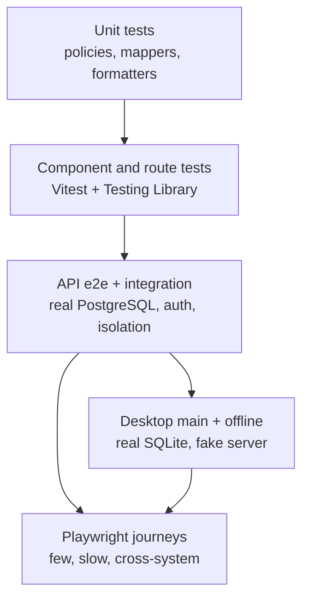

# Testing architecture

**Status:** Step 2 strategy. It supersedes the former `test-strategy.md`, which is deleted. Only the
Phase 0 tests exist today; every module suite described here is planned.

The rule that governs this document: **a test counts only when it ran.** Skipped, blocked or
not-executed suites are reported as such and never summarized as passing.

## 1. Tooling

| Layer                 | Tool                                              | Runs against                     |
| --------------------- | ------------------------------------------------- | -------------------------------- |
| API unit              | Jest 30 + ts-jest                                 | No database, no network          |
| API integration / e2e | Jest + Supertest                                  | Real PostgreSQL, real app module |
| Web component / unit  | Vitest + Testing Library + jsdom                  | MSW-mocked API                   |
| Desktop main          | Vitest                                            | Real SQLite (temporary file)     |
| Desktop renderer      | Vitest + Testing Library                          | Fake IPC bridge                  |
| System end-to-end     | Playwright                                        | Built web app + API + PostgreSQL |
| Accessibility         | axe-core in Vitest; Playwright axe scan (planned) | Component and page               |
| Contract / sandbox    | Jest against sandbox or emulator                  | Chapa sandbox, storage emulator  |

Integration tests never mock Prisma. A mocked database would pass while stock or money invariants
break, which is exactly the failure this architecture exists to prevent.

## 2. Test tiers

- **Unit** proves a rule in isolation: price precedence, permission evaluation, quantity math,
  state-transition policy, formatters, mappers.
- **Integration** proves a rule with real persistence and real transactions: stock movements,
  receiving, sale commit, idempotency, isolation.
- **API e2e** proves the public contract: guards, validation, status codes, problem details, scope.
- **Desktop main** proves durability and recovery: local commit, outbox, migrations, IPC validation.
- **Playwright** proves a user journey across UI, API and database. It is not a substitute for the
  lower layers.

## 3. Environments and data

| Concern         | Rule                                                                                    |
| --------------- | --------------------------------------------------------------------------------------- |
| Database        | A disposable PostgreSQL database per CI run, migrated with the real migrations          |
| Isolation       | Each test starts from a clean schema or a rolled-back transaction; no order dependence  |
| Fixtures        | Factories create business A and business B, branches, users per role, catalog and stock |
| Tenant fixtures | Every isolation test has a second business with its own branch, user and rows           |
| Clock           | Injected clock; no assertions on wall-clock time; `occurredAt` controlled               |
| IDs             | Assert shape and relationships, never generated values                                  |
| External calls  | Forbidden in unit/CI by default; sandbox suites run only with explicit credentials      |
| Files           | Temporary directories per test; object storage emulator for integration                 |
| Secrets         | Test secrets are local values, never real provider keys in the repository               |

The existing CI workflow already provisions PostgreSQL, runs Prisma generate/validate, then
format, lint, typecheck, unit, e2e, integration and build. Playwright and desktop packaging jobs are
added when those suites exist.

## 4. API testing

- Unit tests cover domain policies and application services with fake ports, including denial paths.
- Integration tests instantiate the Nest module with the real `PrismaService` and a real database.
- e2e tests use Supertest against the app; they assert:
  - success body shape and `data` envelope;
  - `401`, `403`, `404` semantics (non-member sees 404, member without permission sees 403);
  - problem-details shape and stable `code`;
  - validation errors, unknown fields rejected;
  - idempotent replay returning the original result;
  - version conflicts returning 409.
- A controller test never asserts business logic; that belongs to the service.

## 5. Authorization and isolation suites

These are blocking and are not optional per feature.

| Suite                | What it proves                                                                                              |
| -------------------- | ----------------------------------------------------------------------------------------------------------- |
| Role matrix          | For every restricted route, each role's allow/deny outcome matches the catalogue                            |
| Admin separation     | Business Admin is denied receiving, stock adjustment, POS, refund execution, void and cash handling         |
| Cashier boundary     | Cashier can sell and read own sales/shift; cannot adjust stock, void, approve refunds or see others' shifts |
| Manager branch scope | A Manager assigned to branch A receives 403 on branch B operations, and sees only branch A reports          |
| Owner scope          | Owner reaches all branches of their business, and no branch of another business                             |
| Tenant isolation     | Business B cannot read, update, delete, export, download or infer the existence of business A data          |
| Background jobs      | A job with business A scope cannot read or write business B rows                                            |
| Events               | A handler rejects an event whose `businessId` cannot be resolved to the expected scope                      |

Every new endpoint adds a row to the matrix. A missing test is a review blocker.

## 6. Inventory and financial invariants

| Invariant                                | Test                                                                                                                              |
| ---------------------------------------- | --------------------------------------------------------------------------------------------------------------------------------- |
| Stock never goes negative                | Concurrent sales of the last unit: one succeeds, one receives `INSUFFICIENT_STOCK`; the same guard applies to sync-ingested sales |
| Purchase order never increases stock     | Approve a PO, assert no movement and unchanged balance                                                                            |
| Only accepted receiving increases stock  | Receive partially/fully; assert movement and balance per accepted quantity                                                        |
| Movements are append-only                | Corrections create compensating rows; original rows unchanged                                                                     |
| Sale, stock issue and payment are atomic | Inject failure after stock issue; assert no sale, no movement, no payment                                                         |
| Retrying a sale does not duplicate       | Same idempotency key returns the same sale and one movement set                                                                   |
| Refund cannot exceed paid amount         | Attempt over-refund; assert 422 and unchanged balances                                                                            |
| Restock only after inspection            | Approve return without inspection fails; with inspection succeeds                                                                 |
| Transfer is two-step and atomic          | Dispatch does not change destination; receipt completes; failure leaves a consistent state                                        |
| Concurrent approvals cannot both succeed | Two approvals on the same PO: one 200, one 409                                                                                    |
| Shift totals match sales and payments    | Close shift with mixed payments; assert reconciliation                                                                            |
| History survives archival                | Archive product/supplier/branch; historical sale and movement rows remain readable                                                |

These run against real PostgreSQL. Serializable transactions and bounded retries must be exercised,
not simulated.

## 7. Offline synchronization tests

| Scenario                           | Expected                                                                                                                                  |
| ---------------------------------- | ----------------------------------------------------------------------------------------------------------------------------------------- |
| Local commit before success        | Kill the app before commit → no sale; after commit → sale exists and is queued                                                            |
| Duplicate delivery                 | Replay the same operation → `duplicate`, one sale, one set of movements                                                                   |
| Two devices oversell the last unit | First sale commits; second is refused with no sale and no stock movement, preserved as one reconciliation exception; stock never negative |
| Price drift                        | Offline sale keeps its recorded total; drift flagged                                                                                      |
| Revoked device                     | Sync rejected, operation preserved, export available                                                                                      |
| Revoked membership                 | Operation rejected and preserved; no silent apply                                                                                         |
| Shift close conflict               | Conflict visible; resolution audited; sales unchanged                                                                                     |
| Clock skew                         | Outside window rejected; inside accepted with server timestamps                                                                           |
| Feed gap                           | Full snapshot requested and applied; no partial merge                                                                                     |
| Corrupt local database             | Startup blocks selling, export offered, no silent wipe                                                                                    |
| App update with pending outbox     | Outbox survives; sync resumes                                                                                                             |
| Duplicate feed application         | Applying the same delta twice is harmless                                                                                                 |

Desktop tests use real SQLite in a temporary directory and a controllable fake HTTP server. The API
side of the same scenarios runs as integration tests with a real database.

## 8. Payment and subscription tests

| Scenario                        | Expected                                                                 |
| ------------------------------- | ------------------------------------------------------------------------ |
| Valid webhook                   | Attempt verified, subscription activated once, audit written             |
| Invalid/stale signature         | 401, no state change, audited                                            |
| Duplicate webhook               | No second activation; stored outcome returned                            |
| Amount/currency/plan mismatch   | No activation; reconciliation task                                       |
| Redirect without webhook        | No activation                                                            |
| Provider unavailable            | 503, subscription unchanged, retry possible                              |
| Missed webhook + reconciliation | Subscription activated from a verified provider query                    |
| Expired trial / grace period    | Entitlements follow policy; data retained                                |
| Client attempts activation      | Forbidden; only server verification activates                            |
| Entitlement gate                | Endpoint requiring a plan returns a stable denial code when not entitled |

No Chapa test is marked passing until it runs against the sandbox with real credentials. Until then
the suite is reported as blocked or skipped.

## 9. Business workflow tests

Each phase ships at least one cross-module integration scenario:

1. Register business → create branch → invite Manager → Manager signs in with scoped permissions.
2. Create product with business-type attributes → set price → receive stock → sell → return → report.
3. Create RFQ → PO → approve (no stock) → partial receiving (stock) → supplier invoice → payment.
4. Offline sale → sync → reprint → refund online → stock restored after inspection.
5. Role matrix for Admin and Cashier across the same workflow.
6. Subscription expiry → restricted mode → renewal → restored access.
7. Offline sale → stock shortfall → reconciliation exception → authorized stocktake/adjustment →
   explicit release → single commit; Business Admin resolution denied.

These are the closest tests to real usage and are required before a module is called complete.

## 10. Frontend tests

- Component tests for forms (validation, server field errors, double submit), tables (pagination,
  empty, error), dialogs (focus trap, escape), and status components.
- Route tests: auth gate, business gate, deep link refresh, 403 and 404, lazy route failure.
- Navigation tests per role: Admin sees no POS/inventory execution entry; Cashier sees POS and own
  sales only; Manager sees assigned branches.
- API mocking with MSW at the network boundary; no mocking of feature hooks.
- Accessibility: axe assertions on key screens; keyboard-only POS flow; labels and focus.
- No snapshot-only tests for critical UI. Snapshots may support layout review but do not prove
  behavior.

## 11. Desktop tests

| Area           | Test                                                                                           |
| -------------- | ---------------------------------------------------------------------------------------------- |
| Security       | Navigation denied to untrusted origins, window-open denied, webview denied, permissions denied |
| IPC            | Valid, invalid, oversized and unauthorized payloads for every channel                          |
| Local database | Real SQLite: sale transaction, outbox, migration, integrity, corruption handling               |
| Offline login  | PIN verifier, lockout, idle lock, permission snapshot                                          |
| Sync engine    | Duplicate, conflict, rejection, retry, coalesced triggers                                      |
| Printing       | Template version parity; failure does not roll back                                            |
| Packaging      | Clean install, upgrade with pending outbox, rollback, unsigned update refused                  |

Electron end-to-end launch is required before any desktop runtime claim. The current environment
could not verify launch; that remains an open gap, not a pass.

## 12. Playwright journeys

Planned critical journeys:

1. Owner registers, creates a branch, invites a Manager.
2. Admin creates products and prices; Manager receives stock.
3. Cashier completes a sale and reprints the receipt.
4. Manager refunds a return after inspection; stock restores.
5. Offline sale on the desktop, reconnect, sync, verify once-only creation.
6. Admin attempts a physical operation and is denied in UI and API.
7. Owner views a report comparing two branches.
8. Subscription checkout sandbox success and failure (when Chapa sandbox is available).

Journeys run against the real API and database, with seeded businesses A and B. They assert no
cross-tenant element is visible.

## 13. Regression policy

- A bug fix ships with a test that fails before the fix and passes after it.
- Security and isolation bugs additionally get a regression test in the blocking suite, not only a
  feature test.
- A flaky test is fixed or quarantined with an owner and a date; it is not retried silently to green.
- Deleting or weakening a test requires review by the module owner.

## 14. CI gates

| Stage             | Blocks merge       | Notes                                         |
| ----------------- | ------------------ | --------------------------------------------- |
| Format check      | Yes                | Prettier                                      |
| Lint              | Yes                | ESLint, module boundary rules when added      |
| Typecheck         | Yes                | All packages                                  |
| API unit          | Yes                | Fast                                          |
| Web/desktop unit  | Yes                | Fast                                          |
| API e2e           | Yes                | Real app, test database                       |
| Integration       | Yes                | Real PostgreSQL service                       |
| Tenant isolation  | Yes                | Part of integration/e2e; never waived         |
| Build             | Yes                | API, web, desktop bundles                     |
| Playwright        | Yes when it exists | Smoke journeys on PR; full suite nightly      |
| Sandbox contracts | No (conditional)   | Runs only with configured sandbox credentials |

A red isolation suite stops the merge. Feature deadlines do not override it.

## 15. Module responsibilities

Every module owner writes and maintains these tests. The owner column follows the approved
allocation (D-034); the test column is the minimum blocking suite.

| Module                   | Owner | Minimum test responsibility                                                                                                                                             |
| ------------------------ | ----- | ----------------------------------------------------------------------------------------------------------------------------------------------------------------------- |
| `identity`               | M1    | Credential hashing, refresh rotation/reuse, session revocation, rate limits, reset enumeration                                                                          |
| `tenancy`                | M1    | Membership isolation, invitation expiry, branch archival rules, ownership transfer                                                                                      |
| `authorization`          | M1    | Permission matrix per role, deny-by-default, grant-only-what-you-hold, stale assignment revocation                                                                      |
| `employees`              | M1    | Branch assignment boundaries, deactivation effects, history preservation                                                                                                |
| `business-configuration` | M2    | One profile contract per business type, immutable type switch, capability gating                                                                                        |
| `catalog`                | M2    | Variant uniqueness, unit conversions, import validation/idempotency, archive with history                                                                               |
| `pricing`                | M2    | Precedence (branch override → list → base), time-effective history, discount stacking                                                                                   |
| `inventory`              | M3    | Every movement type, no-negative guard on every accepted movement (online and sync), receiving idempotency, transfer atomicity, counts                                  |
| `suppliers`              | M3    | Supplier isolation, archive with history, statement arithmetic                                                                                                          |
| `procurement`            | M3    | PO approval does not change stock, partial receiving, three-way match, payment idempotency                                                                              |
| `customers`              | M4    | Deduplication, consent, history after archive, projection correctness from events                                                                                       |
| `sales`                  | M4    | Atomic sale + stock + payment, idempotent replay, shift reconciliation, offline ingest refuses on shortfall                                                             |
| `after-sales`            | M4    | Refund ceiling, inspection-before-restock, exchange reservation, original sale immutability                                                                             |
| `intelligence`           | M4    | Fixture forecasts, proposal-only behavior, no operational writes, review attribution                                                                                    |
| `analytics`              | M4    | Aggregation correctness, tenant/branch filters, export scope, large-range pagination                                                                                    |
| `subscriptions`          | M1    | Entitlement matrix, webhook security/idempotency, grace transitions, payment matching                                                                                   |
| `notifications`          | M4    | Preference enforcement, retry/backoff, template escaping, business transaction independence                                                                             |
| `audit`                  | M1    | Append-only, actor/business/branch attribution, query authorization, retention export                                                                                   |
| `synchronization`        | M4    | Duplicate, out-of-order, conflict retention, stock-shortfall exception preservation, authorized resolution commits at most once, revoked device, cross-tenant rejection |
| `files`                  | M2    | Traversal, MIME spoofing, oversize, cross-tenant access, signed URL expiry                                                                                              |
| `super-admin`            | M1    | Grant expiry, audit completeness, denied access without grant, separation from business roles                                                                           |

Platform-level suites (isolation, contract, Playwright) are owned by the whole team and reviewed by
the module owner whose surface they touch.

## 16. Critical scenario catalogue

The following must exist before Step 3 functionality is called complete. IDs are stable for tracking.

| ID   | Scenario                                                                                   | Layer             |
| ---- | ------------------------------------------------------------------------------------------ | ----------------- |
| T-01 | Refresh rotation and reuse detection                                                       | API integration   |
| T-02 | Login rate limit and generic errors                                                        | API e2e           |
| T-03 | Non-member sees 404 for business resources                                                 | API e2e           |
| T-04 | Member without permission sees 403                                                         | API e2e           |
| T-05 | Business Admin denied every physical operation                                             | API + UI          |
| T-06 | Cashier cannot read another cashier's shift                                                | API integration   |
| T-07 | Manager cannot operate in an unassigned branch                                             | API integration   |
| T-08 | Cross-tenant read/update/export/download rejected                                          | API integration   |
| T-09 | Online oversell prevented                                                                  | API integration   |
| T-10 | PO approval leaves stock unchanged                                                         | API integration   |
| T-11 | Accepted receiving increases stock exactly once                                            | API integration   |
| T-12 | Sale atomicity under injected failure                                                      | API integration   |
| T-13 | Idempotent sale replay                                                                     | API integration   |
| T-14 | Refund ceiling and inspection rule                                                         | API integration   |
| T-15 | Offline sale survives crash and syncs once                                                 | Desktop + API     |
| T-16 | Offline stock shortfall refuses sale with no movement, preserves exception and transaction | Desktop + API     |
| T-17 | Revoked device preserves data and stops sync                                               | Desktop + API     |
| T-18 | Feed gap triggers full snapshot                                                            | Desktop + API     |
| T-19 | Webhook signature, replay and amount mismatch                                              | API integration   |
| T-20 | Entitlement gate denies and later restores access                                          | API integration   |
| T-21 | Business switching cannot leak cached data                                                 | Web component     |
| T-22 | Role-aware navigation hides forbidden areas                                                | Web component     |
| T-23 | POS keyboard-only flow                                                                     | Web + Playwright  |
| T-24 | Packaged app upgrade with pending outbox                                                   | Desktop packaging |
| T-25 | Cross-tenant isolation in a background job                                                 | API integration   |
| T-26 | Stock-shortfall reconciliation resolves once, no duplicate commit                          | Desktop + API     |
| T-27 | Business Admin cannot resolve a physical stock outcome                                     | API + UI          |

## 17. Reporting honesty

- A suite that did not run is reported as **not run**, with the reason (environment, missing
  credentials, missing dependency).
- A blocked integration test because Docker/PostgreSQL is unavailable is **blocked**, not passed.
- A feature tested only by typechecking is **not tested**.
- Counts include the command and the result; "17 tests passed" is a fact only for the run that
  produced it.
- The release checklist includes the exact commands and the date of the last successful run.

## 18. Current state

Last verified during the Phase 0 foundation, not re-run as part of Step 2:

| Suite                     | State                                              |
| ------------------------- | -------------------------------------------------- |
| Format / lint / typecheck | Passed at Phase 0                                  |
| API unit                  | 17 tests passed at Phase 0                         |
| API e2e                   | 4 tests passed at Phase 0                          |
| Web and desktop unit      | Passed at Phase 0 (renderer target included)       |
| Build (API, web, desktop) | Passed at Phase 0                                  |
| API integration (real DB) | Blocked: Docker unavailable; not verified          |
| Electron runtime launch   | Blocked: binary download unavailable; not verified |
| Playwright                | Not installed                                      |
| Sandbox payment tests     | Not started                                        |
